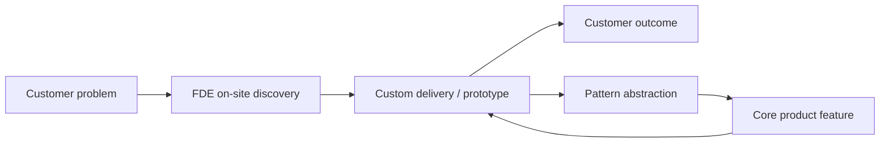

# Chapter 0 The FDE Role at a Glance

> 🌐 [中文](README.md)

> [🏠 Back to home](../README.en.md)

## Learning Objectives
- Define the FDE precisely and explain how it differs from SWE, SE, consultant, and PM roles
- Understand the origins and business logic of the FDE model
- Judge whether the role suits you

## 0.1 Definition
**Forward Deployed Engineer (FDE)**: a software engineer who is embedded in the customer's environment, aims to deliver measurable outcomes for the customer, writes production code directly on the customer's data and systems, and feeds what they learn on the front line back to the product team.
Three keywords: **embedded**, **production code**, and **feedback loop**.

## 0.2 Origins
The term FDE originated at Palantir. In its early days Palantir stationed engineers on site with customers (government and enterprise) to build solutions for specific missions on its platform; internally the role was often split into "Delta", which faces the customer and delivers, and "Dev", which builds the core product. In recent years, as demand for deploying generative AI has grown, companies such as OpenAI, Anthropic, Scale AI, Ramp, Sierra, Harvey, and Databricks have also created FDE or similar positions (see each company's careers page). The Pragmatic Engineer has an in-depth analysis of the topic (see Further Reading).

Business logic: when a product needs deep adaptation to complex customer environments, putting engineers "up front" buys successful deployment and retention, and lets the product team abstract general capabilities from many deployments, in other words "do things that don't scale first, then productize".

## 0.3 Comparison with Adjacent Roles
| Dimension | FDE | Product SWE | Solutions Engineer (SE) | Consultant | PM |
|---|---|---|---|---|---|
| Main output | Production code and outcomes in the customer's environment | General product features | Pre-sales demos, technical proposals | Recommendations, reports, project management | Requirements and roadmap |
| Share of coding | High | High | Medium–low | Low | Low |
| Customer contact | Very high | Low | Very high | Very high | Medium |
| Success metric | Customer adopts it and gets value | Quality, delivery speed | Winning deals | Customer satisfaction, project delivery | Product metrics |
| Time scale | Weeks–months | Quarters | Days–weeks | Months | Quarters–years |

## 0.4 Day-to-Day Work (A Typical Week)
- Run discovery interviews with customer stakeholders and confirm priorities
- Connect data sources (databases, APIs, files), then clean and model the data
- Build applications / workflows / LLM pipelines, ship them, and monitor them
- Demo progress, collect feedback, iterate
- Write up general needs as product feedback documents for the core team

## 0.5 Trade-offs and Fit
**Upsides**: fast growth, directly visible impact, and you build technical and business judgment at the same time.
**Costs**: possibly a lot of travel, frequent context switching, a tech stack constrained by the customer, code that is "not elegant enough", and customer pressure to absorb.
Self-assessment (score each item 1–5; ≥20 suggests a good fit):
1. I like to start prototyping before all the information is in; 2. I can explain technical trade-offs to non-technical people; 3. Changing environments excite me rather than make me anxious; 4. I am willing to own outcomes, not just tasks; 5. I can accept solutions that are imperfect but work.

## 0.6 Career Path
FDE → Senior/Staff FDE → FDE team lead / deployment lead; or move into product engineering, PM, solutions architecture, or founding a company (many founders have front-line customer experience).

## 0.7 Core Curriculum and Specializations
Chapters 0–7 are the core curriculum for the role. The language-model part is Chapter 3, in the directory `02-ai-llm` (directory numbers are not chapter numbers). The core sections are [3.1 Business and Model Choice](../02-ai-llm/01-business-and-model-choice.en.md) and [3.2 Applications](../02-ai-llm/02-applications-rag-agent-eval.en.md). Pretraining, fine-tuning and alignment, neural networks, PyTorch, training and inference systems, CUDA, and the storage stack are electives within the same chapter, [3.3–3.9](../02-ai-llm/README.en.md), and are not required for every FDE. If a job focuses on on-site customer delivery, do not let elective progress stand in for a portfolio; if a job mentions training or serving performance, study the electives in the elective weeks of the roadmap. The byte accounting and queueing models in the electives are derivations, not any company's performance commitments.

## Case Study
A logistics customer wants to "use AI to reduce dispatching costs". A product SWE would wait for clear requirements; an SE would build a demo; an FDE would first interview the dispatchers, discover that the real bottleneck is inconsistent data across three systems, deliver data integration and an anomaly dashboard first so that dispatchers save time every day within two weeks, and only then bring in a model. **Key point**: an FDE finds the real constraint first rather than reaching for a technology first.

## Exercises
1. Explain the FDE role to a non-technical friend in 200 words. *Scoring: does it include the three elements of embedding, production code, and feedback?*
2. Pick two companies hiring FDEs, read their job descriptions, and list the common requirements and the differences. *Reference: the common ground is usually full-stack/data skills, customer communication, and willingness to travel; the differences lie in the domain (government, finance, AI).*

## Summary
FDE = engineering ability × customer-outcome orientation × product feedback loop.

## Key Terms
FDE, embedded delivery, productization, discovery, Delta/Dev

## Further Reading
- Pragmatic Engineer: Forward Deployed Engineers — https://newsletter.pragmaticengineer.com/p/forward-deployed-engineers
- Palantir careers — https://www.palantir.com/careers/

---

[🏠 Back to home](../README.en.md)
