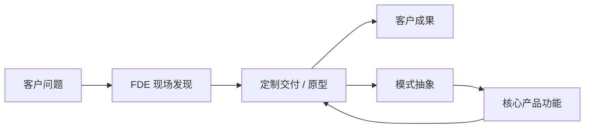

# 第 0 章 FDE 岗位全景

> [🏠 返回主页](../README.md)

## 学习目标
- 准确定义 FDE,并说明其与 SWE、SE、咨询顾问、PM 的区别
- 理解 FDE 模式的起源与商业逻辑
- 判断自己是否适合该岗位

## 0.1 定义
**前线部署工程师(FDE)**:嵌入客户环境、以交付客户可衡量成果为目标,直接在客户数据与系统上编写生产代码,并把一线发现反馈给产品团队的软件工程师。
三个关键词:**嵌入(embedded)**、**生产代码(production code)**、**闭环反馈(feedback loop)**。

## 0.2 起源
FDE 一词源于 Palantir。Palantir 早期将工程师派驻到客户(政府与企业)现场,在其平台上为具体任务构建方案;内部常把该角色分为面向客户交付的 "Delta" 与构建核心产品的 "Dev"。近年随着生成式 AI 落地需求增长,OpenAI、Anthropic、Scale AI、Ramp、Sierra、Harvey、Databricks 等公司也设立了 FDE 或类似职位(以各自招聘页为准)。Pragmatic Engineer 对此有专题分析(见延伸阅读)。

商业逻辑:当产品需要深度适配复杂客户环境时,用工程师"前置"换取成功落地与留存,并让产品团队从多个部署中抽象出通用能力——即"先做不可规模化的事,再产品化"。

## 0.3 与相邻岗位对比
| 维度 | FDE | 产品 SWE | 解决方案工程师 SE | 咨询顾问 | PM |
|---|---|---|---|---|---|
| 主要产出 | 客户环境中的生产代码与成果 | 通用产品功能 | 售前演示、技术方案 | 建议、报告、项目管理 | 需求与路线图 |
| 写代码比重 | 高 | 高 | 中低 | 低 | 低 |
| 客户接触 | 很高 | 低 | 很高 | 很高 | 中 |
| 成功指标 | 客户用起来、产生价值 | 质量、交付速度 | 赢单 | 客户满意、项目交付 | 产品指标 |
| 时间尺度 | 周–月 | 季度 | 天–周 | 月 | 季度–年 |

## 0.4 日常工作(典型一周)
- 与客户干系人做发现访谈、确认优先级
- 打通数据源(数据库、API、文件),清洗建模
- 构建应用/工作流/LLM 管线,上线并监控
- 演示进度、收集反馈、迭代
- 把通用需求写成产品反馈文档给核心团队

## 0.5 取舍与适配度
**优点**:成长快、影响直接可见、同时积累技术与商业判断。
**代价**:可能出差多、上下文切换频繁、技术栈受客户约束、代码"不够优雅"、需承受客户压力。
自测(每题 1–5 分,≥20 较适合):
1. 我喜欢在信息不全时先动手做原型;2. 我能向非技术人员解释技术取舍;3. 我对多变的环境感到兴奋而非焦虑;4. 我愿意为结果负责而不仅是为任务负责;5. 我能接受不完美但可用的方案。

## 0.6 职业路径
FDE → 高级/主任 FDE → FDE 团队负责人 / 部署负责人;或转向产品工程、PM、解决方案架构、创业(大量创业者有一线客户经验)。

## 0.7 通识与专项
第 0–7 章是岗位通识。语言模型这一部分是第 3 章,放在目录 `02-ai-llm`(目录编号不是章号):通识是 [3.1 业务与选型](../02-ai-llm/01-business-and-model-choice.md) 和 [3.2 应用](../02-ai-llm/02-applications-rag-agent-eval.md),预训练、微调与对齐、神经网络、PyTorch、训练推理系统、CUDA 和存储栈是同一章里的选修 [3.3–3.9](../02-ai-llm/README.md),不是全体 FDE 的必修。招聘要求若是客户现场交付,不要用选修进度代替作品集;招聘要求若写了训练或服务性能,再按路线图里的选修周去学。选修里的字节账和排队模型是推导,不是各公司的性能承诺。

## 案例分析
某物流客户希望"用 AI 降低调度成本"。产品 SWE 会等待明确需求;SE 会做演示;FDE 会先访谈调度员,发现瓶颈其实是三套系统的数据不一致,先交付数据整合与异常看板,两周内让调度员每天节省时间,再引入模型。**要点**:FDE 先找到真实约束,而不是先套用技术。

## 练习
1. 用 200 字向一位非技术朋友解释 FDE。*评分:是否包含嵌入、生产代码、反馈三要素。*
2. 选择两家招聘 FDE 的公司,阅读其岗位描述,列出共同要求与差异。*参考:通常共同点是全栈/数据能力、客户沟通、可出差;差异在领域(政府、金融、AI)。*

## 小结
FDE = 工程师能力 × 客户成果导向 × 产品反馈闭环。

## 关键术语
FDE、嵌入式交付、产品化、发现(Discovery)、Delta/Dev

## 延伸阅读
- Pragmatic Engineer:Forward Deployed Engineers — https://newsletter.pragmaticengineer.com/p/forward-deployed-engineers
- Palantir 招聘 — https://www.palantir.com/careers/

---

[🏠 返回主页](../README.md)
