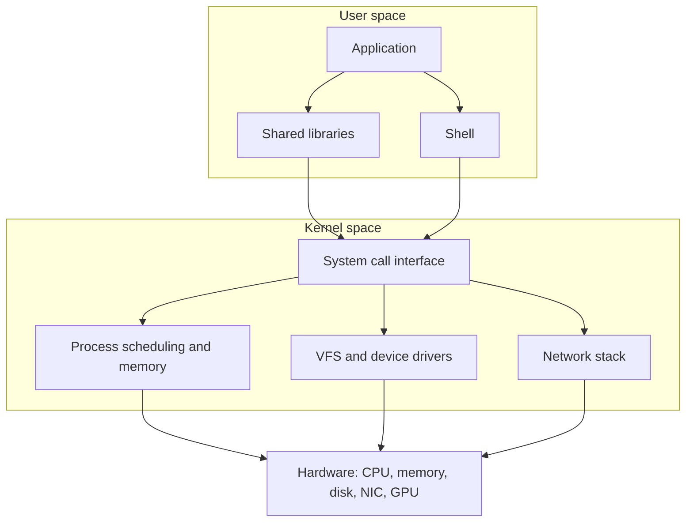

# Preliminary Chapter: Linux Fundamentals

> 🌐 [中文](00-linux-basics.md)

> [🏠 Back to home](../README.en.md)

This chapter is a prerequisite for [Chapter 1](01-integration-and-data.en.md) (systems integration) and [Chapter 2](02-deployment-and-security.en.md) (deployment, operations, and security). It does not take a chapter number and does not change the numbering of later chapters. It is written for people who deploy software on customer machines and GPU servers: the goal is not to turn you into a kernel developer, but to let you independently perform health checks, troubleshoot, and deliver in an unfamiliar Linux environment.

## Learning Objectives

- Explain the boundary between the kernel and user space, and what a system call does
- Explain the file system hierarchy, inodes, hard links, and symbolic links, and use `/proc` and `/sys` to inspect state
- Process logs with pipes and common text tools, and write scripts that use `set -euo pipefail`
- Understand permissions, sudo, and SSH, and transfer files safely in a customer environment with `scp` / `rsync`
- Manage processes with `ps`, signals, and systemd, and read a service unit file
- Troubleshoot startup failures caused by `PATH`, shared libraries (including CUDA), proxies, and certificates
- Run a resource health check with the USE method, and understand that container isolation is built on namespaces and cgroups
- Follow a checklist to complete a first round of observation on an unfamiliar customer server in about ten minutes

## L.1 Linux Architecture: Kernel, User Space, and Distributions

The **kernel** manages the CPU, memory, processes, file systems, and devices, and runs in privileged kernel mode. **User space** holds your shell, Python, inference service, and shared libraries. User space cannot operate the hardware directly; it must ask the kernel through **system calls**, such as `open`, `read`, `write`, `mmap`, `fork`, `execve`, and `ioctl`. `strace -f -p <pid>` shows which system calls a process is making, a common technique when troubleshooting.



**The boot process (you only need the layers, not the firmware details):**

1. Firmware (BIOS or UEFI) initializes the hardware and finds the bootloader.
2. The bootloader (commonly GRUB) loads the kernel and the initramfs.
3. After the kernel initializes, the initramfs finds and mounts the real root file system.
4. The kernel starts PID 1; on almost all modern server distributions this is **systemd**.
5. systemd enters the default target (such as `multi-user.target`) and brings up services according to their dependencies; only then come logins or `sshd`.

When troubleshooting, separating "never reached the kernel / reached the kernel but did not mount root / reached systemd but a unit failed" is far more useful than vaguely saying "boot is broken". `systemctl status`, `systemctl --failed`, and `journalctl -b -p err` are the usual entry points for the later stages of boot.

A **distribution** is a combination of a kernel, user-space tools, software packages, and default policies. FDEs most often meet Debian / Ubuntu (`apt`, `.deb`) and the RHEL family such as Rocky, Alma, and RHEL itself (`dnf`, `.rpm`), and occasionally SUSE or Amazon Linux. What you really need to confirm first is not "is it nice to use", but: which package manager it uses, whether the kernel version matches the NVIDIA driver, whether the glibc version can run the binaries you bring, whether cgroups are v1 or v2, and whether the customer has their own mirrors and hardening policies. To see the distribution and kernel:

```bash
cat /etc/os-release
uname -r
```

## L.2 File System: Hierarchy, Inodes, and Everything Is a File

The [Filesystem Hierarchy Standard (FHS)](https://refspecs.linuxfoundation.org/FHS_3.0/fhs-3.0.html) defines the meaning of common directories. Real systems merge some of them with symbolic links (many distributions fold `/bin` and `/lib` into `/usr`), but when troubleshooting you still look for things by these roles:

| Path | Typical use |
|---|---|
| `/` | Root; every path starts here |
| `/boot` | Kernel, initramfs, boot configuration |
| `/etc` | System configuration |
| `/home`, `/root` | Home directories of regular users and of root |
| `/opt` | Third-party applications or ones you drop in; a common deployment directory at customer sites |
| `/usr` | Programs and libraries provided by the distribution; `/usr/local` is usually for software installed separately on this machine |
| `/var` | Data that changes at runtime, such as `/var/log` and caches |
| `/tmp`, `/var/tmp` | Temporary files; `/tmp` is often cleared on reboot |
| `/run` | Runtime data (PID files, sockets), held in memory |
| `/dev` | Device nodes |
| `/proc`, `/sys` | Virtual file systems exported by the kernel and devices, not regular files on disk |
| `/mnt`, `/media` | Temporary or removable mount points |

An **inode** stores a file's metadata: type, permissions, owner, timestamps, size, link count, and pointers to data blocks. The file name is not in the inode but in a directory entry. Several directory entries can point to the same inode; that is a **hard link**. Hard links must be on the same file system, and you usually cannot hard-link a directory. A **symbolic link (soft link)** is a special file that stores a path; it can cross file systems and can point to a target that does not exist (a dangling link).

So "deleting a name" only removes a directory entry. The kernel frees the data blocks only when the link count drops to 0 and no process still has the file open. This explains a very common on-site phenomenon: a log was removed with `rm`, `ls` no longer shows it, but `df` shows no space returned, because a process still holds a file descriptor to the deleted file. Find it with `lsof +L1` or `lsof | grep deleted`; the space is released only after a restart or after the process reopens its log. `df -i` shows whether inodes are exhausted: lots of small files can use up the inodes, and then you cannot write new files even though "the disk still has space".

"**Everything is a file**" is a design philosophy, not a literal truth. Devices, pipes, and sockets often appear as file descriptors, and `/dev`, `/proc`, and `/sys` also expose information through paths; but modern network configuration mostly goes through netlink, so you cannot expect everything to be a plain `read` / `write`. For an FDE, the practical meaning of the phrase is: find the path and the file descriptor first, then decide which tool to use.

`/proc` provides process and kernel state, for example `/proc/<pid>/fd`, `/proc/<pid>/status`, `/proc/meminfo`, `/proc/cpuinfo`, and `/proc/self`. `/sys` (sysfs) provides device and driver parameters, such as those of network interfaces and block-device schedulers. Read-only inspection is safe; writing to `/proc` or `/sys` changes kernel behavior and requires explicit authorization on customer production systems.

## L.3 The Shell and Core Command-Line Tools

The shell is your interface for talking to the system and the starting point of automation. First get fluent with navigation and observation: `pwd`, `ls -la`, `cd`, `find`, `stat`, `file`, `head`, `tail`, `less`. Then chain commands together with pipes.

**Redirection and pipes:** `>` overwrites with standard output, `>>` appends, `<` reads standard input from a file, `2>` redirects standard error, `2>&1` merges standard error into standard output, and `|` sends the standard output of one command to the standard input of the next. `/dev/null` discards output.

**Exit codes:** by convention 0 means success and non-zero means failure. `$?` is the exit code of the previous command. By default, a pipeline's exit code is that of its last command; with `set -o pipefail`, any failure in the pipeline makes the whole pipeline fail.

**Common text tools (you should be able to combine them by hand):**

| Command | Purpose |
|---|---|
| `grep -nE` | Search by regular expression; `-r` recursive, `-v` invert |
| `sed` | Stream editing, often for substituting or deleting lines |
| `awk` | Column-oriented text processing |
| `sort`, `uniq -c` | Sorting and counting; `uniq` requires sorted input |
| `cut -d: -f1` | Extract columns by delimiter |
| `xargs` | Turn standard input into arguments for the next command; for file names with spaces, pair `-0` with `find -print0` |

Example: extract the most frequent error patterns from the systemd journal (look at the content first, then decide how to change the service):

```bash
journalctl -u inference -p err --no-pager \
  | awk '{$1=$2=$3=""; print $0}' \
  | sort | uniq -c | sort -nr | head
```

**When writing a script, start with:**

```bash
#!/usr/bin/env bash
set -euo pipefail
```

- `-e`: exit when a command fails. The conditions of `if` and `while`, and commands handled explicitly with `||` or `&&`, do not trigger an exit merely because they return non-zero.
- `-u`: using an undefined variable is an error, which keeps empty strings out of `rm` and path concatenation.
- `-o pipefail`: see above.

Build two more habits: quote your variables, and pass arguments through unchanged with `"$@"`; avoid patterns such as `rm -rf "$dir"/*` that become dangerous when the variable is empty. For tasks that must run for a long time over SSH, use `tmux` or `screen` rather than relying on a background `&` alone.

## L.4 Users, Permissions, and Remote Access

Every process has a user and group identity. File permissions come in three sets, **owner / group / others**, each with `r`, `w`, `x` (read, write, execute; for a directory, `x` means whether you can enter it). In octal, `4` is read, `2` is write, and `1` is execute, so `755` is `rwxr-xr-x` and `644` is `rw-r--r--`. `umask` determines which bits are masked off for newly created files: the common `022` gives new files `644` and new directories `755` (files start from `666` and directories from `777`, then are bitwise ANDed with the complement of the umask).

Special bits:

- **setuid** (`4xxx`): on execution, the effective user becomes the file's owner. Programs like `passwd` use it. Distributions usually ignore setuid on scripts.
- **setgid** (`2xxx`): an executable runs with the file's group identity; on a directory, new files inherit the directory's group.
- **sticky bit** (`1xxx`): common on `/tmp`; only a file's owner (and root) can delete their own files.

`chmod`, `chown`, and `chgrp` change these attributes. Do not set a directory to `777` just for convenience. To see your own identity and sudo privileges:

```bash
id
sudo -l
```

`sudo` lets you run commands as another user (root by default). Always change sudo rules with `visudo` so that a syntax error does not lock you out. Command lines appear in the process list, so never put passwords or keys in arguments.

**SSH** is the normal way into customer machines. Use keys rather than passwords:

```bash
ssh-keygen -t ed25519 -f ~/.ssh/customer_ed25519 -C "allen@customer"
```

Put the public key into the remote `~/.ssh/authorized_keys`. Keep permissions tight: the `.ssh` directory is generally `700`, the private key `600`, and `authorized_keys` `600` or `644`. On your own machine, write a `~/.ssh/config` so you do not have to remember hosts, jump hosts, and keys every time:

```sshconfig
Host customer-jump
    HostName jump.example.internal
    User allen
    IdentityFile ~/.ssh/customer_ed25519
    IdentitiesOnly yes

Host customer-gpu
    HostName 10.0.0.12
    User deploy
    ProxyJump customer-jump
    IdentityFile ~/.ssh/customer_ed25519
    IdentitiesOnly yes
    ServerAliveInterval 30
    ServerAliveCountMax 3
```

`IdentitiesOnly yes` prevents the SSH agent from offering too many keys at once and getting rejected by the server. `scp` suits a few files; for directories, resumable transfers, and repeated syncs, `rsync` is the better choice. A trailing slash on the source path changes the meaning: `src/` syncs the contents of the directory, whereas `src` puts another `src` level under the destination. Run with `--dry-run` first, then for real. There is no need for `-z` when transferring model weights that are already compressed:

```bash
rsync -aH --partial --info=progress2 --dry-run ./artifact/ customer-gpu:/opt/inference/
rsync -aH --partial --info=progress2 ./artifact/ customer-gpu:/opt/inference/
```

Before operating inside a customer network, confirm whether you are allowed to copy data out or in, and what approvals the jump host requires.

## L.5 Processes and systemd

A new process is usually created by `fork` (copying the current process) followed by `exec` (replacing the current address space with a new program). This is the basic way a shell runs commands and a service spawns child processes.

**Signals** are asynchronous notifications sent to a process. You should remember these: `SIGINT` (Ctrl-C), `SIGHUP` (terminal hangup; many daemons use it to reload configuration), `SIGTERM` (15, a request to exit gracefully), `SIGKILL` (9, cannot be caught or ignored; the process gets no chance to clean up), and `SIGSTOP` / `SIGCONT` (pause and continue). `kill <pid>` sends `SIGTERM` by default; `kill -9` is a last resort, and on a GPU service it may leave GPU memory or temporary files unreleased.

Viewing processes: `ps aux`, `ps -ef`, `top`, and `htop` when an interactive interface is available. `nice` and `renice` adjust CPU scheduling priority, from `-20` (higher priority) to `19` (yields more); regular users can usually only lower the priority. Job control: `&` sends a job to the background, Ctrl-Z pauses it, `bg` / `fg` resume it, and `jobs` lists jobs. When SSH disconnects, jobs not taken over by `nohup`, `disown`, or a terminal multiplexer are affected by the hangup signal, so long-running tasks belong in systemd, `tmux`, or a job system the customer approves.

A **zombie process** is a child that has exited but whose parent has not yet reaped it with `wait`; `ps` shows its state as `Z`. It uses almost no memory, only a PID; what really needs fixing is the parent that refuses to reap it. Orphans that lose their parent are adopted by PID 1 (or a subreaper), which reaps them.

Modern servers manage services with **systemd**. Unit files usually live in `/etc/systemd/system/` (local overrides) or `/lib/systemd/system/` (provided by packages). Common commands: `systemctl start|stop|restart|status name`, `systemctl enable --now name` (enable at boot and start immediately), `systemctl daemon-reload` (required after editing unit files), `systemctl cat name`, `journalctl -u name -f`, and `journalctl -u name --no-pager -n 200`.

Below is an example of handing a Python inference service to systemd. The paths, user, and port are placeholders to be replaced with the real values of the customer environment; do not run business processes as root.

```ini
[Unit]
Description=Customer model inference service
After=network-online.target
Wants=network-online.target

[Service]
Type=simple
User=app
Group=app
WorkingDirectory=/opt/inference
Environment=PATH=/opt/inference/.venv/bin:/usr/bin
EnvironmentFile=-/etc/inference.env
ExecStart=/opt/inference/.venv/bin/python -m uvicorn app:app --host 127.0.0.1 --port 8080
Restart=on-failure
RestartSec=5
TimeoutStopSec=30
NoNewPrivileges=yes
PrivateTmp=yes
LimitNOFILE=65536

[Install]
WantedBy=multi-user.target
```

The `-` in front of `EnvironmentFile=-...` means a missing file is not an error. After editing the file:

```bash
sudo systemctl daemon-reload
sudo systemctl enable --now inference
sudo systemctl status inference --no-pager
```

When something works in an interactive shell but fails under systemd, the cause is usually one of these differences: no login-shell `PATH` and no `~/.bashrc`, a different working directory, environment variables not written into the unit, network or GPU devices not yet ready, or the service binding to the wrong address. Compare with `systemctl cat` and `journalctl -u` instead of running `restart` over and over.

## L.6 Packages, Environment Variables, and Shared Libraries

Debian / Ubuntu use `apt` (`apt update` refreshes the index, `apt install` installs, `dpkg -L` lists a package's files). The RHEL family uses `dnf` (or the older `yum`), and `rpm -ql` lists files. Do not run `apt upgrade` or `dnf update` on an entire customer production system on your own unless the change window and rollback plan have been agreed. Prefer the customer's approved repositories and version-pinned artifacts.

**Environment variables** affect how programs find configuration, libraries, and executables. `PATH` is the list of directories searched for executables; `which`, `type -a`, and `command -v` let you check which one is actually used. Login shells, non-login interactive shells, and systemd services read different startup files: a variable available in `~/.bashrc` may not be visible to a service, so it should go in the unit's `Environment=` / `EnvironmentFile=`, or in the configuration the customer specifies.

Dynamically linked programs depend on shared libraries. `ldd /path/to/binary` lists the `.so` files it needs and the paths they actually resolve to; `ldconfig -p` shows the system library cache. `LD_LIBRARY_PATH` can temporarily change the search path, but do not treat it as a long-term solution: it easily makes a process load the wrong library version, and under systemd it should be configured explicitly rather than relying on some manual `export`.

CUDA-related libraries are especially easy to confuse:

- The driver installation provides the kernel module and `libcuda.so`, the user-space entry point for talking to the GPU.
- The CUDA Toolkit provides `nvcc`, `libcudart`, and so on.
- Many PyTorch wheels ship their own copy of the CUDA runtime, but they **still** need a `libcuda.so` that is compatible with the driver.

The CUDA Version in the top-right corner of `nvidia-smi` is the **highest CUDA version supported by the current driver**, not the version of the Toolkit installed on the machine. For the Toolkit version, check `nvcc --version` (if it is installed). For version relationships, rely on NVIDIA's [official compatibility documentation](https://docs.nvidia.com/cuda/cuda-compatibility/) rather than applying a lookup table from memory. For the deeper programming model, see [Section 3.8](../02-ai-llm/08-cuda-and-gpu-kernels.en.md).

## L.7 Networking Basics

First look at the local addresses, routes, and listening ports:

```bash
ip -br addr
ip route
ss -lntup
```

`ss` replaces the old `netstat`. `-lntup` means listening, numeric output, TCP, UDP, and an attempt to show process names; seeing other users' process names usually requires the appropriate privileges. Check whether a service is bound to `127.0.0.1` (local only) or `0.0.0.0` (all interfaces); in a customer environment this directly determines whether you need an additional reverse proxy or firewall rule.

**DNS:** `/etc/hosts` holds static mappings, consulted before the resolver, and is often used to pin internal addresses. `/etc/resolv.conf` lists name servers; on systems with systemd-resolved or NetworkManager, it may be a symbolic link to a local stub (such as `127.0.0.53`). In that case look at `resolvectl status` instead of editing a file that will be overwritten.

`curl -I` shows HTTP response headers, `curl -v` shows the handshake and certificate, and `curl --connect-timeout 5` keeps you from hanging. When a probe fails, classify the error: DNS resolution failure, TCP connection failure, untrusted TLS certificate, unexpected HTTP status code, or interception by a proxy.

The **firewall** is a policy layer; underneath, modern systems mostly use nftables (or the iptables interface you still see). Ubuntu commonly wraps it with **UFW**, and the RHEL family commonly uses **firewalld**. You need to know how to *view* the current rules and how to explain on which side a business port should be opened; changing the firewall on a customer machine must go through their change process. Denying inbound traffic by default and allowing only the necessary ports is a common and sensible stance.

**Proxies at customer sites** are almost the norm. Besides `http_proxy`, `https_proxy`, and `no_proxy` in the shell (and their uppercase variants), check separately: the proxy configuration of `apt` / `dnf`, `pip`, `git`, the container runtime (such as Docker's systemd drop-in), and graphical or Java programs that do not read environment variables. Miss any one of these layers and you get the illusion of "curl works for me, but the install script fails". `no_proxy` should include internal domains, image registries, and metadata addresses so that internal traffic is not sent to the egress proxy.

**TLS trust stores** are another frequent on-site problem. Corporate gateways often inspect HTTPS and require you to trust their private CA. On Debian / Ubuntu, put the extra certificates in the appropriate directory and run `update-ca-certificates`; the RHEL family uses `update-ca-trust`. After updating the system trust store, also confirm that the language runtime actually uses it: Python's `certifi` and the certificate bundles shipped with some languages may bypass the system store. Use `SSL_CERT_FILE`, `REQUESTS_CA_BUNDLE`, or the runtime's own option to point to the CA bundle the customer provides. Never disable certificate verification "just to get it running" and then leave it that way in production.

## L.8 Resource Troubleshooting and Performance

First separate four areas: CPU, memory, disk, and network. Then ask the three questions of the USE method for each: **Utilization**, **Saturation** (is work queuing?), and **Errors**. The method was formulated by Brendan Gregg (see Further Reading); it is a checklist, not a formula that automatically yields the root cause.

| Resource | How to see utilization | How to see saturation | How to see errors |
|---|---|---|---|
| CPU | `top`, `mpstat`, load compared with core count | Run queue (`r` in `vmstat`, load persistently above core count) | Hardware errors, rate limiting, being `throttled` |
| Memory | `free -h`, `/proc/meminfo` | Frequent swapping in and out, OOM | OOM killer records, allocation failures |
| Disk | `iostat -x 1`, `df -h` | Average wait, queue depth, `%util` near full for long periods | Kernel I/O errors, read-only mounts, inode exhaustion |
| Network | `ip -s link`, interface speed | Packet loss, retransmissions, queue overflows | NIC errors, DNS failures, connection resets |

For memory, `available` in `free -h` is closer than `free` to "how much more can I give applications". `buff/cache` is usually the page cache, not a leak; the kernel can reclaim it when needed. A swap partition can prevent an immediate kill under brief memory pressure, but once paging becomes frequent, latency gets noticeably worse. If an inference process suddenly disappears, check for OOM first:

```bash
journalctl -k --no-pager | grep -i -E 'oom|killed process'
dmesg -T | grep -i -E 'oom|killed process'
```

The OOM killer picks a process to kill in order to free memory. This is not "Linux crashing at random"; memory has run out. For quick observation, use `free -h` and process RSS; the fixes are limiting batch size, adding memory, limiting the cgroup, or avoiding several large models resident at the same time. Do not treat "turning off the OOM killer" as a solution.

For disks, first check `df -h` and `df -i`, then use `du -xh --max-depth=1` to locate directories. Space, inodes, and read-only mounts are three different kinds of failure. For the finer layers of the storage stack (page cache, `fsync`, Direct I/O, device mapper, overlayfs), see [Section 3.9 Linux I/O and the Storage Stack](../02-ai-llm/09-linux-io-and-storage-stack.en.md).

Where the logs are depends on the system: for systemd services, start with `journalctl`; also check `/var/log/syslog`, `/var/log/messages`, and application logs such as `/var/log/nginx`. Save the output of the current state before changing configuration, so you are not describing things from memory.

**On-site quick checklist (USE style):**

1. Is the process still there? Did it exit, get killed, or is it alive but making no progress?
2. Is the CPU busy computing or waiting on I/O? Look at `us`, `sy`, `wa`, and `st` in `top`.
3. Is memory nearly exhausted, is swap active, and did the kernel just OOM?
4. Is there enough disk space and inodes, and is I/O stuck?
5. Is the network problem DNS, a proxy, the firewall, or the remote application?
6. Do the application logs and `journalctl -p err -b` show errors at the matching time?

## L.9 The Linux Foundations of Containers and GPU Servers

A container is not another virtual machine; it **shares the same kernel** with the host. Its isolation comes mainly from two kinds of kernel mechanisms:

- **namespaces**: give processes their own view of the PID tree, network stack, mount table, hostname, IPC, and so on. Common types include `pid`, `net`, `mnt`, `uts`, `ipc`, `user`, and `cgroup`.
- **cgroups (control groups)**: limit and account for CPU, memory, I/O, and other resources. Modern distributions default to cgroup v2.

**Docker** (and containerd, Podman, and others) adds image distribution, a union file system (commonly overlayfs), and a command-line interface on top of these mechanisms. So "the container cannot see host processes", "port 80 in the container is not the host's port 80", and "this container is limited to 8GiB of memory" are all namespaces and cgroups at work, not a second kernel being started. For the copy-on-write overhead of overlayfs, and why large models and large logs belong on mounted volumes, see [Section 3.9](../02-ai-llm/09-linux-io-and-storage-stack.en.md).

At customer sites, also remember: a container cannot escape the limits of the host kernel; the kernel version, drivers, security modules (SELinux, AppArmor), and cgroup version all belong to the host. This is especially true for GPUs: the NVIDIA driver is installed on the **host**, and containers use it through device nodes and libraries, usually with a component such as the NVIDIA Container Toolkit installed and the devices declared at run time. If a container cannot see the GPU, check the host driver, device-node permissions, and runtime configuration first, rather than reinstalling the framework.

On a GPU server, the first thing to look at is:

```bash
nvidia-smi
```

It shows the driver version, each card's utilization and memory, and the processes currently using the GPU. As noted earlier, the CUDA Version in the header is the upper limit supported by the driver. If the command is not found, it usually means the driver is not installed, it is not on `PATH`, or you are inside a container without correct device passthrough. For the relationship between the driver, CUDA, and user-space libraries, see [L.6](#l6-packages-environment-variables-and-shared-libraries) and [Section 3.8](../02-ai-llm/08-cuda-and-gpu-kernels.en.md). The CUDA sections of this repository were not run-verified on a GPU when they were written.

## L.10 The First 10 Minutes on an Unfamiliar Customer Server

The goal is to **observe and record**, not to change configuration right away. Get the customer's consent before logging in; do not escalate privileges unless you have to. Here is a checklist to follow in order:


1. **Who am I, and which machine is this?** `id`, `hostnamectl` or `hostname`, `uname -a`, `cat /etc/os-release`. Note the user, whether you can sudo (`sudo -l`), the distribution, and the kernel.
2. **Is the time correct?** `timedatectl`. Clock skew breaks TLS, Kerberos, and log alignment all at once.
3. **Disk.** `df -hT`, `df -i`, `lsblk`. Watch for read-only mounts, inodes, and `/`, `/var`, or `/opt` about to fill up.
4. **Memory and CPU.** `free -h`, `nproc`, `uptime`, `lscpu`. Look at `available`, whether swap is already in use, and how load compares with the core count.
5. **Network and egress.** `ip -br addr`, `ip route`, `ss -lntup`. Check proxy environment variables, `/etc/hosts`, and DNS. Probe each internal and external address you really need once, with a timeout, for example `curl -I --connect-timeout 5`. Write down the reasons for any failures.
6. **What is already running.** `systemctl --failed`, `systemctl list-units --type=service --state=running`; if there are containers, also check the runtime the customer uses (such as `docker ps`). Do not stop services you do not yet understand.
7. **GPU (if this is a GPU machine).** `nvidia-smi`. Record the driver version, number of cards, memory usage, and existing processes, so you do not crowd out someone else's jobs.
8. **Recent errors.** `journalctl -p err -b --no-pager | tail -n 50`, plus the application log paths the customer points you to.
9. **Permissions and landing spots.** Can you write to the agreed deployment directory (such as `/opt`)? Where should keys, configuration, and data each go? Are there disk quotas?
10. **Write your observations down in a few lines before you act.** Include: system version, resource headroom, network restrictions, existing services, signs of anomalies, and the first change you plan to make. Changing production without a written record leaves later rollbacks without a baseline.

## Case Studies

All of the scenarios below are **fictional** composite examples of customer sites, meant to illustrate the reasoning path; they are not real customer data.

**Case A (fictional): the disk is not full, yet the service cannot write.** An inference node alerts "disk full", yet `df -h` shows free space on `/var`. A follow-up `df -i` reveals that the inodes are exhausted: the directory has accumulated millions of small temporary files, one per request. Writes resume after cleaning up expired temporary files and switching to packaging them by date or by batch. **Lesson:** check inodes as well as space; small-file density is itself a capacity-planning problem.

**Case B (fictional): the same start command succeeds in the shell but fails under systemd.** In a login session, an engineer runs `source venv/bin/activate` and then starts the service, and it works; written as a unit, it keeps exiting. `journalctl` shows a missing module, and `systemctl cat` shows that `ExecStart` calls the system Python and the virtual environment's `PATH` was not written into the unit. Fixing `ExecStart` and `Environment=`, and adding `WorkingDirectory`, restores it. **Lesson:** systemd does not read your interactive shell configuration.

**Case C (fictional): pip and curl behave differently on a customer intranet.** `curl https://example.com` succeeds, but `pip install` reports a certificate verification failure. The cause is that the egress proxy injects the company CA; the system trust store had been updated, but pip in that environment uses its own CA bundle. Installs recover after pointing `REQUESTS_CA_BUNDLE` to the certificate chain provided by the customer and configuring the same proxy separately for pip, apt, and the container runtime. **Lesson:** check proxies and trust stores tool by tool, layer by layer; one successful `curl` does not stand in for all of them.

**Case D (fictional): the inference process "vanished on its own".** The service exits overnight without any log, and GPU utilization drops to zero. `journalctl -k` shows that the OOM killer chose that Python process when memory ran out. At the time, a leftover evaluation job that had never been cleaned up was still on the same machine. The fix was first to avoid stacking two large processes together, then to set a memory limit on the service's cgroup and add a restart policy. **Lesson:** first check whether the kernel killed the process, then check whether the application "crashed on its own".

## Exercises

1. After an 8GiB log file is removed with `rm`, `ls` no longer shows it, but the used space in `df -h` barely changes. Explain why, and write the commands you would use to locate and free the space.
   *Reference answer: the file's directory entry has been deleted, but some process still has the inode open, and the space is released only after the last file descriptor is closed. Use `lsof +L1` or `lsof | grep deleted` to find the process; where acceptable, have the process rotate its log or restart that service. Do not kill unknown processes before confirming who holds the file.*

2. After adapting the unit file from L.5 to a machine's real paths, `systemctl start` still fails. List at least three causes you would check first, and give the corresponding commands.
   *Scoring rubric: covers at least (a) no `daemon-reload` after editing the unit file; (b) incorrect `ExecStart`, `PATH`, or virtual environment, checked with `systemctl cat` and `journalctl -u`; (c) user permissions, a missing working directory, or a missing configuration file; (d) the port is already in use (`ss -lntup`) or the network / GPU it depends on is not ready. Writing only "restart it again" earns no points.*

3. The current `umask` is `027`. You create a regular file and a directory. What are their default permissions (assuming no extra ACLs)? Show your calculation.
   *Reference answer: files start from `666`; ANDed with `~027` this gives `640` (`rw-r-----`). Directories start from `777`, giving `750` (`rwxr-x---`).*

4. You log in for the first time to a customer machine said to have "slow GPU inference". Based on L.8 and L.10, write the list of commands you would run in the first ten minutes, and explain what each command rules out.
   *Scoring rubric: covers identity and system, time, disk (including inodes), memory and OOM, CPU / load, network and proxy, services and ports, `nvidia-smi`, and error logs; and states clearly to observe first and change later.*

5. A colleague says "this machine's CUDA is 12.x, because the top-right corner of `nvidia-smi` says 12.x", copies over an extension compiled for that version, and it fails to load. Point out the mistake in this reasoning, and explain what other information you would check.
   *Reference answer: the CUDA Version in `nvidia-smi` is the upper limit supported by the driver, not the installed Toolkit version, and it is not the same as the runtime version bundled with the current Python package. You should also check the driver version, `nvcc --version` (if present), the `libcuda` / `libcudart` the process actually links against (`ldd`), and the framework's own CUDA build information. Use NVIDIA's official compatibility documentation as the reference.*

## Summary

For an FDE, Linux is a working language for the field: the kernel and user space are divided by system calls; files and processes are the main windows for observing the system; permissions and SSH determine how far you can safely go; and systemd, package managers, shared libraries, and network policy determine whether a service can run stably in the customer environment. Containers are built on namespaces and cgroups, and GPU servers additionally require checking the driver and user-space libraries. Observe first, then change, and pin each troubleshooting effort to a specific layer instead of guessing back and forth between the application, the system, and the hardware.

## Key Terms

Kernel, user space, system call, distribution, FHS, inode, hard link, symbolic link, page cache, umask, setuid, sudo, SSH, rsync, fork/exec, signal, zombie process, systemd, unit, journalctl, PATH, ldd, LD_LIBRARY_PATH, proxy, trust store, OOM killer, USE method, namespace, cgroup, nvidia-smi

## Further Reading

- Linux kernel documentation — https://docs.kernel.org/
- Filesystem Hierarchy Standard 3.0 — https://refspecs.linuxfoundation.org/FHS_3.0/fhs-3.0.html
- Linux man-pages (including [namespaces(7)](https://man7.org/linux/man-pages/man7/namespaces.7.html), [cgroups(7)](https://man7.org/linux/man-pages/man7/cgroups.7.html), [inode(7)](https://man7.org/linux/man-pages/man7/inode.7.html)) — https://man7.org/linux/man-pages/
- GNU Bash manual — https://www.gnu.org/software/bash/manual/bash.html
- OpenSSH manual pages — https://www.openssh.org/manual.html ; [`ssh_config`](https://man.openbsd.org/ssh_config)
- systemd.service — https://www.freedesktop.org/software/systemd/man/latest/systemd.service.html
- Brendan Gregg: The USE Method — https://www.brendangregg.com/usemethod.html
- Kernel OOM documentation — https://docs.kernel.org/mm/oom.html
- cgroup v2 — https://docs.kernel.org/admin-guide/cgroup-v2.html
- NVIDIA CUDA compatibility — https://docs.nvidia.com/cuda/cuda-compatibility/
- nvidia-smi — https://docs.nvidia.com/deploy/nvidia-smi/index.html
- Debian Reference: package management — https://www.debian.org/doc/manuals/debian-reference/ch02.en.html
- Fedora: DNF — https://docs.fedoraproject.org/en-US/quick-docs/dnf/
- Debian `update-ca-certificates(8)` — https://manpages.debian.org/bookworm/ca-certificates/update-ca-certificates.8.en.html
- Ubuntu Server: firewalls — https://documentation.ubuntu.com/server/how-to/security/firewalls/

---

[🏠 Back to home](../README.en.md)
