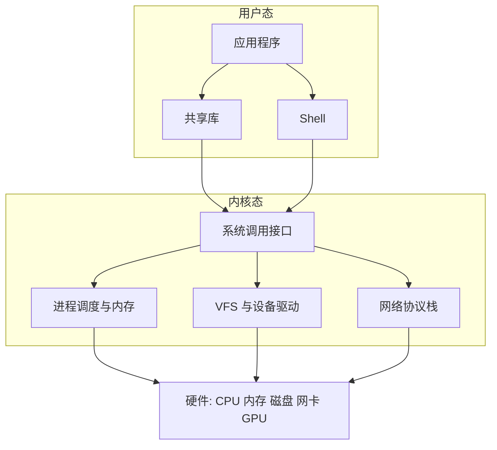

# 预备章 Linux 基础

> 🌐 [English](00-linux-basics.en.md)

> [🏠 返回主页](../README.md)

本章是[第 1 章](01-integration-and-data.md)（系统集成）与[第 2 章](02-deployment-and-security.md)（部署、运维与安全）的先修，不占用章号，也不改动后面各章的编号。它面向要在客户机器和 GPU 服务器上部署软件的人：目标不是把你变成内核开发者，而是让你在陌生的 Linux 环境里能独立完成体检、排障和交付。

## 学习目标

- 能说明内核与用户态的边界，以及一次系统调用在做什么
- 能解释文件系统层次、inode、硬链接与软链接，并会用 `/proc`、`/sys` 查状态
- 能用管道与常见文本工具完成日志处理，并写出带 `set -euo pipefail` 的脚本
- 理解权限、sudo 与 SSH，能用 `scp` / `rsync` 在客户环境里安全传文件
- 能用 `ps`、信号和 systemd 管理进程，读懂一份服务单元文件
- 能排查 `PATH`、共享库（含 CUDA）、代理和证书导致的启动失败
- 能用 USE 方法做资源体检，并理解容器隔离建立在 namespace 与 cgroup 之上
- 能按清单在陌生客户服务器上用大约十分钟完成第一轮观察

## L.1 Linux 架构：内核、用户态与发行版

**内核（kernel）** 管理 CPU、内存、进程、文件系统和设备，运行在特权的内核态。**用户态（user space）** 里是你的 Shell、Python、推理服务和共享库。用户态不能直接操作硬件，必须通过**系统调用（system call）** 请求内核：例如 `open`、`read`、`write`、`mmap`、`fork`、`execve`、`ioctl`。`strace -f -p <pid>` 可以看见一个进程正在发出哪些系统调用，这是排障时常用的手段。



**启动过程（只需掌握层次，不必背固件细节）：**

1. 固件（BIOS 或 UEFI）初始化硬件，找到引导程序。
2. 引导程序（常见是 GRUB）加载内核和 initramfs。
3. 内核初始化后，initramfs 负责找到并挂载真正的根文件系统。
4. 内核启动 PID 1；当代服务器发行版几乎都是 **systemd**。
5. systemd 进入默认 target（如 `multi-user.target`），按依赖拉起服务；之后才是登录或 `sshd`。

排障时，把「还没进内核 / 进了内核但没挂上根 / 已到 systemd 但某个 unit 失败」分开，比笼统说「开机坏了」有用得多。`systemctl status`、`systemctl --failed` 和 `journalctl -b -p err` 是启动后期的常用入口。

**发行版**是内核、用户态工具、软件包和默认策略的组合。FDE 最常遇到 Debian / Ubuntu（`apt`、`.deb`）和 RHEL 系如 Rocky、Alma、RHEL 本身（`dnf`、`.rpm`），偶尔还有 SUSE、Amazon Linux。你真正要先确认的不是「好不好用」，而是：包管理器是哪一种、内核版本能否匹配 NVIDIA 驱动、glibc 版本能否跑你带来的二进制、cgroup 是 v1 还是 v2、客户是否有自己的镜像源和加固策略。看发行版与内核：

```bash
cat /etc/os-release
uname -r
```

## L.2 文件系统：层次、inode 与一切皆文件

[Filesystem Hierarchy Standard (FHS)](https://refspecs.linuxfoundation.org/FHS_3.0/fhs-3.0.html) 约定了常见目录的含义。实际系统会有符号链接合并（不少发行版把 `/bin`、`/lib` 并入 `/usr`），但排障时仍按这些角色去找东西：

| 路径 | 典型用途 |
|---|---|
| `/` | 根；所有路径从这里开始 |
| `/boot` | 内核、initramfs、引导配置 |
| `/etc` | 系统配置 |
| `/home`、`/root` | 普通用户与 root 的家目录 |
| `/opt` | 第三方或你投放的应用，常见于客户现场的部署目录 |
| `/usr` | 发行版提供的程序与库；`/usr/local` 多为本机另行安装 |
| `/var` | 会随运行变化的数据，如 `/var/log`、缓存 |
| `/tmp`、`/var/tmp` | 临时文件；`/tmp` 重启后常被清空 |
| `/run` | 运行时数据（PID 文件、套接字），在内存中 |
| `/dev` | 设备节点 |
| `/proc`、`/sys` | 内核和设备导出的虚拟文件系统，不是磁盘上的普通文件 |
| `/mnt`、`/media` | 临时或可移动挂载点 |

**inode** 保存文件的元数据：类型、权限、属主、时间戳、大小、链接计数，以及数据块指针。文件名不在 inode 里，而在目录项中。多个目录项可以指向同一个 inode，这就是**硬链接**：它们必须在同一文件系统内，通常不能给目录做硬链接。**符号链接（软链接）** 是一个存放路径的特殊文件，可以跨文件系统，也可以指向不存在的目标（悬空链接）。

因此，「删除一个名字」只是减少一条目录项。当链接计数降到 0，且没有进程仍打开着这个文件时，内核才释放数据块。这能解释一种现场高频现象：日志被 `rm` 掉了，`ls` 看不见，但 `df` 空间没有回来——进程还握着已删除文件的文件描述符。可用 `lsof +L1` 或 `lsof | grep deleted` 查找，重启或让该进程重新打开日志后空间才会释放。`df -i` 则看 inode 是否耗尽：大量小文件可以把 inode 用完，这时「磁盘还有空间」也写不进新文件。

「**一切皆文件**」是设计理念，不是字面真理。设备、管道、套接字常以文件描述符的形式出现，`/dev`、`/proc`、`/sys` 也用路径暴露信息；但现代网络配置更多走 netlink，不能期望所有事情都是普通的 `read` / `write`。对 FDE 来说，这句话的实用含义是：先找路径和文件描述符，再决定该用哪一种工具。

`/proc` 提供进程和内核状态，例如 `/proc/<pid>/fd`、`/proc/<pid>/status`、`/proc/meminfo`、`/proc/cpuinfo`、`/proc/self`。`/sys`（sysfs）提供设备和驱动参数，例如网卡、块设备调度器。只读查看是安全的；向 `/proc` 或 `/sys` 写入会改变内核行为，在客户生产上必须先得到明确授权。

## L.3 Shell 与核心命令行

Shell 是你与系统对话的界面，也是自动化的起点。先熟练导航与观察：`pwd`、`ls -la`、`cd`、`find`、`stat`、`file`、`head`、`tail`、`less`。然后把命令用管道连起来。

**重定向与管道：** `>` 覆盖写入标准输出，`>>` 追加，`<` 从文件读标准输入，`2>` 重定向标准错误，`2>&1` 把标准错误并入标准输出，`|` 把前一个命令的标准输出送给下一个命令的标准输入。`/dev/null` 用来丢弃输出。

**退出码：** 约定 0 表示成功，非 0 表示失败。`$?` 是上一条命令的退出码。默认情况下，管道的退出码取最后一条命令；加上 `set -o pipefail` 后，管道中任一失败都会让整条管道失败。

**常用文本工具（应能动手组合）：**

| 命令 | 作用 |
|---|---|
| `grep -nE` | 按正则搜索；`-r` 递归，`-v` 取反 |
| `sed` | 流编辑，常用于替换或删行 |
| `awk` | 按列处理文本 |
| `sort`、`uniq -c` | 排序与计数；`uniq` 要求输入已排序 |
| `cut -d: -f1` | 按分隔符取列 |
| `xargs` | 把标准输入转成后面命令的参数；文件名含空格时用 `-0` 与 `find -print0` 搭配 |

实例：从 systemd 日志里取出报错最多的若干条模式（先看内容，再决定怎么改服务）：

```bash
journalctl -u inference -p err --no-pager \
  | awk '{$1=$2=$3=""; print $0}' \
  | sort | uniq -c | sort -nr | head
```

**编写脚本时先写：**

```bash
#!/usr/bin/env bash
set -euo pipefail
```

- `-e`：命令失败则退出。`if`、`while` 的判断条件，以及用 `||`、`&&` 显式处理的命令，不会仅仅因为返回非 0 就触发退出。
- `-u`：使用未定义变量即失败，避免把空字符串传进 `rm` 或路径拼接。
- `-o pipefail`：见上。

再养成两个习惯：变量加引号，`"$@"` 原样传递参数；不要用 `rm -rf "$dir"/*` 这类在变量为空时变得危险的写法。需要长时间挂在 SSH 上跑的任务，用 `tmux` 或 `screen`，不要只靠后台 `&`。

## L.4 用户、权限与远程访问

每个进程都有用户和组身份。文件权限按**属主 / 属组 / 其他人**三组，每组是 `r`、`w`、`x`（读、写、执行；对目录而言 `x` 表示能否进入）。八进制中 `4` 是读、`2` 是写、`1` 是执行，所以 `755` 是 `rwxr-xr-x`，`644` 是 `rw-r--r--`。`umask` 决定新建文件时要遮掉哪些位：常见 `022` 使新文件为 `644`、新目录为 `755`（文件默认起点是 `666`，目录是 `777`，再与 umask 取反后按位与）。

特殊位：

- **setuid**（`4xxx`）：执行时有效用户变为文件属主。`passwd` 一类程序会用到。发行版通常忽略脚本上的 setuid。
- **setgid**（`2xxx`）：可执行文件以属组身份运行；用在目录上时，新文件继承该目录的组。
- **粘滞位（sticky）**（`1xxx`）：常见于 `/tmp`，使只有文件属主（和 root）能删除自己的文件。

`chmod`、`chown`、`chgrp` 修改这些属性。不要图省事把目录改成 `777`。查看自己的身份和 sudo 权限：

```bash
id
sudo -l
```

`sudo` 让你以另一用户（默认 root）执行命令。改 sudo 规则必须用 `visudo`，以免语法错误把自己锁住。命令行会出现在进程列表里，不要把密码或密钥写进参数。

**SSH** 是进入客户机器的常规方式。用密钥而不是密码：

```bash
ssh-keygen -t ed25519 -f ~/.ssh/customer_ed25519 -C "allen@customer"
```

把公钥放入对方 `~/.ssh/authorized_keys`。权限要收紧：`.ssh` 目录一般为 `700`，私钥为 `600`，`authorized_keys` 为 `600` 或 `644`。本机建议写 `~/.ssh/config`，避免每次记主机、跳板和密钥：

```sshconfig
Host customer-jump
    HostName jump.example.internal
    User allen
    IdentityFile ~/.ssh/customer_ed25519
    IdentitiesOnly yes

Host customer-gpu
    HostName 10.0.0.12
    User deploy
    ProxyJump customer-jump
    IdentityFile ~/.ssh/customer_ed25519
    IdentitiesOnly yes
    ServerAliveInterval 30
    ServerAliveCountMax 3
```

`IdentitiesOnly yes` 可以避免 SSH 代理一次性献出太多密钥、被服务器拒绝。`scp` 适合少量文件；目录、断点续传和重复同步更宜用 `rsync`。源路径末尾有没有斜线含义不同：`src/` 同步的是目录中的内容，`src` 则会在目标下再放一层 `src`。先 `--dry-run` 再正式执行。传已经压缩的模型权重时不必加 `-z`：

```bash
rsync -aH --partial --info=progress2 --dry-run ./artifact/ customer-gpu:/opt/inference/
rsync -aH --partial --info=progress2 ./artifact/ customer-gpu:/opt/inference/
```

在客户网络里操作前，先确认是否允许把数据拷出、拷入，以及跳板机的审批要求。

## L.5 进程与 systemd

新进程通常先 `fork`（复制当前进程），再 `exec`（用新程序替换当前地址空间）。这就是 Shell 跑命令、服务拉起子进程的基本方式。

**信号**是发给进程的异步通知。你应当记住这几个：`SIGINT`（Ctrl-C）、`SIGHUP`（终端挂断，许多守护进程用来重载配置）、`SIGTERM`（15，请求优雅退出）、`SIGKILL`（9，不能被捕获或忽略，进程没有机会清理）、`SIGSTOP` / `SIGCONT`（暂停与继续）。`kill <pid>` 默认发 `SIGTERM`；`kill -9` 是最后手段，用在 GPU 服务上可能导致显存或临时文件来不及释放。

查看进程：`ps aux`、`ps -ef`、`top`，有交互界面时可用 `htop`。`nice` 与 `renice` 调整 CPU 调度优先级，取值从 `-20`（更优先）到 `19`（更让出）；普通用户通常只能把优先级调低。作业控制：`&` 放到后台，Ctrl-Z 暂停，`bg` / `fg` 继续，`jobs` 查看。SSH 断开后，没有被 `nohup`、`disown` 或终端复用器接管的作业会被挂断信号影响，所以长时间任务应放到 systemd、`tmux` 或客户认可的作业系统里。

**僵尸进程（zombie）** 是已经退出、但父进程还没有 `wait` 收尸的子进程，`ps` 中状态为 `Z`。它几乎不再占用内存，只占一个 PID；真正要修的是那个不肯收尸的父进程。失去父进程的孤儿会被托管给 PID 1（或子收割者），由它负责回收。

当代服务器用 **systemd** 管理服务。单元文件常放在 `/etc/systemd/system/`（本机覆盖）或 `/lib/systemd/system/`（软件包提供）。常用命令：`systemctl start|stop|restart|status name`、`systemctl enable --now name`（设为开机启动并立即启动）、`systemctl daemon-reload`（改过单元文件之后必须执行）、`systemctl cat name`、`journalctl -u name -f`、`journalctl -u name --no-pager -n 200`。

下面是一份把 Python 推理服务交给 systemd 管理的示例。路径、用户和端口都是占位，要改成客户环境中的真实值；不要以 root 跑业务进程。

```ini
[Unit]
Description=Customer model inference service
After=network-online.target
Wants=network-online.target

[Service]
Type=simple
User=app
Group=app
WorkingDirectory=/opt/inference
Environment=PATH=/opt/inference/.venv/bin:/usr/bin
EnvironmentFile=-/etc/inference.env
ExecStart=/opt/inference/.venv/bin/python -m uvicorn app:app --host 127.0.0.1 --port 8080
Restart=on-failure
RestartSec=5
TimeoutStopSec=30
NoNewPrivileges=yes
PrivateTmp=yes
LimitNOFILE=65536

[Install]
WantedBy=multi-user.target
```

`EnvironmentFile=-...` 前面的 `-` 表示文件不存在时不失败。改完文件后：

```bash
sudo systemctl daemon-reload
sudo systemctl enable --now inference
sudo systemctl status inference --no-pager
```

交互式 Shell 里能跑、放到 systemd 里却失败，多半是这些差异：没有登录 Shell 的 `PATH` 和 `~/.bashrc`，工作目录不同，环境变量没写入 unit，依赖的网络或 GPU 设备还没就绪，或者服务绑定了错误的地址。用 `systemctl cat` 和 `journalctl -u` 对照，而不是反复 `restart`。

## L.6 软件包、环境变量与共享库

Debian / Ubuntu 用 `apt`（`apt update` 刷新索引，`apt install` 安装，`dpkg -L` 列出文件）。RHEL 系用 `dnf`（或较旧的 `yum`），`rpm -ql` 列文件。在客户生产上不要自行 `apt upgrade` 或 `dnf update` 整个系统，除非变更窗口和回滚方案已经谈妥。优先使用客户批准的源和已经锁定版本的制品。

**环境变量**影响程序找配置、找库、找可执行文件。`PATH` 是搜索可执行文件的目录列表，`which`、`type -a`、`command -v` 可以核对最终用的是哪一个。登录 Shell、非登录交互 Shell 和 systemd 服务读的启动文件不同：`~/.bashrc` 里能用的变量，服务未必看得见，应写在 unit 的 `Environment=` / `EnvironmentFile=`，或客户指定的配置里。

动态链接的程序依赖共享库。`ldd /path/to/binary` 会列出它要找的 `.so` 以及实际解析到的路径；`ldconfig -p` 查看系统的库缓存。`LD_LIBRARY_PATH` 能临时改变搜索路径，但不要把它当成长期方案：它容易让进程挂上错误版本的库，在 systemd 里也应当显式配置，而不是指望某次手工 `export`。

CUDA 相关库尤其容易混：

- 驱动安装提供内核模块和 `libcuda.so`，这是与 GPU 对话的用户态入口。
- CUDA Toolkit 提供 `nvcc`、`libcudart` 等。
- 许多 PyTorch 轮子会自带一份 CUDA 运行时，但**仍然**需要与驱动兼容的 `libcuda.so`。

`nvidia-smi` 右上角的 CUDA Version 表示**当前驱动所支持的最高 CUDA 版本**，不是机器上已经安装的 Toolkit 版本。Toolkit 版本要看 `nvcc --version`（如果装了的话）。版本关系以 NVIDIA 的[官方兼容说明](https://docs.nvidia.com/cuda/cuda-compatibility/)为准，不要凭记忆硬套对照表。更深的编程模型见[第 3.8 节](../02-ai-llm/08-cuda-and-gpu-kernels.md)。

## L.7 网络基础

先看本机地址、路由和监听端口：

```bash
ip -br addr
ip route
ss -lntup
```

`ss` 取代了老的 `netstat`。`-lntup` 分别表示监听、数值显示、TCP、UDP、以及尝试给出进程名；看别人的进程名通常需要相应权限。确认服务是绑在 `127.0.0.1`（仅本机）还是 `0.0.0.0`（所有接口），这在客户环境里直接关系到是否要再加反向代理或防火墙规则。

**DNS：** `/etc/hosts` 是静态映射，排在解析器之前，常被用来固定内网地址。`/etc/resolv.conf` 写名字服务器；在启用 systemd-resolved 或 NetworkManager 的系统上，它可能是指向本地存根（如 `127.0.0.53`）的符号链接，此时应看 `resolvectl status`，不要只改一个会被覆盖的文件。

`curl -I` 查看 HTTP 响应头，`curl -v` 看握手和证书，`curl --connect-timeout 5` 避免自己被挂住。探测失败时，把错误分成：DNS 解析失败、TCP 连不上、TLS 证书不被信任、HTTP 状态码异常、或被代理拦截。

**防火墙**是一层策略，底层在现代系统上多是 nftables（或仍能见到的 iptables 接口）。Ubuntu 常用 **UFW** 做封装，RHEL 系常用 **firewalld**。你需要知道如何*查看*当前规则、如何说明业务端口该开在哪一端；在客户机器上改防火墙必须走对方的变更流程。默认拒绝入站、只放行必要端口，是常见且合理的姿态。

**客户现场的代理**几乎是常态。除了 Shell 里的 `http_proxy`、`https_proxy`、`no_proxy`（以及对应的大写变量），还要分别检查：`apt` / `dnf` 的代理配置、`pip`、`git`、容器运行时（如 Docker 的 systemd drop-in）、以及不读环境变量的图形或 Java 程序。漏掉其中任何一层，都会出现「我这边 curl 通了，安装脚本却失败」的假象。`no_proxy` 应包含内网域名、镜像仓库和元数据地址，避免内网流量被送到出口代理。

**TLS 信任库**也是现场高频问题。公司网关常做 HTTPS 检查，并要求你信任它的私有 CA。Debian / Ubuntu 把额外证书放到相应目录后运行 `update-ca-certificates`；RHEL 系使用 `update-ca-trust`。系统信任库更新后，还要确认语言运行时是否真的在用它：Python 的 `certifi`、某些语言自带的证书包，可能绕过系统存储。可用 `SSL_CERT_FILE`、`REQUESTS_CA_BUNDLE` 或该运行时自己的选项指向客户提供的 CA 包。不要为了「先跑起来」而关闭证书校验后把它留给生产。

## L.8 资源排查与性能

先分清四个方向：CPU、内存、磁盘、网络。再对每一项问 USE 方法里的三个问题：**Utilization（利用率）**、**Saturation（饱和，是否在排队）**、**Errors（错误）**。该方法由 Brendan Gregg 归纳，详见延伸阅读；它是一份检查清单，不是自动得出根因的公式。

| 资源 | 利用率怎么看 | 饱和怎么看 | 错误怎么看 |
|---|---|---|---|
| CPU | `top`、`mpstat`、负载与核数的比较 | 运行队列（`vmstat` 的 `r`、负载持续高于核数） | 硬件错误、限流、被 `throttled` |
| 内存 | `free -h`、`/proc/meminfo` | 频繁换入换出、OOM | OOM killer 记录、分配失败 |
| 磁盘 | `iostat -x 1`、`df -h` | 平均等待、队列深度、`%util` 长期接近满 | 内核 I/O 错误、只读挂载、inode 耗尽 |
| 网络 | `ip -s link`、接口速率 | 丢包、重传、队列溢出 | 网卡报错、DNS 失败、连接被重置 |

内存方面，`free -h` 里的 `available` 比 `free` 更接近「还能再给应用多少」。`buff/cache` 通常是页缓存，不是泄漏；内核可以在需要时收回。交换分区（swap）能在短时间内存压力下避免立刻被杀，但一旦频繁换页，延迟会明显变差。若推理进程突然消失，先查 OOM：

```bash
journalctl -k --no-pager | grep -i -E 'oom|killed process'
dmesg -T | grep -i -E 'oom|killed process'
```

OOM killer 会选一个进程杀掉以释放内存。这不是「Linux 随机崩溃」，而是内存已经不够。临时观察用 `free -h`、进程 RSS；治理则是限批大小、加内存、限制 cgroup，或避免多个大模型同时常驻。不要把「关掉 OOM killer」当成解决方案。

磁盘先看 `df -h` 与 `df -i`，再看 `du -xh --max-depth=1` 定位目录。空间、inode、只读挂载是三类不同故障。存储栈更细的层（页缓存、`fsync`、Direct I/O、device mapper、overlayfs）见[第 3.9 节 Linux I/O 与存储栈](../02-ai-llm/09-linux-io-and-storage-stack.md)。

日志入口视系统而定：systemd 服务优先 `journalctl`；同时查看 `/var/log/syslog`、`/var/log/messages`、`/var/log/nginx` 等应用日志。改配置之前先保存现场输出，避免只凭记忆描述。

**现场快速清单（USE 风格）：**

1. 进程还在吗，是退出、被杀，还是在但没有进度？
2. CPU 是忙于计算，还是在等 I/O？`top` 里看 `us`、`sy`、`wa`、`st`。
3. 内存是否接近耗尽，swap 是否在动，内核是否刚 OOM？
4. 磁盘空间和 inode 够不够，I/O 是否卡住？
5. 网络是 DNS、代理、防火墙还是对端应用的问题？
6. 应用日志和 `journalctl -p err -b` 有没有对应的错误时间点？

## L.9 容器的 Linux 基础与 GPU 服务器

容器不是另一台虚拟机，它与宿主机**共用同一个内核**。隔离主要来自两类内核机制：

- **namespaces（命名空间）**：让进程看到自己的 PID 树、网络栈、挂载表、主机名、IPC 等。常见类型包括 `pid`、`net`、`mnt`、`uts`、`ipc`、`user`、`cgroup`。
- **cgroups（控制组）**：限制并统计 CPU、内存、I/O 等资源。现代发行版默认是 cgroup v2。

**Docker**（以及 containerd、Podman 等）在这些机制之上再加镜像分发、联合文件系统（常见为 overlayfs）和一套命令行。所以「容器里看不到宿主机进程」「容器里 80 端口和宿主机 80 端口不是一回事」「这个容器被限制了 8GiB 内存」，都是 namespace 与 cgroup 在起作用，而不是又启动了一个内核。overlayfs 带来的写时复制开销，以及为什么大模型和大日志应放到挂载卷上，见[第 3.9 节](../02-ai-llm/09-linux-io-and-storage-stack.md)。

在客户现场还要记住：容器逃不出宿主机内核的限制；内核版本、驱动、安全模块（SELinux、AppArmor）和 cgroup 版本都属于宿主机。GPU 尤其如此——NVIDIA 驱动装在**宿主机**上，容器通过设备节点和库来使用它，通常还要安装 NVIDIA Container Toolkit 一类的组件，并在运行时声明设备。容器里看不到 GPU，优先查宿主机驱动、设备节点权限和运行时配置，而不是先重装框架。

在 GPU 服务器上，第一眼看：

```bash
nvidia-smi
```

它给出驱动版本、每张卡的利用率与显存、以及当前占用 GPU 的进程。如前所述，表头的 CUDA Version 是驱动支持的上限。找不到命令通常表示驱动未装、没在 `PATH` 里，或你正处于没有正确透传设备的容器中。驱动、CUDA 与用户态库的关系见 [L.6](#l6-软件包环境变量与共享库) 和[第 3.8 节](../02-ai-llm/08-cuda-and-gpu-kernels.md)。本仓库的 CUDA 章节在编写时没有在 GPU 上做运行验证。

## L.10 到达陌生客户服务器的前 10 分钟

目标是**观察和记录**，不是马上改配置。先征得对方同意再登录；能不提权就不提权。下面是一份可按顺序执行的清单：


1. **我是谁，这是哪台机器。** `id`、`hostnamectl` 或 `hostname`、`uname -a`、`cat /etc/os-release`。记下用户、是否可 sudo（`sudo -l`）、发行版和内核。
2. **时间是否正确。** `timedatectl`。时钟偏差会让 TLS、Kerberos 和日志对齐一起出问题。
3. **磁盘。** `df -hT`、`df -i`、`lsblk`。注意只读挂载、inode、以及即将写满的 `/`、`/var`、`/opt`。
4. **内存与 CPU。** `free -h`、`nproc`、`uptime`、`lscpu`。看 `available`、swap 是否已在使用、负载与核数的关系。
5. **网络与出口。** `ip -br addr`、`ip route`、`ss -lntup`。检查代理环境变量、`/etc/hosts`、DNS。对你真正需要的内部地址和外部地址各做一次有超时的探测，例如 `curl -I --connect-timeout 5`。把失败原因记下来。
6. **已经在跑什么。** `systemctl --failed`、`systemctl list-units --type=service --state=running`；若有容器，再看客户使用的运行时（如 `docker ps`）。不要停止你还不理解的服务。
7. **GPU（若这是 GPU 机器）。** `nvidia-smi`。记录驱动版本、卡数、显存占用和已有进程，避免把别人的任务挤掉。
8. **最近的错误。** `journalctl -p err -b --no-pager | tail -n 50`，以及对方指明的应用日志路径。
9. **权限与落点。** 你能否写入约定的部署目录（如 `/opt`）？密钥、配置和数据分别应该放在哪里？磁盘配额是否存在？
10. **把观察写成几行笔记再动手。** 包括：系统版本、资源余量、网络限制、已有服务、异常迹象，以及你计划做的第一件变更。没有书面记录就改生产，会让后续回滚失去基准。

## 案例

以下场景均为**虚构**的客户现场合成例子，用来说明判断路径，不是真实客户数据。

**案例 A（虚构）：磁盘未满，服务却写不进去。** 某推理节点报警「磁盘满」，`df -h` 却显示 `/var` 还有空闲。补看 `df -i` 发现 inode 用尽；该目录里堆了数百万个按请求切分的临时小文件。清理过期临时文件并改为按日期或按批打包后恢复写入。**教训：** 看空间也要看 inode；小文件密度本身就是一种容量规划问题。

**案例 B（虚构）：同一条启动命令，Shell 里成功，systemd 里失败。** 工程师在登录会话里先 `source venv/bin/activate` 再启动服务，效果正常；写成 unit 后反复退出。`journalctl` 显示找不到模块，`systemctl cat` 显示 `ExecStart` 调用了系统 Python，且没有把虚拟环境的 `PATH` 写进 unit。修正 `ExecStart` 与 `Environment=`，并加上 `WorkingDirectory` 后恢复。**教训：** systemd 不会读取你的交互式 Shell 配置。

**案例 C（虚构）：客户内网里 pip 和 curl 表现不一致。** `curl https://example.com` 成功，但 `pip install` 报证书校验失败。原因是出口代理注入了公司 CA，系统信任库已更新，而该环境的 pip 使用独立的 CA 包。把 `REQUESTS_CA_BUNDLE` 指向客户提供的证书链，并在 pip、apt 和容器运行时中分别配置同一代理后，安装恢复。**教训：** 代理和信任库要按工具逐层检查，不能以一次 `curl` 成功代替全部。

**案例 D（虚构）：推理进程「自己没了」。** 服务在夜间无日志地退出，GPU 利用率归零。`journalctl -k` 显示 OOM killer 在内存耗尽时选择了该 Python 进程。当时同一台机器上还留着一份未清理的评测作业。处理是先避免两个大进程叠在一起，再为服务所在 cgroup 设置内存上限并加上重启策略。**教训：** 先查内核是否杀过进程，再查应用是不是「自己崩溃」。

## 练习

1. 一个 8GiB 的日志文件被 `rm` 后，`ls` 已经看不见它，但 `df -h` 的已用量几乎没变。解释原因，并写出你用来定位和释放空间的命令。
   *参考答案：文件的目录项已删除，但仍有进程打开该 inode，空间要等最后的文件描述符关闭后才释放。用 `lsof +L1` 或 `lsof | grep deleted` 找到进程；在可接受的前提下让进程轮转日志或重启该服务。不要在未确认占用者之前删除未知进程。*

2. 把 L.5 的单元文件改到某台机器的真实路径后，`systemctl start` 仍然失败。列出至少三种应优先核对的原因，并给出对应的查看命令。
   *评分标准：至少覆盖（a）单元文件修改后未 `daemon-reload`；（b）`ExecStart`、`PATH` 或虚拟环境不正确，用 `systemctl cat` 与 `journalctl -u` 核对；（c）用户权限、工作目录或配置文件不存在；（d）端口已被占用（`ss -lntup`）或依赖的网络 / GPU 未就绪。只写「再 restart 一次」不得分。*

3. 当前 `umask` 为 `027`。新建一个普通文件和一个目录，它们的默认权限（在没有额外 ACL 的情况下）分别是什么？请写出计算过程。
   *参考答案：文件起点 `666`，与 `~027` 按位与得到 `640`（`rw-r-----`）。目录起点 `777`，结果为 `750`（`rwxr-x---`）。*

4. 你第一次登录一台声称「GPU 推理很慢」的客户机器。根据 L.8 与 L.10，写出前十分钟要执行的命令清单，并说明每条命令在排除什么。
   *评分标准：覆盖身份与系统、时间、磁盘（含 inode）、内存与 OOM、CPU / 负载、网络与代理、服务与端口、`nvidia-smi`、错误日志；并明确先观察后变更。*

5. 同事说「这台机器的 CUDA 是 12.x，因为 `nvidia-smi` 右上角写了 12.x」，于是把一份按该版本编译的扩展拷上去，结果无法加载。指出这个判断里的错误，并说明你还会检查哪些信息。
   *参考答案：`nvidia-smi` 的 CUDA Version 是驱动支持的上限，不是已安装的 Toolkit 版本，也不等于当前 Python 包自带的运行时版本。还应查看驱动版本、`nvcc --version`（若存在）、进程实际链到的 `libcuda` / `libcudart`（`ldd`）、以及框架自己的 CUDA 构建信息。对照以 NVIDIA 官方兼容文档为准。*

## 小结

Linux 对 FDE 来说是一套现场工作语言：内核与用户态通过系统调用分界，文件与进程是观察系统的主要窗口，权限和 SSH 决定你能安全地走到哪一步，systemd、包管理器、共享库和网络策略决定服务能不能在客户环境里稳定跑起来。容器建立在 namespace 与 cgroup 之上，GPU 服务器还要额外核对驱动和用户态库。先观察、再改动，把每一次排障落在具体的一层上，而不是在应用、系统和硬件之间来回猜测。

## 关键术语

内核、用户态、系统调用、发行版、FHS、inode、硬链接、符号链接、页缓存、umask、setuid、sudo、SSH、rsync、fork/exec、信号、僵尸进程、systemd、unit、journalctl、PATH、ldd、LD_LIBRARY_PATH、代理、信任库、OOM killer、USE 方法、namespace、cgroup、nvidia-smi

## 延伸阅读

- Linux 内核文档 — https://docs.kernel.org/
- Filesystem Hierarchy Standard 3.0 — https://refspecs.linuxfoundation.org/FHS_3.0/fhs-3.0.html
- Linux man-pages（含 [namespaces(7)](https://man7.org/linux/man-pages/man7/namespaces.7.html)、[cgroups(7)](https://man7.org/linux/man-pages/man7/cgroups.7.html)、[inode(7)](https://man7.org/linux/man-pages/man7/inode.7.html)）— https://man7.org/linux/man-pages/
- GNU Bash 手册 — https://www.gnu.org/software/bash/manual/bash.html
- OpenSSH 手册页 — https://www.openssh.org/manual.html ；[`ssh_config`](https://man.openbsd.org/ssh_config)
- systemd.service — https://www.freedesktop.org/software/systemd/man/latest/systemd.service.html
- Brendan Gregg：The USE Method — https://www.brendangregg.com/usemethod.html
- 内核 OOM 文档 — https://docs.kernel.org/mm/oom.html
- cgroup v2 — https://docs.kernel.org/admin-guide/cgroup-v2.html
- NVIDIA CUDA 兼容性 — https://docs.nvidia.com/cuda/cuda-compatibility/
- nvidia-smi — https://docs.nvidia.com/deploy/nvidia-smi/index.html
- Debian 手册：软件包管理 — https://www.debian.org/doc/manuals/debian-reference/ch02.en.html
- Fedora：DNF — https://docs.fedoraproject.org/en-US/quick-docs/dnf/
- Debian `update-ca-certificates(8)` — https://manpages.debian.org/bookworm/ca-certificates/update-ca-certificates.8.en.html
- Ubuntu Server：防火墙 — https://documentation.ubuntu.com/server/how-to/security/firewalls/

---

[🏠 返回主页](../README.md)
