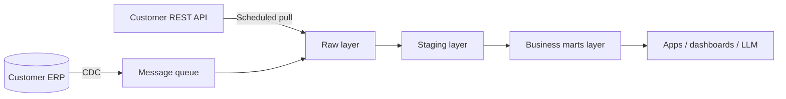

# Chapter 1 Systems Integration and Data Engineering

> 🌐 [中文](01-integration-and-data.md)

> [🏠 Back to home](../README.en.md)

## Learning Objectives
- Master integration patterns (point-to-point, batch ETL/ELT, event-driven, CDC) and their trade-offs
- Be able to design data pipelines that are idempotent, retryable, and observable
- Be able to profile, clean, and model customer data with SQL

## 1.1 Core Concepts
- **Integration**: making two or more independent systems exchange data or trigger behavior reliably.
- **ETL / ELT**: extract-transform-load / extract-load-transform; ELT runs the transformation inside the data warehouse, which makes auditing and re-running easier.
- **CDC (Change Data Capture)**: reading database logs (such as the PostgreSQL WAL or the MySQL binlog) to synchronize changes incrementally.
- **Idempotency**: performing an operation once gives the same result as performing it many times. In distributed systems "at-least-once" delivery is the norm, so idempotency is the foundation of correctness.
- **Data Contract**: an explicit agreement between producer and consumer about schema, semantics, and freshness.

## 1.2 Principles: Why Integration Is Hard
1. **The network is unreliable**: a timeout is not a failure; the request may have succeeded. → You need idempotency keys and retries.
2. **Schema drift**: fields in customer systems can change at any time. → You need schema validation and alerts.
3. **Semantic inconsistency**: fields with the same name mean different things ("customer" is defined differently in the CRM and the ERP). → You need a business glossary.
4. **Time and ordering**: out-of-order events, time zones, daylight saving time. → Standardize on UTC, and use event time rather than processing time.



## 1.3 API Integration Essentials
- Authentication: API keys, OAuth 2.0 (authorization code / client credentials), mTLS
- Pagination: offset vs. cursor; prefer cursors to avoid missing records when data changes
- Rate limiting: honor 429 and `Retry-After`; exponential backoff + jitter
- Webhooks: verify signatures, return 2xx quickly, process asynchronously, deduplicate by event ID

### Example: Pulling Data with Backoff and Idempotency (Python)
```python
import time, random, requests
def get_with_retry(url, headers, max_tries=5):
    for i in range(max_tries):
        r = requests.get(url, headers=headers, timeout=30)
        if r.status_code == 429 or r.status_code >= 500:
            wait = float(r.headers.get("Retry-After", 2 ** i)) + random.random()
            time.sleep(wait); continue
        r.raise_for_status(); return r.json()
    raise RuntimeError("exhausted retries")

# Writes use upsert keyed on the source-system ID → re-runs create no duplicates
UPSERT = """INSERT INTO raw.orders(id, payload, updated_at)
VALUES (%s, %s, %s)
ON CONFLICT (id) DO UPDATE SET payload=EXCLUDED.payload, updated_at=EXCLUDED.updated_at
WHERE raw.orders.updated_at < EXCLUDED.updated_at;"""
```

## 1.4 Data Profiling and SQL
The "first-hour checklist" once you get customer data: row counts, primary-key uniqueness, null rates, value distributions, time range, orphaned foreign keys.
```sql
-- Primary-key uniqueness
SELECT id, COUNT(*) FROM orders GROUP BY id HAVING COUNT(*) > 1;
-- Orphaned foreign keys
SELECT COUNT(*) FROM orders o LEFT JOIN customers c ON o.customer_id=c.id WHERE c.id IS NULL;
-- Latest record per customer (window function)
SELECT * FROM (
  SELECT *, ROW_NUMBER() OVER (PARTITION BY customer_id ORDER BY updated_at DESC) rn FROM orders
) t WHERE rn = 1;
```
**Modeling**: dimensional modeling (fact tables + dimension tables); slowly changing dimensions of SCD Type 2 keep history with `valid_from/valid_to`.

## 1.5 Observable Data Pipelines
For every job, record: input rows, output rows, rejected rows, duration, and data freshness. Set assertions (for example dbt tests: unique, not_null, relationships).

## Case Study
A customer exports a CSV to SFTP every day. The first version of the script overwrote the target table directly, and one day a half-uploaded file cut the report's data in half. Improvement: write to a staging table first → check the row-count fluctuation (±30% relative to the mean of the previous 7 days) → swap atomically; on failure, alert and keep the old data. **Lesson**: first make sure it "can't be wrong", then make it "fast".

## Exercises
1. Design a service that receives orders via webhook, and explain how it handles duplicates, out-of-order events, and downstream outages.
   *Reference answer: a deduplication table keyed on event_id; "last write wins" comparison using the source updated_at; persist to a queue/table before ACKing; retries + a dead-letter queue when downstream is down.*
2. Write SQL to find stores with no orders for 3 consecutive days. *Hint: calendar table LEFT JOIN + window functions, or gaps-and-islands.*
3. Compare CDC with scheduled full pulls in terms of latency, load on the source database, and implementation complexity.

## Summary
The essence of integration is building reliable data flows in an unreliable environment: idempotency, retries, validation, observability.

## Key Terms
ETL/ELT, CDC, idempotency, data contract, SCD, dead-letter queue, cursor pagination

## Further Reading
- Martin Kleppmann, *Designing Data-Intensive Applications* — https://dataintensive.net/

---

[🏠 Back to home](../README.en.md)
