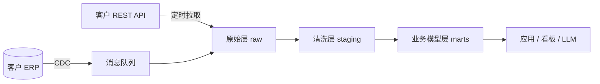

# 第 1 章 系统集成与数据工程

> [🏠 返回主页](../README.md)

## 学习目标
- 掌握集成模式(点对点、批处理 ETL/ELT、事件驱动、CDC)及其取舍
- 能设计幂等、可重试、可观测的数据管线
- 能用 SQL 完成客户数据的探查、清洗与建模

## 1.1 核心概念
- **集成(Integration)**:让两个或以上独立系统可靠交换数据或触发行为。
- **ETL / ELT**:抽取-转换-加载 / 抽取-加载-转换;ELT 把转换放到数仓内执行,便于审计与重跑。
- **CDC(变更数据捕获)**:读取数据库日志(如 PostgreSQL WAL、MySQL binlog)以增量同步变更。
- **幂等性(Idempotency)**:同一操作执行一次与多次结果相同。分布式系统中"至少一次"投递是常态,幂等是正确性的基础。
- **数据契约(Data Contract)**:生产者与消费者间关于模式、语义、时效的明确约定。

## 1.2 原理:为什么集成很难
1. **网络不可靠**:超时不等于失败,请求可能已成功。→ 需要幂等键与重试。
2. **模式漂移**:客户系统字段随时改变。→ 需要模式校验与告警。
3. **语义不一致**:同名字段含义不同("客户"在 CRM 与 ERP 中定义不同)。→ 需要业务词表。
4. **时间与顺序**:事件乱序、时区、夏令时。→ 统一 UTC、用事件时间而非处理时间。



## 1.3 API 集成要点
- 认证:API Key、OAuth 2.0(授权码 / 客户端凭证)、mTLS
- 分页:offset 与 cursor;优先 cursor,避免数据变动导致漏读
- 限流:遵守 429 与 `Retry-After`,指数退避 + 抖动
- Webhook:校验签名、快速返回 2xx、异步处理、按事件 ID 去重

### 实例:带退避与幂等的拉取(Python)
```python
import time, random, requests
def get_with_retry(url, headers, max_tries=5):
    for i in range(max_tries):
        r = requests.get(url, headers=headers, timeout=30)
        if r.status_code == 429 or r.status_code >= 500:
            wait = float(r.headers.get("Retry-After", 2 ** i)) + random.random()
            time.sleep(wait); continue
        r.raise_for_status(); return r.json()
    raise RuntimeError("exhausted retries")

# 写入使用 upsert,主键为源系统 ID → 重跑不产生重复
UPSERT = """INSERT INTO raw.orders(id, payload, updated_at)
VALUES (%s, %s, %s)
ON CONFLICT (id) DO UPDATE SET payload=EXCLUDED.payload, updated_at=EXCLUDED.updated_at
WHERE raw.orders.updated_at < EXCLUDED.updated_at;"""
```

## 1.4 数据探查与 SQL
拿到客户数据后的"第一小时清单":行数、主键唯一性、空值率、取值分布、时间范围、外键孤儿。
```sql
-- 主键唯一性
SELECT id, COUNT(*) FROM orders GROUP BY id HAVING COUNT(*) > 1;
-- 孤儿外键
SELECT COUNT(*) FROM orders o LEFT JOIN customers c ON o.customer_id=c.id WHERE c.id IS NULL;
-- 每个客户最新一条记录(窗口函数)
SELECT * FROM (
  SELECT *, ROW_NUMBER() OVER (PARTITION BY customer_id ORDER BY updated_at DESC) rn FROM orders
) t WHERE rn = 1;
```
**建模**:维度建模(事实表 + 维度表);缓慢变化维 SCD Type 2 用 `valid_from/valid_to` 保留历史。

## 1.5 可观测的数据管线
每个任务记录:输入行数、输出行数、拒绝行数、耗时、数据新鲜度。设置断言(如 dbt tests:unique、not_null、relationships)。

## 案例
客户每天导出 CSV 到 SFTP。初版脚本直接覆盖目标表,某天文件半截上传导致报表数据减半。改进:先写入临时表 → 校验行数波动(相对前 7 日均值 ±30%)→ 原子交换;失败则告警并保留旧数据。**教训**:先保证"不会错",再追求"快"。

## 练习
1. 设计一个从 Webhook 接收订单的服务,说明如何处理重复、乱序与下游宕机。
   *参考答案:按 event_id 去重表;以源 updated_at 做"后写胜出"比较;先持久化到队列/表再 ACK;下游宕机时重试 + 死信队列。*
2. 写 SQL 找出连续 3 天无订单的门店。*提示:日历表 LEFT JOIN + 窗口函数或 gaps-and-islands。*
3. 对比 CDC 与定时全量拉取在延迟、源库负载、实现复杂度上的取舍。

## 小结
集成的本质是在不可靠环境中构建可靠的数据流:幂等、重试、校验、可观测。

## 关键术语
ETL/ELT、CDC、幂等、数据契约、SCD、死信队列、Cursor 分页

## 延伸阅读
- Martin Kleppmann《Designing Data-Intensive Applications》— https://dataintensive.net/

---

[🏠 返回主页](../README.md)
