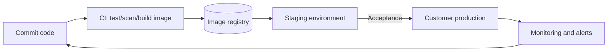

# Chapter 2 Deployment, Operations, and Security

> 🌐 [中文](02-deployment-and-security.md)

> [🏠 Back to home](../README.en.md)

> Prerequisite: [Preliminary Chapter: Linux Fundamentals](00-linux-basics.en.md). The containers, permissions, networking, and logging in this chapter all build on that chapter.

## Learning Objectives
- Be able to containerize an application and deploy it to the cloud or to a customer's private environment
- Understand the twelve-factor app, CI/CD, and the three pillars of observability
- Master the security and compliance requirements common among enterprise customers

## 2.1 Core Concepts
- **Twelve-factor app**: deployability principles such as storing config in environment variables, stateless processes, and explicitly declared dependencies.
- **Infrastructure as Code (IaC)**: managing resources with declarative code using tools such as Terraform, so changes are reviewable and reproducible.
- **Observability**: logs, metrics, and traces.
- **Principle of least privilege**: every principal gets only the minimum permissions it needs to do its job.

## 2.2 Deployment Models
| Model | Description | What the FDE watches |
|---|---|---|
| Multi-tenant SaaS | Runs in the vendor's cloud | Tenant isolation, data residency |
| Single-tenant dedicated cloud | Deployed separately for one customer | Upgrade process, cost |
| Customer VPC / on-premises | Runs in the customer's environment | Network ingress/egress, offline images, approval cycles |
| Air-gapped | No public internet | Offline artifact transfer, dependency pinning |



## 2.3 Example: A Minimal Deployable Unit
```dockerfile
FROM python:3.12-slim
WORKDIR /app
COPY requirements.txt . 
RUN pip install --no-cache-dir -r requirements.txt
COPY . .
USER 1000
CMD ["uvicorn", "app:app", "--host", "0.0.0.0", "--port", "8080"]
```
Key points: pin the base image version, run as non-root, provide a health-check endpoint `/healthz`, read config from environment variables, and emit structured JSON logs.

## 2.4 Operations
- Release strategies: rolling, blue-green, canary; always have a rollback ready
- SLO definitions: for example "99% of requests < 2s"; the error budget drives the release cadence
- Runbook: what each alert means, troubleshooting steps, escalation contacts, handed over to the customer's operations team

## 2.5 Security
- **Identity**: SSO (SAML/OIDC), RBAC, rotation of service-account keys
- **Data**: encryption in transit (TLS), encryption at rest, PII masking, data retention policies
- **Application**: OWASP Top 10 (injection, broken access control, and so on)
- **Supply chain**: dependency scanning, SBOM, image signing
- **Compliance**: customers often ask about SOC 2, ISO 27001, GDPR, and similar; an FDE must be able to answer the architecture questions in security questionnaires, but compliance commitments should be confirmed by the company's security/legal team

### Threat Modeling (STRIDE)
Spoofing, Tampering, Repudiation, Information disclosure, Denial of service, Elevation of privilege: check each one against every data flow.

## Case Study
When deploying inside a customer's intranet, the image could not pull dependencies from the public internet. Solution: build an image containing all dependencies in CI, export it as a tar, and import it into the customer's private registry through their approval channel; pin every version and attach an SBOM. **Lesson**: before the first deployment, use an "environment survey" to confirm the network, certificates, proxies, operating system, and permissions.

## Exercises
1. Write a STRIDE threat list for an LLM Q&A service. *Scoring: covers at least prompt injection (tampering), cross-tenant data leakage, API key leakage, and cost attacks through abuse.*
2. Write a pre-deployment environment survey (≥10 items).
3. Define 2 SLOs for this service and the corresponding alerts.

## Summary
Deployable, observable, reversible, least privilege: these are the foundation of an enterprise customer's trust in you.

## Key Terms
Twelve-factor, IaC, SLO/error budget, canary release, RBAC, SBOM, STRIDE

## Further Reading
- The Twelve-Factor App — https://12factor.net/
- OWASP Top Ten — https://owasp.org/www-project-top-ten/

---

[🏠 Back to home](../README.en.md)
