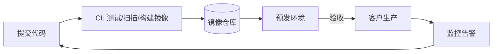

# 第 2 章 部署、运维与安全

> [🏠 返回主页](../README.md)

## 学习目标
- 能把应用容器化并部署到云或客户私有环境
- 理解十二要素应用、CI/CD、可观测性三支柱
- 掌握企业客户常见的安全与合规要求

## 2.1 核心概念
- **十二要素应用**:配置存环境变量、无状态进程、依赖显式声明等可部署性原则。
- **基础设施即代码(IaC)**:用 Terraform 等以声明式代码管理资源,可审查、可复现。
- **可观测性**:日志(Logs)、指标(Metrics)、追踪(Traces)。
- **最小权限原则**:每个主体只获得完成任务所需的最小权限。

## 2.2 部署形态
| 形态 | 说明 | FDE 关注点 |
|---|---|---|
| SaaS 多租户 | 供应商云上运行 | 租户隔离、数据驻留 |
| 单租户专有云 | 为客户独立部署 | 升级流程、成本 |
| 客户 VPC / 本地 | 运行在客户环境 | 网络出入口、离线镜像、审批周期 |
| 物理隔离(air-gapped) | 无公网 | 制品离线传输、依赖锁定 |



## 2.3 实例:最小可部署单元
```dockerfile
FROM python:3.12-slim
WORKDIR /app
COPY requirements.txt . 
RUN pip install --no-cache-dir -r requirements.txt
COPY . .
USER 1000
CMD ["uvicorn", "app:app", "--host", "0.0.0.0", "--port", "8080"]
```
要点:固定基础镜像版本、非 root 运行、健康检查端点 `/healthz`、配置来自环境变量、结构化 JSON 日志。

## 2.4 运维
- 发布策略:滚动、蓝绿、金丝雀;始终准备回滚
- SLO 定义:如"99% 请求 < 2s";错误预算驱动发布节奏
- Runbook:告警含义、排查步骤、升级联系人——交付给客户运维团队

## 2.5 安全
- **身份**:SSO(SAML/OIDC)、RBAC、服务账号密钥轮换
- **数据**:传输加密(TLS)、静态加密、PII 脱敏、数据保留策略
- **应用**:OWASP Top 10(注入、访问控制失效等)
- **供应链**:依赖扫描、SBOM、镜像签名
- **合规**:客户常问 SOC 2、ISO 27001、GDPR 等;FDE 需能回答安全问卷中的架构问题,但合规承诺应由公司安全/法务确认

### 威胁建模(STRIDE)
仿冒、篡改、抵赖、信息泄露、拒绝服务、权限提升——对每条数据流逐项检查。

## 案例
在客户内网部署时,镜像无法拉取公网依赖。解决:在 CI 中构建包含全部依赖的镜像,导出为 tar,经客户审批通道导入其私有仓库;所有版本锁定并附 SBOM。**教训**:首次部署前用一张"环境调查表"确认网络、证书、代理、操作系统、权限。

## 练习
1. 为一个 LLM 问答服务写出 STRIDE 威胁清单。*评分:至少覆盖提示注入(篡改)、跨租户数据泄露、API 密钥泄露、滥用导致成本攻击。*
2. 编写一份部署前环境调查表(≥10 项)。
3. 定义该服务的 2 个 SLO 与相应告警。

## 小结
可部署、可观测、可回滚、最小权限——是企业客户信任你的基础。

## 关键术语
十二要素、IaC、SLO/错误预算、金丝雀发布、RBAC、SBOM、STRIDE

## 延伸阅读
- The Twelve-Factor App — https://12factor.net/
- OWASP Top Ten — https://owasp.org/www-project-top-ten/

---

[🏠 返回主页](../README.md)
