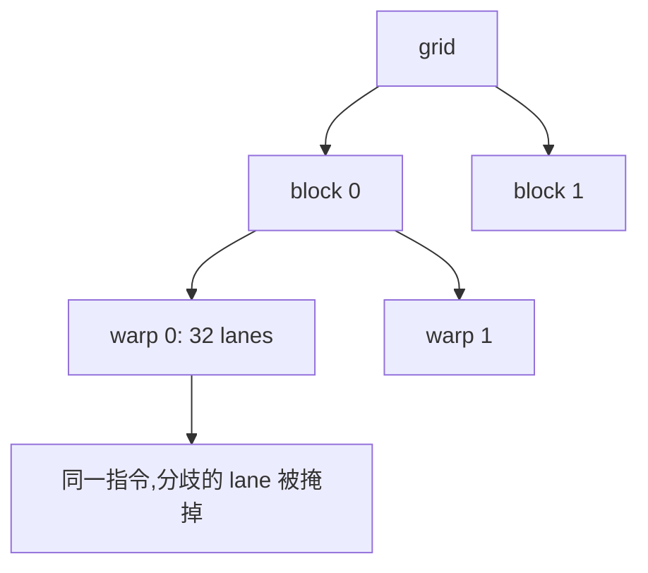

# 3.2.1 执行层次与 SIMT

> [🏠 返回主页](../../README.md) · [返回第 3 章](../README.md) · [返回 3.2](README.md) · [下一节](02-memory-coalescing.md)

## 先修

C 的函数和一维数组。不需要先会写内核。

## 学习目标

- 定义 kernel、grid、thread block、warp、lane
- 由 `blockIdx`、`threadIdx`、`blockDim`、`gridDim` 算出全局下标
- 说明 warp 内分支为什么会串行,以及这和 CPU SIMD 向量指令的差别

## 定义

**内核(kernel)**是在 GPU 上启动的函数。一次启动指定一个 **grid**。grid 由若干 **thread block** 组成,block 由线程组成。CUDA 编程指南把 block 内的线程再分成 32 个一组的 **warp**。一条 warp 里的线程编号 0–31 称为 **lane**。

NVIDIA 文档写明:当前设备的 warp 大小是 32,但程序仍应读取 `cudaDeviceProp.warpSize`,不要在可移植代码里把 32 写成永远不变的语义。本教程的归约和洗牌示例按 32 讲解,因为这是指南里的执行模型;换设备时以查询结果为准。

**SIMT**(Single-Instruction, Multiple-Threads)指一条 warp 在同一时刻发出同一条指令,但每个线程有自己的寄存器和指令地址,因此可以走不同分支。没走当前分支的 lane 被掩掉。**SIMD** 则通常把向量宽度暴露给软件,一条指令显式作用在固定宽度的通道上。指南强调了这个差别:SIMT 的分支行为是按线程描述的,硬件再在 warp 内处理分歧。

## 原理

一次启动并不保证 block 之间的执行顺序。调度器把还有资源的 block 放到流式多处理器(SM)上,某个 block 结束后再装入新的 block。因此:

- 同一 block 内可以用共享内存和 `__syncthreads()` 协作
- block 之间不能靠"谁先跑完"来传递数据;跨 block 的结果要写到全局内存,并在下一次内核启动(或网格级同步,那是另一项特性)之后才可见

全局下标的一维写法是:

$$
i = \mathrm{blockIdx.x}\cdot \mathrm{blockDim.x} + \mathrm{threadIdx.x}
$$

若 \(i\) 可能大于数组长度,内核必须做边界判断。当元素数大于 grid 的线程数时,用 **grid-stride loop**:

$$
i,\; i+s,\; i+2s,\; \ldots \quad s = \mathrm{gridDim.x}\cdot\mathrm{blockDim.x}
$$

这样启动配置可以按 SM 数量来选,而不是按数组长度起一个巨大的 grid。[vector_add.cu](examples/vector_add.cu) 使用了这种循环。

### Warp 分歧

考虑 `if (i % 2 == 0) A(); else B();`。同一 warp 里偶数 lane 和奇数 lane 各走一边。硬件先执行一边并掩掉另一边,再反过来。两边的指令都会发出,warp 的吞吐按更长的路径下降。不同 warp 之间互不影响:一个 warp 全走 `A`、另一个全走 `B`,没有分歧。

这只影响性能,不影响正确性,除非有人把 `__syncthreads()` 放进只有部分线程能到达的分支里。那是第 3.2.3 节的正确性问题。



## 实例

向量加法的标量核,每个线程处理若干相距 \(s\) 的元素:

```cuda
__global__ void add_scalar(const float* a, const float* b, float* c, int n) {
  int stride = blockDim.x * gridDim.x;
  for (int i = blockIdx.x * blockDim.x + threadIdx.x; i < n; i += stride)
    c[i] = a[i] + b[i];
}
```

`float4` 版本让每个线程一次处理 4 个连续 `float`。它没有改变每个输出元素"一次加法、两次读、一次写"的算术强度,只是减少了指令条数。前提是 `n` 为 4 的倍数,且指针按 16 字节对齐;`cudaMalloc` 满足对齐。这两点都写在示例里,主机端用同一组可精确表示的输入做逐元素比较。

## 计时必须同步

内核启动是异步的。CPU 上的 `clock()` 在 `<<<>>>` 返回后几乎立刻结束,量到的不是 GPU 时间。正确的教学写法是:

1. 先启动若干次并 `cudaDeviceSynchronize()`,作为 **warmup**,避开上下文初始化和懒加载
2. 用 `cudaEventRecord` 在同一条流上包住正式迭代
3. `cudaEventSynchronize` 之后再 `cudaEventElapsedTime`
4. 每次启动后用 `cudaGetLastError` 检查启动错误;只检查 `cudaMalloc` 的返回值会漏掉非法的启动配置

[common.cuh](examples/common.cuh) 把检查和事件计时收成宏。示例打印设备名称、计算能力、SM 数、每块最大线程数、每 SM 寄存器和共享内存。这些是**本次查询**的上限。

## 排障

| 现象 | 常见原因 |
|---|---|
| 结果前半段对、后半段是 0 | 没做边界判断,或 grid 太小又没有 stride 循环 |
| CPU 计时接近 0 | 没有同步,量到的是启动开销 |
| 第一次迭代特别慢 | 把懒加载算进了正式计时,缺少 warmup |
| `invalid configuration argument` | `blockDim` 超过 `maxThreadsPerBlock`,或共享内存超过该块上限 |

## 练习

1. `n = 1000`,`blockDim = 256`,不用 stride 循环。至少要几个 block 才能覆盖全部元素?最后一个 block 有多少线程的 `i` 越界?
2. 为什么"把分支写成按 warp 对齐"能减少分歧?举一个仍然必须分歧的例子。
3. `float4` 路径为什么不提高屋顶线给出的算术强度上界?

### 参考解答

1. 需要 \(\lceil 1000/256\rceil = 4\) 个 block。前 3 个 block 覆盖 768 个元素,最后一个 block 只有下标 768–999 共 232 个线程的 `i < n`,其余 24 个线程必须被 `if` 挡住,不能写内存。
2. 一个 warp 的 32 个 lane 若对同一条件取值相同,硬件只走一条路径。例如按 `warp_id` 而不是按 `lane` 分支。数据相关的条件(每个元素的符号不同)无法通过对齐消除,这时应接受分歧,或改写算法让一个 warp 处理同质数据。
3. 每个 `float` 仍然是一次加法和 12 字节约的读写(2 次读 + 1 次写,各 4 字节)。`float4` 把 4 次标量访存合成更少的指令,算术强度 \(\mathrm{FLOP}/\mathrm{byte}\) 不变。它可能减少指令开销,但这不是屋顶线公式里的峰值变化。

## 小结

先把下标和启动配置写对,再谈优化。warp 是调度单位;block 是协作单位;grid 没有顺序。计时之前要同步、预热,并打印设备上限。

## 关键术语

kernel、grid、thread block、warp、lane、SIMT、grid-stride loop、warmup

## 延伸阅读

- 编程模型 — https://docs.nvidia.com/cuda/cuda-programming-guide/01-introduction/programming-model.html
- SIMT 执行模型 — https://docs.nvidia.com/cuda/cuda-programming-guide/03-advanced/advanced-kernel-programming.html
- 事件计时 API — https://docs.nvidia.com/cuda/cuda-runtime-api/group__CUDART__EVENT.html

---

[🏠 返回主页](../../README.md)
