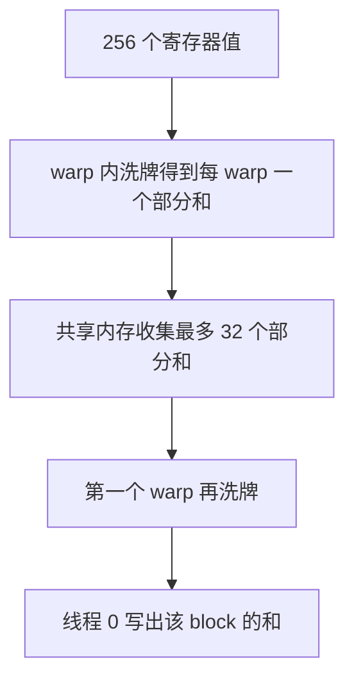

# 3.2.3 同步、竞争与归约

> [🏠 返回主页](../../README.md) · [返回第 3 章](../README.md) · [返回 3.2](README.md) · [上一节](02-memory-coalescing.md) · [下一节](04-tiled-matmul.md)

## 先修

[3.2.1](01-execution-simt.md) 和 [3.2.2](02-memory-coalescing.md)。需要能读一段 20 行的 CUDA。

## 学习目标

- 定义数据竞争,并说明 `__syncthreads()` 能保证什么、不能保证什么
- 实现块内求和的三种写法,并知道它们为什么应该得到同一个和
- 把多块部分和收成一个标量,同时记住浮点加法不满足结合律

## 定义

**数据竞争**:两个线程访问同一地址,至少一方写入,且这两次访问之间没有发生同步,使它们排序。结果是未定义的。

`__syncthreads()` 等待**同一个 block 里的所有线程**都到达该调用,并保证该调用之前的共享内存和全局内存写入,对此后读取的线程可见。它不等其他 block。如果有的线程因分支到不了这次调用,行为是未定义的;不要把屏障放进 `if (threadIdx.x < 16)` 这种只有部分线程进入的语句里。

**原子操作**给单个地址提供读改写的原子性,例如多个 block 同时对一个计数器做 `atomicAdd`。原子性不是顺序一致性的全部故事,但足够实现"许多线程累加到一个地址"。

**洗牌(shuffle)** 用 `__shfl_down_sync(mask, value, offset)` 在 warp 内直接交换寄存器。参与的 lane 必须都执行这条指令,`mask` 里置位的线程要一致。它不经过共享内存。

## 原理:树形归约

块内 256 个线程各持有一个数,要求和。每一步把一对值合成一个,步数是 \(\log_2 256 = 8\),而不是 255 次串行相加。

发散写法在第 \(s\) 步让满足 \(t \bmod 2s = 0\) 的线程执行 `s[t] += s[t+s]`。同一步内,目标和源下标不相交,所以并行读旧值是安全的,但大量线程在 `if` 里被掩掉,而且步长很小时只有少数线程在干活。

顺序寻址从 `stride = blockDim/2` 减半,由线程 `0 .. stride-1` 执行 `s[t] += s[t+stride]`。仍然每步都要 `__syncthreads()`,否则下一步会读到还没写完的共享内存。活跃线程是连续的一段,分歧比取模写法少。

当 stride 降到 32 以下,一个 warp 里的线程已经隐式同步,可以用洗牌完成最后一步,少几次共享内存往返和屏障。前提是这 32 个线程全都进入洗牌。



多块时,每个 block 写出一个部分和。再把部分和数组当作新的输入,重复同一个内核,直到只剩一个数。[reduction.cu](examples/reduction.cu) 就是这样做的。也可以把最后一小段部分和拷回主机相加;那仍然正确,只是最后一程没有占用 GPU。

### 浮点

整数 1 的和在不超过 \(2^{24}\) 时,float32 可以精确表示每一次整数加法。示例用 \(n = 25600\) 个 1,三种内核都必须得到 25600。一般数据的浮点树形和与 CPU 从左到右的和不必逐位相等,因为加法不满足结合律。比较时要先约定容差,或改用能够精确比较的输入。不要把"差了 1e-4"自动说成竞争。

### 一个真正的竞争

下面的片段在同一步里没有屏障。线程 0 可能读到线程 1 还没写入的 `s[1]`,也可能读到旧值:

```cuda
s[threadIdx.x] = v;
if (threadIdx.x == 0) s[0] += s[1];  // 错误:缺少 __syncthreads
```

补上屏障之后,读到的是本块全部线程写入之后的值。屏障仍然不使其他块的写入可见。

## 实例

Python 参考按"同一步先读旧值再写"模拟这三种索引,[reference_kernels.py](py/reference_kernels.py):

- 8 个 1 的发散归约与顺序归约都得到 8
- 32 个 1 的洗牌归约得到 32,64 个 1 得到 64

GPU 程序在全 1 输入上做精确比较,并对单次部分归约计时。计时输出不是加速比结论:它没有固定时钟、没有报告缓存状态,也没有在多张卡上重复。

Mark Harris 的 NVIDIA 讲义把从发散寻址到洗牌的一系列改写讲得很细,适合作为本节的对照读物。那些幻灯片里的时间是他当时机器上的测量,不要抄到你的报告里。

## 排障

| 现象 | 原因 |
|---|---|
| 结果每次运行都变 | 共享内存读写缺少屏障,或全局地址上的非原子读改写 |
| 程序挂起 | 屏障不在所有线程的路径上,或 block 内线程提前 `return` 跳过了屏障 |
| 洗牌结果只在 lane 0 正确、其他 lane 是垃圾 | 只有部分 lane 执行了 `__shfl_down_sync`,mask 与实际执行不一致 |
| 和 CPU 顺序和差一个很小的相对误差 | 先检查是不是结合律。用全 1 或整数再比一次 |
| 多块归约少加了一截 | 最后一截的长度不是块大小的倍数,却没有把越界线程填成 0 |

## 练习

1. 块大小 8,初始共享内存是 `1,1,1,1,1,1,1,1`。按发散归约写出 stride = 1 之后的数组。
2. 为什么顺序寻址的循环条件是 `stride > 0`,并且块大小必须是 2 的幂才和参考实现一致?
3. 三个 block 各自得到部分和 10、20、30。若不用第二次内核,怎样得到总和?这样做好在哪里,差在哪里?

### 参考解答

1. stride = 1 时,偶数下标加上右边一位:下标 0、2、4、6 分别变成 2,数组是 `2,1,2,1,2,1,2,1`。下一步 stride = 2,下标 0 加上下标 2,下标 4 加上下标 6,得到 `4,1,2,1,4,1,2,1`。再下一步得到 8。测试 `reduce_naive_block` 锁定了最终结果。
2. 每步 stride 减半,直到只剩一个有效元素。若块大小不是 2 的幂,减半会漏掉中间的一些下标,必须改用"向上补齐到 2 的幂并填 0"或改索引。示例把块大小固定为 256,并用 0 填充不足一块的尾部,因此每块内部仍是 2 的幂。
3. 在主机上计算 \(10+20+30=60\)。正确性没问题,数据量只有 3 个数,传输可以忽略。当部分和还有几百万个时,主机相加和回传会变成新的瓶颈,那时才值得再启动内核。选择取决于部分和的个数,而不是"GPU 上做永远更快"。

## 小结

归约的正确性是"每一步的读写集合不相交,步与步之间有屏障"。性能上的差别是分歧、屏障次数和是否还要走共享内存。浮点比较要尊重结合律。跨块的和需要另一次归约或原子操作,屏障帮不上忙。

## 关键术语

数据竞争、`__syncthreads`、原子操作、洗牌、树形归约、结合律

## 延伸阅读

- 进阶内核编程中的同步 — https://docs.nvidia.com/cuda/cuda-programming-guide/03-advanced/advanced-kernel-programming.html
- Mark Harris, Optimizing Parallel Reduction in CUDA — https://developer.download.nvidia.com/assets/cuda/files/reduction.pdf

---

[🏠 返回主页](../../README.md)
