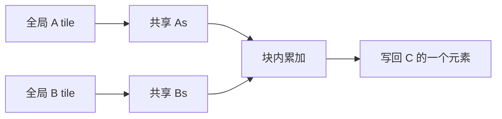

# 3.2.4 分块矩阵乘

> [🏠 返回主页](../../README.md) · [返回第 3 章](../README.md) · [返回 3.2](README.md) · [上一节](03-sync-reduction.md) · [下一节](05-occupancy-roofline.md)

## 先修

[3.2.2](02-memory-coalescing.md) 的合并访问和 bank 填充,[3.2.3](03-sync-reduction.md) 的屏障。矩阵按行主序存储:\(A\) 是 \(M\times K\),\(B\) 是 \(K\times N\),\(C\) 是 \(M\times N\)。

## 学习目标

- 写出朴素矩阵乘的全局下标
- 推导分块后每个输出 tile 的全局流量和算术强度
- 在不能整除的边上用 0 填充,使边界结果与三重循环一致

## 定义

朴素内核让线程 \((r,c)\) 计算

$$
C_{rc} = \sum_{k=0}^{K-1} A_{rk} B_{kc}
$$

每个乘加是 2 个浮点操作,所以总 FLOP 数是 \(2MNK\)。这是算法的操作数,不是芯片的吞吐。

**分块(tiled)**内核中,一个 block 负责 \(C\) 的 \(\mathrm{TILE}\times\mathrm{TILE}\) 子块。把 \(K\) 维切成若干段。每一段把 \(A\) 的 \(\mathrm{TILE}\times\mathrm{TILE}\) 和 \(B\) 的 \(\mathrm{TILE}\times\mathrm{TILE}\) 载入共享内存,块内所有线程复用它们,然后屏障,再做这段的乘加,再屏障,才能载入下一段。第二次屏障是必须的:否则有的线程还在读旧 tile,另一些线程已经开始覆盖它。

## 原理:流量

先看没有复用的下界。计算一个 \(C_{rc}\) 要读 \(K\) 个 \(A\) 和 \(K\) 个 \(B\)。float32 下字节数是 \(8K\),FLOP 数是 \(2K\),算术强度

$$
\frac{2K}{8K} = 0.25\ \mathrm{FLOP/byte}
$$

这是"每次从全局内存重新读"的账,不是缓存已经帮你复用之后的账。

再看一块 \(\mathrm{TILE}\times\mathrm{TILE}\) 的输出,覆盖整个 \(K\)。FLOP 数是 \(2\cdot\mathrm{TILE}^2\cdot K\)。每一段从全局载入两块 tile,共 \(2\cdot\mathrm{TILE}^2\) 个元素、\(8\cdot\mathrm{TILE}^2\) 字节,段数是 \(K/\mathrm{TILE}\)(先假设整除)。全局读流量是

$$
\frac{K}{\mathrm{TILE}}\cdot 8\cdot\mathrm{TILE}^2 = 8\cdot\mathrm{TILE}\cdot K
$$

算术强度

$$
\frac{2\cdot\mathrm{TILE}^2\cdot K}{8\cdot\mathrm{TILE}\cdot K} = \frac{\mathrm{TILE}}{4}\ \mathrm{FLOP/byte}
$$

\(\mathrm{TILE}=16\) 时是 4 FLOP/byte,是上面那条无复用下界的 16 倍。\(C\) 的最终写回是 \(\mathrm{TILE}^2\) 个 float,当 \(K\) 较大时相对较小,上面把它略去了;要严格就把写回字节加进分母。

这个 16 倍是**流量模型的比值**,不是实测加速比。缓存、占用率、bank 冲突和启动开销都会改变墙上时间。模型只说明:分块改变的是全局字节数,方向是对的。

### 边界

\(M,N,K\) 不是 tile 的倍数时,越界的 \(A\) 或 \(B\) 元素按 0 装入共享内存,越界的 \(C\) 不写。0 不改变和。因此 \(18\times 19\) 乘 \(19\times 20\)、tile 为 16 的结果必须和三重循环一致。[reference_kernels.py](py/reference_kernels.py) 的 `matmul_tiled_sim` 按线程下标模拟了这一规则,测试覆盖了这个不能整除的形状。

共享内存声明为 `[TILE][TILE+1]`。计算时按列读 `As[ty][k]` 与按行读 `Bs[k][tx]` 的 bank 行为不同;填充的是第 3.2.2 节那一列,避免行距成为 32 的倍数。\(\mathrm{TILE}=16\) 时行距 16 本身不一定打满 32 个冲突,填充仍然是同一条地址规则,而不是只对 32 才合法。



## 实例

[matmul_tiled.cu](examples/matmul_tiled.cu) 在 GPU 上做两件事:

- \(18\times 20\times 19\) 与 \(64\times 64\times 64\),元素取小整数,朴素核、分块核和主机三重循环逐位比较
- 对 \(64^3\) 做预热后的事件计时,并在输出里写明这不是加速比结论

小整数的乘积和不超过 float32 的精确整数范围,所以这里用相等而不是容差。换上任意浮点矩阵时,应先定容差再比较。

CPU 侧不需要 nvcc:

```bash
python3 02-ai-llm/02-cuda/tests/test_cuda_models.py
```

## 排障

| 现象 | 原因 |
|---|---|
| 边缘元素是错的,中间是对的 | 越界没有补 0,读到了别的行;或越界仍然写了 \(C\) |
| 整除的尺寸正确,不能整除就错 | 只测了 64 的倍数。把 18、19、20 加进测试 |
| 结果偶发大面积错误 | 两段 tile 之间少了第二次 `__syncthreads()` |
| 分块后更慢 | tile 太小,复用不够;或填充没做,bank 冲突吃掉了流量收益。先用模型算流量,再上性能计数器 |
| 共享内存启动失败 | `TILE*TILE*2*sizeof(float)` 加上填充后超过该设备每个 block 的共享内存上限 |

## 练习

1. \(\mathrm{TILE}=32\),\(K\) 整除 32,忽略 \(C\) 的写回。分块后的算术强度是多少?它是无复用下界的几倍?
2. 为什么载入 tile 之后、开始乘加之前要有一次屏障,乘加之后、载入下一段之前还要有一次?
3. 一个 block 有 \(16\times 16=256\) 个线程,tile 也是 \(16\times 16\)。线程 \((ty,tx)\) 应装入 `As[ty][tx]` 的哪个全局元素? \(K\) 方向的段号是 \(t\) 时写出行和列。

### 参考解答

1. 强度是 \(32/4 = 8\) FLOP/byte。无复用下界是 0.25,比值是 \(8/0.25 = 32\),也就是 tile 边长。流量公式里强度与 \(\mathrm{TILE}\) 成正比,和 \(K\) 在整除时相消。
2. 第一次屏障保证所有线程都把本段 tile 写完,别人才能读。第二次保证所有线程都读完本段,才能用下一段覆盖共享内存。少任何一次都是竞争。
3. 行是 \(\mathrm{blockIdx.y}\cdot 16 + ty\),列是 \(t\cdot 16 + tx\)。列越界或行越界时装入 0。这就是 `matmul_tiled` 和 `matmul_tiled_sim` 的索引。

## 小结

分块矩阵乘把 \(K\) 维的复用从"每次重读"变成"每段读一次、块内用 TILE 次"。强度公式给出 \(\mathrm{TILE}/4\) FLOP/byte 的流量账。正确性靠补零、两次屏障和与三重循环对拍,包括不能整除的边。

## 关键术语

行主序、tile、复用、算术强度、补零、两次屏障

## 延伸阅读

- Best Practices 中的共享内存矩阵乘讨论 — https://docs.nvidia.com/cuda/cuda-c-best-practices-guide/contents.html
- 编程指南中的共享内存 — https://docs.nvidia.com/cuda/cuda-programming-guide/02-basics/writing-cuda-kernels.html

---

[🏠 返回主页](../../README.md)
