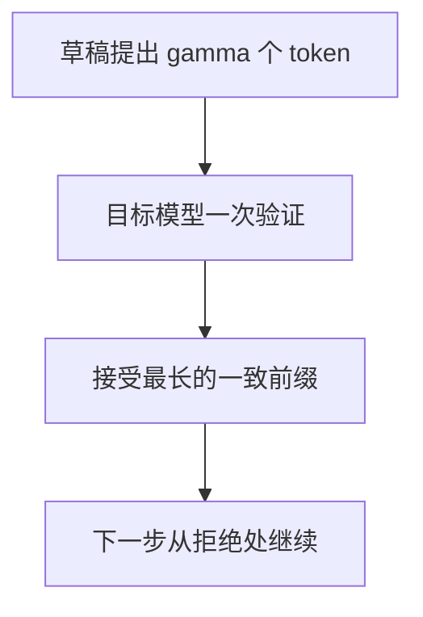

# 3.5.2 组批、量化与投机解码

> [🏠 返回主页](../../README.md) · [返回第 3 章](../README.md) · [返回 3.5](README.md) · [上一节](01-prefill-decode-kv.md) · [下一节](03-serving-profiling-loadtest.md)

## 先修

[3.5.1](01-prefill-decode-kv.md) 的 KV 和 TTFT。排队论只需要"工人一次做一步"这种离散事件。

## 学习目标

- 比较静态组批和迭代级组批各自浪费在哪里
- 把权重量化、KV 量化分成两笔字节和一次必须单独做的质量评测
- 使用投机解码的期望 token 公式,而不把它写成墙钟加速比

## 定义

**静态组批**:凑满一组请求再一起预填,并通常等到组内最长的序列结束。短请求在组内空转。

**连续组批 / 迭代级调度**:每个解码步重新决定这一步包含哪些请求。一个请求结束,空位可以立刻给已经到达的新请求。Orca(Yu 等人,OSDI 2022)把调度做到迭代级别,而不是请求级别。vLLM 后来的调度还能在同一步里混合预填块和解码;那是实现演进,不是 Orca 论文的全部内容。

**分页 KV**:Kwon 等人的 PagedAttention 把 KV 切成块,用块表做逻辑块到物理块的映射,避免按最大长度连续预留。vLLM 文档里有一份早期内核布局说明,页面自己标明它是历史材料,不再描述当前代码。学习机制时读论文;对接当前进程时读你安装的那一版文档和代码。前缀缓存是在块上做的进一步共享,见 vLLM 的 prefix caching 设计笔记。

**投机解码**:小模型或草稿规则先提出 \(\gamma\) 个 token,目标模型一次前向验证能接受的前缀。Leviathan、Kalman 和 Matias 在"每个草稿 token 以恒定概率 \(\alpha\) 被接受"的模型下,给出目标模型每次前向期望产生的 token 数

$$
\frac{1-\alpha^{\gamma+1}}{1-\alpha}
$$

\(\alpha=1\) 时极限是 \(\gamma+1\);\(\alpha=0\) 时是 1。Chen 等人的 speculative sampling 讨论了同一思想的另一种表述。期望 token 数不是加速比,因为草稿也要时间。

## 原理:一个故意写简单的排队模型

[loadsim.py](py/loadsim.py) 有三种策略,时间参数全由调用方给定。它**不是** vLLM,也没有 GPU。

- `serial`:一次一个请求。预填产生第一个 token,之后每个剩余 token 花费 `decode_step`。
- `static`:按到达顺序分组。组必须全员到达才开始。组内预填串行,然后按组内最大剩余 token 数解码。短请求等到整组结束才返回。
- `continuous`:有空位且已到达就准入。新请求的预填**独占**工人,期间其他活动请求等待。这是悲观假设,用来演示"预填堵住解码"时,连续组批不一定帮助队首。真实系统用分块预填避免这一点;模拟器没有把分块预填说成已实现的优化。

手算,`decode_step = 4`,预填都是 10,输出 token 都是 2(含第一个):

| 请求 | 到达 |
|---|---|
| A | 0 |
| B | 5 |

串行:A 在 0 开始,14 结束,延迟 14,TTFT 10。B 在 14 开始,28 结束,延迟 23,TTFT 19。

静态、组大小 2:组在时刻 5 才能开始。A 的预填在 15 结束,B 的预填在 25 结束,再解码一步到 29。A 延迟 29、TTFT 15;B 延迟 24、TTFT 20。A 比串行更差,因为它等了 B 到达,又等了组内对齐。

阻塞式连续、最大批 2:时刻 0 预填 A 到 10,此刻 B 已到达,接着独占预填 B 到 20,然后一步解码到 24,两人同时结束。A 延迟 24、TTFT 10;B 延迟 19、TTFT 15。A 仍比纯串行差,B 比串行好。结论只能是:**在这个预填独占的模型里,连续组批不是对所有请求的改进**。它不能外推成"连续组批在生产上慢"或"快"。测试把这三个延迟向量都锁定了。

把 B 的输出 token 改成 4,静态组会解码 \(\max(1,3)=3\) 步。A 即使只需要 1 步解码,也要等到时刻 37 才返回。这就是短请求被长请求拖住的账。

## 量化

权重量化减少解码时读取权重的字节。KV 量化减少缓存字节。激活量化更难,因为动态范围随 token 变。无论哪一种,任务质量都要在封存的集合上重新测:精确匹配、引用忠实度、拒答。比特宽度不是质量。

第 3.3 节的均匀网格只说明步长。服务端的 NF4、FP8 或 INT8 内核还有尺度、离群通道和是否有对应硬件指令。没有在目标 GPU 上跑过的内核,就不能写吞吐。

## 投机解码的模型化比值

设每个草稿 token 花费 \(t_d\),一次目标验证花费 \(t_t\),两者都是输入。一步时间是 \(\gamma t_d + t_t\)。相对"每次目标前向只产生 1 个 token"的比值是

$$
\frac{\mathbb{E}[\mathrm{tokens}]\cdot t_t}{\gamma t_d + t_t}
$$

\(\alpha=1,\gamma=3,t_d=1,t_t=4\) 时,期望 token 是 4,比值是 \(16/7\)。草稿并不免费:若 \(t_d\) 接近 \(t_t\),比值可以小于 1。这个小于 1 是公式的输出,不是一次失败的实验。vLLM 的投机解码文档按方法列出了草稿模型、n-gram 等选项,并讨论低 QPS 与高 QPS 下的不同侧重;页面上的"高收益/中等收益"是文档对方法类别的定性描述,不是你的流量上的测量。

## 排障

| 现象 | 读法 |
|---|---|
| 连续组批的队首延迟变差 | 先看预填是否堵住了解码。用分块预填的系统才能拿来和这个悲观模型对比 |
| 短请求的延迟等于长请求 | 静态组批的收尾对齐。看模拟器里的 straggler 用例 |
| 量化后显存降了,忠实度没人测 | 字节账和质量门是两项发布条件 |
| 投机解码的期望 token 很高但 QPS 没有上升 | 期望 token 不含草稿成本,也不含高负载下验证批次变大后的排队 |
| 照着历史版 PagedAttention 笔记改当前 vLLM | 那份笔记写明了自己是历史材料 |

## 练习

1. 沿用 A/B 的到达和预填。`decode_step=4`,输出 token 都是 1(只有预填,没有解码步)。串行时 B 的延迟是多少?
2. \(\alpha=0.5,\gamma=1\)。期望 token 数是多少?若 \(t_d=t_t\),模型化比值是大于 1 还是小于 1?
3. 分页块大小从 16 改成 64,逻辑 KV 字节变不变?末块浪费在 \(S=4096\) 时变不变?

### 参考解答

1. A 的服务时间就是预填 10,时刻 10 结束。B 在 10 开始,预填 10,时刻 20 结束,延迟 \(20-5=15\),TTFT 也是 15。没有解码步时,组批的"对齐到最长解码"不会出现,但 B 仍要等 A 的预填。
2. \((1-0.5^{2})/(1-0.5) = 0.75/0.5 = 1.5\)。\(t_d=t_t\) 时一步时间是 \(2t_t\),比值是 \(1.5\times t_t / 2t_t = 0.75\),小于 1。接受率不够高、草稿又不比目标便宜时,公式不支持启用投机解码。
3. 逻辑字节只依赖层、头、维、长度和精度,不变。4096 能被 16 和 64 整除,末块浪费都是 0。换成 4097 时,块越大浪费的槽越多。块大小是空洞和内核效率的折中,不是逻辑容量公式的一项。

## 小结

静态组批浪费在短请求等待长请求。迭代级调度浪费更少,但预填若独占工人,队首仍可能变慢。量化省字节,投机解码用期望 token 换验证方式,两者都要单独过质量门。模拟器的延迟是手算,用来练指标,不能出现在性能声明里。

## 关键术语

静态组批、连续组批、分块预填、分页、前缀缓存、接受概率、草稿成本

## 延伸阅读

- Orca — https://www.usenix.org/system/files/osdi22-yu.pdf
- PagedAttention — https://arxiv.org/abs/2309.06180
- vLLM 分页笔记(历史材料,以页面警告为准) — https://docs.vllm.ai/en/stable/design/paged_attention/
- vLLM 前缀缓存 — https://docs.vllm.ai/en/stable/design/prefix_caching/
- 投机解码 — https://arxiv.org/abs/2211.17192
- Speculative sampling — https://arxiv.org/abs/2302.01318
- vLLM 投机解码选项 — https://docs.vllm.ai/en/latest/features/speculative_decoding/

---

[🏠 返回主页](../../README.md)
