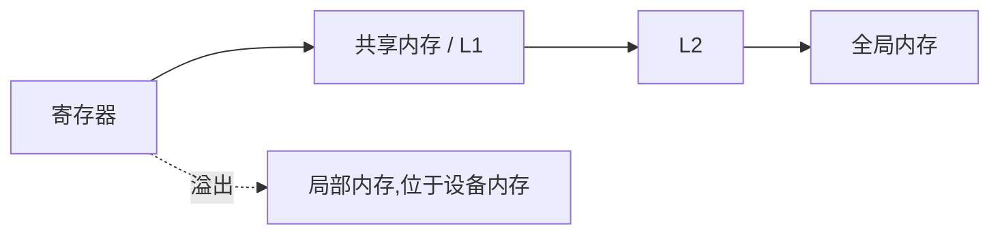

# 8.2 内存层次与合并访问

> [🏠 返回主页](../../README.md) · [返回本章](README.md)

## 先修

[8.1](01-execution-simt.md) 的 warp。知道字节地址即可,不需要先学缓存一致性协议。

## 学习目标

- 按作用域列出寄存器、局部内存、共享内存、全局内存
- 用 32 字节事务模型计算一个 warp 的全局加载
- 用 32 个 bank 判断共享内存读是广播还是冲突,并说明列填充为什么有效

## 定义

编程指南按作用域区分存储:

| 空间 | 谁能看见 | 寿命 | 备注 |
|---|---|---|---|
| 寄存器 | 单个线程 | 线程 | 最快。不够时编译器把变量溢出到局部内存 |
| 局部内存 | 单个线程 | 线程 | 逻辑上私有,物理上在设备内存,延迟与全局内存同级 |
| 共享内存 | 一个 block | block | 在 SM 上,由程序员分配。和 L1 占用同一类片上资源 |
| 全局内存 | 整个 grid,以及主机 | 直到释放 | 内核之间传递数据的地方 |
| 常量内存 | 只读、全 grid | 应用 | 适合所有线程读取的同一小块参数 |

**合并访问(coalescing)**指一个 warp 的并发全局访问被硬件收成尽可能少的内存事务。指南对计算能力 6.0 及更新的设备给出可操作的规则:事务大小按 32 字节计,需要的事务数等于覆盖本次所有被访问字节的 32 字节对齐段个数。最佳实践指南用同一条规则总结对齐、错位和跨步。

共享内存分成 32 个 bank。计算能力 5.x 及更新的设备上,连续的 32 位字映射到连续的 bank,每个 bank 每个时钟周期提供 32 位。一个 warp 若访问同一个 bank 上的**不同地址**,这些访问串行,有效带宽按份数下降。多个线程读取**同一地址**是广播,不算冲突。多个线程写同一地址时,由哪一个线程完成写入是未定义的;这不是广播,而是数据竞争。

## 原理:全局事务

线程 \(t\) 读取从地址 \(a_t\) 开始的 4 字节。覆盖的段编号是

$$
\left\lfloor\frac{a_t}{32}\right\rfloor,\ldots,\left\lfloor\frac{a_t+3}{32}\right\rfloor
$$

warp 的事务数是所有线程这些段的并集大小。[coalesce.py](py/coalesce.py) 的 `count_segments` 就是这个定义。它是事务计数模型,不是实测带宽;L2 是否命中、扇区如何在具体芯片上合并,都以 Nsight Compute 为准。

### 演算

32 个线程读取连续 `float`,基地址 0。字节范围是 \([0,128)\)。段 0、1、2、3 各 32 字节,共 **4** 笔事务,128 字节里全部有用。

基地址改成 4。字节范围是 \([4,132)\)。\(132/32 = 4.125\),段 0 到段 4 都碰到了,共 **5** 笔事务。多出来的是两端各有一段没被用满。所以"线程是连续的"还不充分,起点也要对齐。

跨步为 32 个 `float`(128 字节)时,每个线程落在不同的 32 字节段里,事务数是 **32**。加载 128 字节有用数据却搬运 \(32\times 32 = 1024\) 字节。矩阵按行主序存放时,一列元素的跨步就是行宽;让一个 warp 去读一列,就是这种访问。

### 演算:共享内存 bank

字下标 \(w\) 的 bank 是 \(w \bmod 32\)。

- 线程 \(t\) 读 \(w=t\):32 个不同 bank,冲突度 1
- 32 个线程读同一字:广播,冲突度 1
- 线程 \(t\) 读第 0 列、行距 32,即字下标 \(32t\):全部落在 bank 0,冲突度 32
- 行距改成 33,字下标 \(33t\)。\(33\equiv 1\pmod{32}\),bank 就是 \(t \bmod 32\),冲突度回到 1

因此分块矩阵乘里把共享内存声明成 `As[TILE][TILE + 1]`,多出来的那一列是填充,不是数据。填充让按列读取的行距避开 32 的倍数。



## 实例

CPU 模型可以直接核对上面四则演算:

```bash
python3 -c "from coalesce import *; print(count_segments(consecutive_float_addresses(0)), count_segments(consecutive_float_addresses(4)))"
```

需要先把 `02-ai-llm/08-cuda/py` 放进 `PYTHONPATH`,或运行 [测试](tests/test_cuda_models.py)。测试锁定:对齐 4 段、错位 5 段、跨步 32 段、行距 32 的冲突度 32、行距 33 的冲突度 1。

## 排障

| 现象 | 先查什么 |
|---|---|
| 内核算法正确但带宽远低于简单拷贝 | warp 的地址是不是跨步或错位。用事务模型算一遍,再用 Nsight 看实际扇区 |
| 共享内存版本比朴素版更慢 | bank 冲突,或 tile 太小,复用不足以抵消同步 |
| 寄存器数组导致局部内存流量大 | 编译器溢出。溢出把本该在寄存器的数据变成设备内存往返,占用率公式看不见这笔流量 |
| 结果偶发错误 | 把"写同一共享地址"当成了广播。写冲突是未定义行为,不是性能问题 |

## 练习

1. 基地址 16,32 个线程各读一个 `float` 且地址连续。事务数是多少?写出碰到的段。
2. `TILE = 32`,共享数组声明为 `As[32][32]`,warp 沿列读取 `As[k][lane]` 还是 `As[lane][k]`?哪一种冲突?
3. 为什么常量内存不适合每个线程读取不同的大表?

### 参考解答

1. 字节范围 \([16, 16+128) = [16,144)\)。段从 \(\lfloor 16/32\rfloor = 0\) 到 \(\lfloor 143/32\rfloor = 4\),共 5 段。和基地址 4 一样,128 字节的窗口跨过了 5 个对齐段。
2. `As[k][lane]` 是固定行、连续列,相邻线程相邻字,无冲突。`As[lane][k]` 是固定列、连续行,行距 32,32 个线程打在同一个 bank 上。这就是要填充成 `[32][33]` 的原因。
3. 常量内存的硬件适合"全体线程读同一地址"的广播。每个线程读不同条目时,它没有全局内存那种按 32 字节合并大表的优势,大表仍应放在全局内存并按合并方式读取。

## 小结

全局访问先数 32 字节段,共享访问先数 bank。对齐和填充都是地址映射,不是神秘的编译开关。事务模型用来提出假设;设备上的计数器用来检验假设。

## 关键术语

合并访问、32 字节事务、共享内存、bank 冲突、广播、寄存器溢出、局部内存

## 延伸阅读

- 编写 SIMT 内核中的内存一节 — https://docs.nvidia.com/cuda/cuda-programming-guide/02-basics/writing-cuda-kernels.html
- CUDA C++ Best Practices Guide 目录(合并访问、共享内存 bank) — https://docs.nvidia.com/cuda/cuda-c-best-practices-guide/contents.html

---

[🏠 返回主页](../../README.md)
