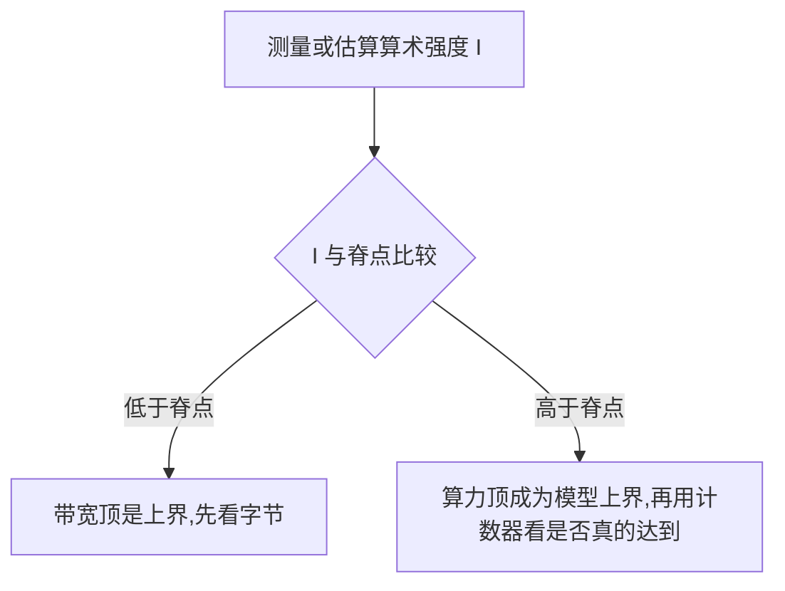

# 8.5 占用率与屋顶线

> [🏠 返回主页](../../README.md) · [返回本章](README.md)

## 先修

[8.1](01-execution-simt.md) 到 [8.4](04-tiled-matmul.md)。需要会做除法和最小值。

## 学习目标

- 定义占用率,并列出让一个 block 无法再多驻留的资源
- 用手算完成一个数值例子,同时说明它和占用率 API 的差距
- 用屋顶线判断一个算术强度是带宽顶还是有机会达到算力顶

## 定义

**占用率**是一个 SM 上活跃的 warp 数,除以这个 SM 允许的最大 warp 数。它是延迟隐藏的一个条件,不是性能本身。占用率低可以很慢,也可以因为每个线程的寄存器复用很好而很快。占用率高但每个线程都在等全局内存,同样慢。

限制活跃块数的量至少有:

- 每 SM 线程槽 / 每块线程数
- 每 SM warp 槽 / 每块 warp 数(不满 32 的尾 warp 仍占一个 warp 槽)
- 每 SM 寄存器 / 每块实际预留的寄存器
- 每 SM 共享内存 / 每块实际预留的共享内存
- 每 SM 最大驻留块数

活跃块数是这些整数除法的最小值。任一资源超过"每块上限"(例如线程数超过 `maxThreadsPerBlock`),内核无法启动,活跃块数记 0。

编译器预留的寄存器不是你在源码里数出来的局部变量个数,分配粒度也随计算能力变化。[occupancy.py](py/occupancy.py) 把粒度做成显式参数,默认 1,表示"调用方已经传入对齐后的预留量"。权威数字来自 `cudaOccupancyMaxActiveBlocksPerMultiprocessor` 或 Nsight,而不是这个估计器。

**屋顶线**把可达到的浮点速率写成

$$
\mathrm{attainable} = \min(\pi,\ I\cdot \beta)
$$

其中 \(\pi\) 是峰值 FLOP/s,\(\beta\) 是峰值字节/s,\(I\) 是算术强度,单位 FLOP/byte。脊点是 \(\pi/\beta\)。\(I\) 低于脊点时,带宽顶更低,再好的指令调度也过不了这条模型上界。\(I\) 高于脊点时,只说明带宽顶不低于算力顶,**不证明**实现达到了 \(\pi\)。

Williams、Waterman 和 Patterson 的技术报告给出了这个模型的原始形式。下面的 \(\pi\) 和 \(\beta\) 是假设输入,不是某张显卡的公开铭牌。

## 原理与演算:占用率

假设一次查询得到:

| 量 | 假设值 |
|---|---|
| 每 SM 最大线程 | 2048 |
| 每块最大线程 | 1024 |
| 每 SM 寄存器 | 65536 |
| 每块最大寄存器 | 65536 |
| 每 SM 共享内存 | 65536 字节 |
| 每块最大共享内存 | 49152 字节 |
| 每 SM 最大块数 | 32 |
| warp | 32 |

内核:每块 256 线程,每线程 64 个已预留寄存器,每块 16384 字节共享内存。

- 线程槽:\(\lfloor 2048/256\rfloor = 8\) 块
- warp:每块 \(256/32 = 8\) 个 warp,每 SM 最多 \(2048/32 = 64\) 个 warp,\(\lfloor 64/8\rfloor = 8\) 块
- 寄存器:每块 \(64\times 256 = 16384\),\(\lfloor 65536/16384\rfloor = 4\) 块
- 共享内存:\(\lfloor 65536/16384\rfloor = 4\) 块
- 最大块数:32

活跃块数是 4。活跃 warp 是 \(4\times 8 = 32\)。占用率是 \(32/64 = 0.5\)。寄存器和共享内存同时达到这个最小值。把寄存器降到 32 而共享内存不变,仍然是共享内存把块数限制在 4。这就是"只减寄存器可能没有用"的定量版本。

另一个边界:每块 100 个线程,不用寄存器和共享内存限额。每块 warp 数是 \(\lceil 100/32\rceil = 4\),不是 3。warp 槽只允许 \(\lfloor 64/4\rfloor = 16\) 块,而线程槽允许 \(\lfloor 2048/100\rfloor = 20\) 块。更紧的是 warp 槽。尾部 4 个线程仍占满一个 warp。

这些数字由 [测试](tests/test_cuda_models.py) 锁定。它们是估计器的行为,不是某次 `nvidia-smi`。

## 原理与演算:屋顶线

设 \(\pi = 10^{14}\) FLOP/s,\(\beta = 2\times 10^{12}\) byte/s。脊点

$$
\frac{10^{14}}{2\times 10^{12}} = 50\ \mathrm{FLOP/byte}
$$

方阵 GEMM 的**强制流量**假设 \(A\)、\(B\)、\(C\) 的每个元素只进出内存一次。float16 每个元素 2 字节,元素数 \(3N^2\),FLOP 数 \(2N^3\):

$$
I = \frac{2N^3}{6N^2} = \frac{N}{3}
$$

\(N=1024\) 时 \(I = 1024/3 \approx 341.3\),高于 50,模型给出的上界是 \(\pi\),限制侧记为 compute。这只说明强制流量还没把你按在带宽顶上。实现若重复读取 \(A\) 或 \(B\),实际 \(I\) 会更低,仍可能掉到带宽顶下面。

\(N=32\) 时 \(I = 32/3 \approx 10.67\),低于 50。即使强制流量已经是下界(实际流量只会更多、强度只会更低),带宽顶也只有

$$
\frac{32}{3}\times 2\times 10^{12} \approx 2.13\times 10^{13}\ \mathrm{FLOP/s}
$$

低于 \(\pi\)。这时先加指令级优化没有意义,先减少字节或接受带宽顶。

第 8.4 节的分块 float32 矩阵乘在 \(\mathrm{TILE}=16\) 时,全局读强度约 4 FLOP/byte。把 4 放在脊点为 50 的这组假设设备上,仍然远低于脊点:分块改善的是相对朴素核的流量,不自动变成算力受限。要继续提高强度,需要更大的复用(更大的 tile、寄存器分块、让 \(C\) 的累加留在寄存器里),或者这组峰值假设本身就不代表你的设备。换设备必须换 \(\pi\) 和 \(\beta\)。

## 排障

| 若计数器呈现这种模式 | 读法 |
|---|---|
| 占用率低,但内存带宽已经接近该设备的峰值 | 瓶颈在字节,继续堆线程不会过屋顶线 |
| 占用率高,耗时集中在整数地址运算 | 瓶颈不在驻留 warp 数 |
| 手算能驻留 4 个块,API 说 3 个 | 寄存器或共享内存的分配粒度、静态共享内存没算进手算 |
| 内核无法启动 | 单块寄存器或共享内存已经超过每块上限,占用率公式还没开始 |

## 练习

1. 沿用本节的设备假设。每块 256 线程、每线程 32 个寄存器、每块 4096 字节共享内存。活跃块数和占用率是多少?限制因素是哪几项?
2. 同一组 \(\pi,\beta\)。float32 的方阵强制流量强度是 \(N/6\) 还是 \(N/3\)?对 \(N=1024\) 算出 \(I\),并判断落在脊点的哪一侧。
3. 为什么"占用率最大化"不能当作优化的目标函数?

### 参考解答

1. 线程槽 8 块,warp 槽 8 块。寄存器每块 \(32\times 256 = 8192\),\(\lfloor 65536/8192\rfloor = 8\) 块。共享内存 \(\lfloor 65536/4096\rfloor = 16\) 块。活跃块数 8,活跃 warp 64,占用率 1。线程槽、warp 槽和寄存器同时取到 8。这仍然是估计,粒度可能把它降下来。
2. float32 是 4 字节,强制字节数是 \(3N^2\times 4 = 12N^2\),FLOP 数 \(2N^3\),\(I = N/6\)。\(N=1024\) 时 \(I \approx 170.7\),仍高于 50,模型侧是 compute。float16 才是 \(N/3\)。字节宽度必须写进强度公式。
3. 占用率是活跃 warp 的比例。性能还取决于每条指令做多少有用 FLOP、字节是否合并、有没有屏障和分歧。屋顶线先告诉你上界在哪一侧,计数器再告诉你离上界有多远。把占用率从 0.5 提到 1.0 如果伴随寄存器溢出,局部内存流量会把实际强度打下去。

## 小结

占用率回答"SM 上还能再放多少 warp"。屋顶线回答"多出来的 warp 有没有机会变成 FLOP,还是仍被字节挡住"。两个都是上界和估计。设备查询、编译器的预留量和 Nsight 的计数器负责把估计换成你这块 GPU 上的事实。

## 关键术语

占用率、脊点、算术强度、强制流量、寄存器预留、分配粒度

## 延伸阅读

- 内核启动与占用率 — https://docs.nvidia.com/cuda/cuda-programming-guide/02-basics/writing-cuda-kernels.html
- 占用率 API — https://docs.nvidia.com/cuda/cuda-runtime-api/group__CUDART__OCCUPANCY.html
- 计算能力表 — https://docs.nvidia.com/cuda/cuda-programming-guide/05-appendices/compute-capabilities.html
- Williams, Waterman, Patterson, Roofline — https://www2.eecs.berkeley.edu/Pubs/TechRpts/2008/EECS-2008-134.html
- Nsight Compute — https://docs.nvidia.com/nsight-compute/NsightCompute/index.html

---

[🏠 返回主页](../../README.md)
