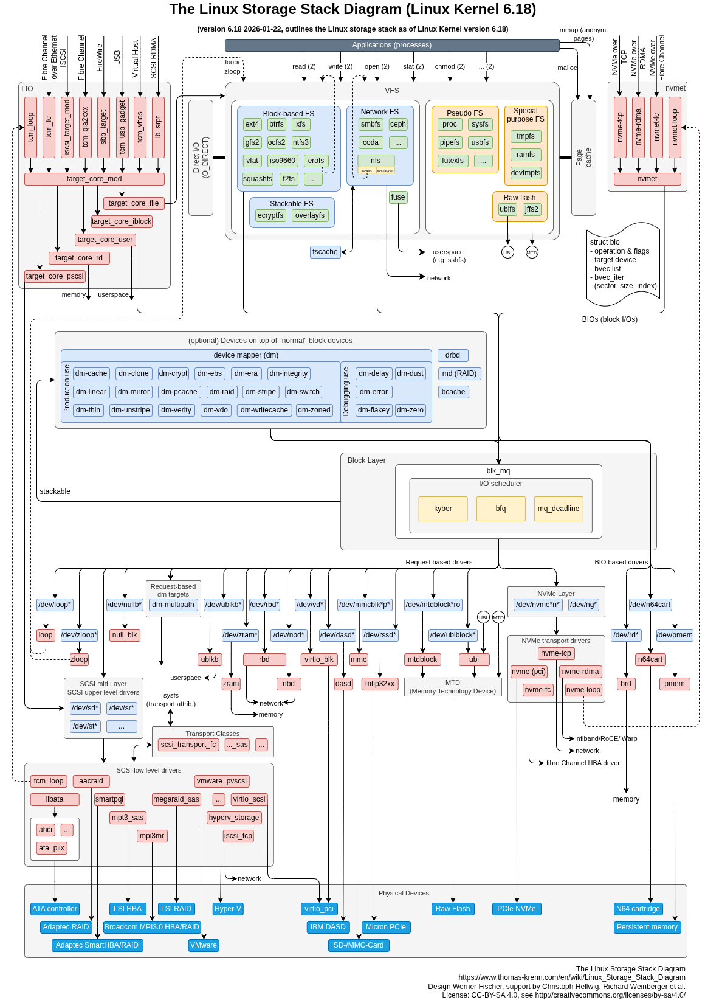

# 3.9 Linux I/O and the Storage Stack (System-Layer Supplement)

> 🌐 [中文](09-linux-io-and-storage-stack.md)

> [🏠 Back to home](../README.en.md) · [Back to chapter](README.en.md) · [Previous: 3.8](08-cuda-and-gpu-kernels.en.md)

## Prerequisites
3.6 (PyTorch engineering, data loading), 3.7 (training and inference systems).

## Why an FDE Needs to Understand the Storage Stack
However fast the GPU is, it idles if data cannot be fed to it. Common problems at customer sites, such as a stuttering DataLoader during training, very slow checkpoint saves, models taking minutes to load on cold start, unusually slow file reads inside containers, and data that was clearly written but is lost after a power failure, mostly have their root cause in the storage stack, not in the model. This section provides a "map" so that you can tell which layer a problem falls in.

## The Big Picture

> Figure: *The Linux Storage Stack Diagram*, version 6.18, designed by Werner Fischer with help from Christoph Hellwig, Richard Weinberger, and others; source: [Thomas-Krenn Wiki](https://www.thomas-krenn.com/en/wiki/Linux_Storage_Stack_Diagram); license: CC BY-SA 4.0.

## The Journey of a Read or Write
Seven layers from top to bottom:

| Layer | Representative components | Role |
|---|---|---|
| Application / system calls | `read`, `write`, `open`, `mmap` | Entry point into the kernel |
| VFS | Unified file interface | Hides the differences between file systems |
| File systems | ext4, xfs, btrfs, NFS, overlayfs, tmpfs, FUSE | Map "files" onto "blocks" |
| Page cache | Page cache | In-memory cache that ordinary I/O passes through |
| Block layer | `bio`, blk-mq, I/O schedulers (kyber, bfq, mq-deadline) | Merge, sort, and dispatch I/O requests |
| Device mapping layer (optional) | device mapper (LVM, dm-crypt, thin, verity), md RAID, bcache | Logical volumes, encryption, RAID, and caching on top of block devices |
| Drivers and hardware | SCSI/SATA, NVMe, virtio, pmem | Communicate with the real devices |

On the left and right sides there are also "targets": LIO exports local storage as iSCSI / FC, and nvmet exports it as NVMe over TCP / RDMA.

## Key Mechanisms

### 1. The Page Cache and `fsync`
An ordinary `write` returns as soon as the data is in the page cache, while the data is still in memory; a power failure may lose it. To guarantee it reaches the disk, you need `fsync` / `fdatasync`, or `O_SYNC`.
**Scenario:** if power fails right after a checkpoint is saved, the file may be incomplete. In engineering practice, write to a temporary file first, `fsync`, then atomically `rename`.

### 2. Direct I/O (`O_DIRECT`)
Bypasses the page cache and interacts directly with the block layer; requires alignment (usually 512B or 4KB). Common for databases and high-performance reads, as it keeps large files from crowding out the cache.
**Scenario:** when reading a huge training dataset, the page cache is flushed over and over for little benefit; consider Direct I/O or GPUDirect Storage.

### 3. `mmap`
Maps a file into the process address space and loads it page by page on page faults.
**Scenario:** model formats such as safetensors and GGUF use `mmap` for fast loading and sharing across processes; on cold start, the first access still causes page faults that read from disk.

### 4. The Block Layer and I/O Schedulers
- NVMe SSDs have high parallelism and usually use `none` or `mq-deadline`.
- Spinning disks or multi-tenant scenarios can use `bfq` to ensure fairness.
- `blk-mq` creates a queue per CPU, matching multi-queue NVMe hardware.

### 5. The Device Mapping Layer
- LVM / dm-thin: flexible volumes and thin provisioning, but may add latency.
- dm-crypt: full-disk encryption, adding CPU overhead.
- md RAID: software RAID, which determines reliability and throughput.
**Scenario:** when a customer machine stacks several dm layers, investigate the performance loss layer by layer.

### 6. overlayfs and Containers
The copy-on-write layer of containers is based on overlayfs; the first modification of a lower-layer file requires copying the whole file (copy-up).
**Scenario:** putting large models in the container's writable layer, or writing logs to it frequently, is slow; put the data on a mounted volume instead.

### 7. Network File Systems
NFS, Ceph, and SMB have different latency and consistency semantics from local disks, and the overhead of metadata operations (`stat`, `open`) is especially noticeable.
**Scenario:** with a training set of millions of small files on NFS, the overhead of `ls` and opening files crushes throughput; pack them into large files (such as WebDataset or Parquet).

## Diagnostic Tools and Methods
| Purpose | Tools |
|---|---|
| Device-level throughput, latency, utilization | `iostat -x 1` |
| I/O per process | `iotop`, `pidstat -d` |
| Block device topology and scheduler | `lsblk`, `cat /sys/block/<dev>/queue/scheduler` |
| Tracing block-layer requests | `blktrace`, `biolatency` (bcc / bpftrace) |
| Benchmarking | `fio` |
| Cache hits | `vmstat`, `free -h`, `/proc/meminfo` (Cached, Dirty) |
| File-system layer | `strace -T -e trace=file,read,write` |

**Suggested troubleshooting order:**
1. First confirm whether the bottleneck is the CPU, GPU, memory, network, or disk (`top`, `nvidia-smi`, `iostat`).
2. If it is the disk, distinguish sequential from random reads/writes, and compare `fio` results with the hardware's rated values.
3. Look at the latency distribution (P99), not just the average.
4. Strip layers one at a time: bypass the file system, bypass dm, test the raw device directly, and locate which layer the loss comes from.

## Common Symptoms and Possible Causes
| Symptom | Possible causes |
|---|---|
| The first few training steps are slow, then it speeds up | Cold page cache; the first pass reads from disk |
| GPU utilization periodically drops to 0 | DataLoader blocked on I/O; too few `num_workers` or data on a slow disk |
| Training pauses while saving checkpoints | Synchronous writes of large files; switch to asynchronous saving, or write to local NVMe and then upload |
| Reads/writes inside the container are slower than on the host | overlayfs, mount options, volume driver |
| Very slow when there are many small files | Metadata overhead; merge them into large files |
| Persistently many Dirty pages in memory | Writes arrive faster than they reach disk, triggering writeback throttling |

## Exercises
1. Use `fio` to measure sequential reads and 4KB random reads on the same disk, and explain the gap.
2. Compare the speed of reading the same file with `dd` the first and second time, and explain the role of the page cache.
3. Write a script that writes a temporary file, calls `fsync`, then `rename`s it, and explain why this is safer than overwriting directly.
4. Draw it yourself: from `torch.load` reading model weights to the data arriving in GPU memory, which layers does it pass through?

## References
- [Linux Storage Stack Diagram](https://www.thomas-krenn.com/en/wiki/Linux_Storage_Stack_Diagram) (Thomas-Krenn Wiki, CC BY-SA 4.0)
- Kernel documentation: `Documentation/block/`, `Documentation/filesystems/`

---

[🏠 Back to home](../README.en.md) · [Back to chapter](README.en.md)
