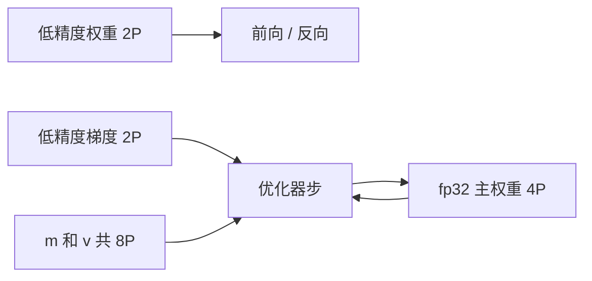

# 10.1 内存账与混合精度

> [🏠 返回主页](../../README.md) · [返回本章](README.md)

## 先修

第 9 章的参数量。知道 Adam 保存一阶矩和二阶矩。

## 学习目标

- 写出全精度 Adam 和混合精度 Adam 的静态字节
- 说明这两笔账为什么都是 \(16P\),但组成不同
- 把激活单独估算,并标出哪些项依赖实现

## 定义

静态状态指优化器跨步保留的张量:参数、梯度、矩。激活是前向为了反向而保留的中间结果,随批次和序列长度增长,检查点可以少留一些。碎片、分配器缓存和通信缓冲都不在下面的恒等式里。恒等式用来判断数量级和"卡在哪一行",设备上的 `max_memory_allocated` 或 Nsight 用来核对。

**全精度 Adam** 对 \(P\) 个参数,全部 fp32(4 字节):

| 项 | 字节 |
|---|---|
| 参数 | \(4P\) |
| 梯度 | \(4P\) |
| 一阶矩 \(m\) | \(4P\) |
| 二阶矩 \(v\) | \(4P\) |
| 合计 | \(16P\) |

**混合精度 Adam** 采用 ZeRO 论文中的那张静态账:低精度参数和梯度各 \(2P\),fp32 主权重 \(4P\),fp32 的 \(m\) 和 \(v\) 各 \(4P\),合计仍是 \(16P\)。低精度那两份是前向和反向用的;优化器步发生在主权重上。因此"打开 fp16/bf16"并不把优化器状态从 \(16P\) 变成 \(2P\)。它减少的是激活的宽度,以及一部分带宽。8 bit 优化器(Dettmers 等人)才会去动矩的字节,那是另一笔账,本仓库没有运行 bitsandbytes。

## 演算

取假设的 \(P = 7\times 10^9\)。

$$
16P = 1.12\times 10^{11}\ \mathrm{字节} = \frac{1.12\times 10^{11}}{2^{30}} \approx 104.31\ \mathrm{GiB}
$$

一张 24 GiB 或 80 GiB 的卡都放不下这份静态状态。这不是测量,是乘法。LoRA 把公式里的 \(P\) 换成可训练参数 \(P_{\mathrm{train}}\)。第 9 章里四块注意力、\(r=8\)、\(d=4096\)、32 层的 \(P_{\mathrm{train}}=8388608\),全精度 Adam 的静态账是 \(16\times 8388608\) 字节,约 128 MiB。冻结基座若以 bf16 存放,另加 \(2\times 7\times 10^9 = 1.4\times 10^{10}\) 字节,约 13.04 GiB。两笔要相加,不能用 128 MiB 代替全部。

激活的教学估计:

$$
\underbrace{L\cdot c\cdot B\cdot S\cdot H\cdot b}_{\text{隐状态类}} + \underbrace{L\cdot B\cdot n_{\mathrm{head}}\cdot S^2\cdot b}_{\text{若物化注意力分数}}
$$

\(c\) 是"每层保留几份 \(B\times S\times H\)"的假设,必须和实现一起报告。FlashAttention 不物化 \(S\times S\) 的分数矩阵,第二项应设为 0。把第二项算进去又声称自己用了 FlashAttention,就是重复计数。检查点若每个段只留边界隐状态,边界字节是 \(\mathrm{segments}\cdot B\cdot S\cdot H\cdot b\),段内在反向时重算。这是 Chen 等人子线性显存方法的记账形式,不是某次运行少掉的百分比。

[memory_accounting.py](py/memory_accounting.py) 把这些项分开返回。测试锁定 \(16P\) 以及"物化分数会使总数变大"。

## 混合精度的数值

Micikevicius 等人的做法是:卷积和矩阵乘走低精度,损失缩放后反向,权重更新前回到 fp32。fp16 的指数范围比 fp32 窄,小梯度会下溢,所以配合 `GradScaler`。bf16 的指数范围和 fp32 相同、尾数更短,PyTorch 的 AMP 文档说明 bf16 通常不需要梯度缩放。缩放是为了范围,不是为了速度。

FSDP 有自己的 `MixedPrecision` 参数:计算用低精度,分片状态在优化器步之前可以回到全精度。这和"在 FSDP 外面再套一层 Autocast"不是同一个开关。文档建议优先使用 FSDP 自带的混合精度,fp16 时配合分片的 `GradScaler`,bf16 时一般不缩放。本章没有跑 FSDP,因此只把这个约束写出来,避免配置时叠两层缩放。

## 排障

| 现象 | 先核对的行 |
|---|---|
| 优化器状态比参数大一个数量级 | 正常,Adam 是 \(16P\) 量级。先确认你是不是把激活也算进来了 |
| 打开 bf16 以后静态内存几乎不动 | 符合这张账。要省静态内存,换 LoRA、8 bit 优化器或分片 |
| fp16 损失变 NaN | 看缩放是否打开,以及是否有未保护的 exp 或 layer norm 累加 |
| 激活估计和分配峰值差几倍 | \(c\) 或注意力分数项和真实实现不符。以 profiler 修正 \(c\),不要倒过来改测量 |

## 练习

1. \(P_{\mathrm{train}}=10^6\),全精度 Adam。静态字节是多少 GiB?
2. 为什么"混合精度把训练内存降到原来的一半"这句话,在 ZeRO 的静态账里不成立?
3. \(B=1,S=128,H=64,L=2,b=2,c=1\),不物化分数。隐状态类字节是多少?若再物化 `heads=4` 的分数,增加多少字节?

### 参考解答

1. \(16\times 10^6 = 1.6\times 10^7\) 字节。除以 \(2^{30}\) 约 0.0149 GiB。小适配器的优化器状态可以很小,这不代表基座权重很小。
2. 静态合计仍是 \(16P\):省下的 fp32 参数和梯度,被 fp32 主权重加了回来。低精度副本只有 \(4P\),主权重加两个矩是 \(12P\)。激活和带宽才会变。若实现不保留一份低精度参数副本,字节会不同,所以必须写明实现,不能把 16 当成所有框架的物理定律。
3. 隐状态类:\(2\times 1\times 1\times 128\times 64\times 2 = 32768\) 字节。分数:\(2\times 1\times 4\times 128^2\times 2 = 262144\) 字节。分数项比隐状态大。长序列时先问实现有没有物化 \(S^2\)。

## 小结

先写 \(16P\) 的组成,再写激活的 \(c\) 和是否物化 \(S^2\)。混合精度主要不是用来把 Adam 状态减半。所有 GiB 都要能除回字节,并且和一次真实的分配峰值对得上,才配出现在实验记录里。

## 关键术语

主权重、一阶矩、二阶矩、梯度缩放、bf16、激活、物化注意力分数

## 延伸阅读

- ZeRO — https://arxiv.org/abs/1910.02054
- Mixed precision training — https://arxiv.org/abs/1710.03740
- 8-bit optimizers — https://arxiv.org/abs/2110.02861
- PyTorch AMP — https://docs.pytorch.org/docs/stable/amp.html
- FlashAttention(为何可以不物化 \(S\times S\)) — https://arxiv.org/abs/2205.14135

---

[🏠 返回主页](../../README.md)
