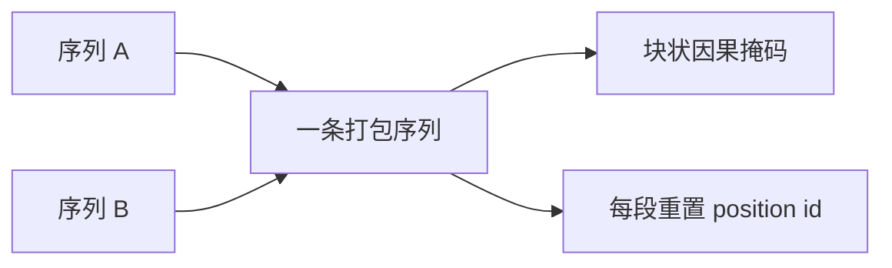

# 10.2 累积、检查点、打包与数据加载

> [🏠 返回主页](../../README.md) · [返回本章](README.md)

## 先修

[10.1](01-memory-precision.md) 的激活账,第 9 章的 token 屏蔽。

## 学习目标

- 在 micro-batch 的 token 数不同时,把平均梯度合成全局 token 平均
- 说明激活检查点用额外前向换边界激活
- 计算填充浪费,并构造不会跨段注意的因果掩码
- 列出数据加载要记录的旋钮,而不预设哪个旋钮更快

## 定义

**梯度累积**:把若干个小批次的梯度相加,再做一次优化器步,用来在内存放不下大批次时保持有效批次。有效批次的定义必须先写清楚,是"按样本平均"还是"按未屏蔽 token 平均"。

**激活检查点**:前向时不保留一段计算的中间激活,反向时用这段的输入重算。PyTorch 文档把它定义成用计算换内存,并建议 `torch.utils.checkpoint.checkpoint(..., use_reentrant=False)`。

**填充**:一个批次里的序列补到本批最长。浪费比例是 \(1 - \sum \ell_i / (N \max \ell)\)。

**打包**:把多条短序列拼进一条长度上限里。正确的注意力是块状因果掩码:位置 \(i\) 只能看见同一段且下标不超过 \(i\) 的位置。每段的位置编号要从 0 重新计。掩码对了但位置编号沿用整段,模型看见的是另一种位置分布。

## 原理:加权

设第 \(i\) 个 micro-batch 在 \(n_i\) 个未屏蔽 token 上的平均梯度是 \(g_i\),\(N=\sum n_i\)。全局 token 平均的梯度是

$$
g = \sum_i \frac{n_i}{N} g_i
$$

若每步直接把 `loss.backward()` 的平均梯度相加再除以步数,得到的是各批平均的平均。它等于 \(g\) 当且仅当每个 \(n_i\) 相同。

演算: \(g_1=(1,0), n_1=2\); \(g_2=(0,3), n_2=6\)。

$$
g = \frac{2}{8}(1,0)+\frac{6}{8}(0,3) = (0.25,\ 2.25)
$$

普通平均是 \((0.5,\ 1.5)\)。测试锁定这两个向量不相等。实现时要注意框架已经做过的除法:有的损失是 sum,有的是 mean,DDP 还会再对 rank 做一次平均。正确的做法是写出你要的 \(g\),再反推每个 micro-batch 乘的系数,并用一个已知 \(g_i\) 的小例子对拍。

## 原理:检查点与打包

检查点不改变数学上的梯度,前提是重算的前向和原来使用同一套随机数(dropout 要一致)并且没有原地修改被保存的输入。文档对 `use_reentrant=True` 和 DDP 的组合有额外限制:存在未使用参数或同一层检查点多次时,行为会出问题。新的代码用 `use_reentrant=False`,并在改分布式之前读一遍当前版本文档。

内存上,若原来每层都留激活,检查点后留下的是段边界。计算上,被检查点的段在反向时多一次前向。少留多少字节、多花多少时间,由段的大小和内核决定,不能写成固定的"慢 30%"。

填充的例子:长度 2、2、8。槽位 \(3\times 8=24\),有用 token 12,浪费比例 \(0.5\)。打包用首次适应把短序列拼到 `max_len`。拼完之后掩码必须满足:段内因果为真,段间为假。`[(0,3),(3,4)]` 上,下标 2 可以看见 0,不能看见 3;下标 3 不能看见 0。测试锁定了这个矩阵。

## 数据加载

这些旋钮会改变"GPU 在等 CPU"还是"CPU 在等 GPU",但方向依赖磁盘、样本大小和工人数:

- `num_workers`、`persistent_workers`、`prefetch_factor`
- `pin_memory`(把页锁住,便于异步拷到 GPU;CPU 训练没有这步收益)
- 批生成是在工人进程里做分词,还是在主进程里做
- 随机数种子是否独立于工人编号,否则增删 worker 会改变样本顺序

先用剖析看数据加载的空隙,再改一个旋钮。不要同时改 worker 数和批次大小。

实验日志至少包含:[experiment_log.py](py/experiment_log.py) 里的时间、种子、配置、数据文件的 SHA-256、Python 版本、命令行、已安装库的版本、git SHA。缺任何一项,别人无法判断两次运行是不是同一个实验。日志不记录你希望出现的加速。

## 排障

| 现象 | 原因 |
|---|---|
| 有效批次变大后损失曲线和真的大批次对不上 | token 数不同却做了普通平均,或 DDP 又除了一次 |
| 检查点打开后结果随 dropout 变化 | 重算时随机状态不一致 |
| 打包后模型把两条制度答串了 | 掩码不是块状的,或位置编号没有按段重置 |
| GPU 利用率为零的空隙很宽 | 先看数据加载,而不是先换一个融合内核 |
| 重跑分数不同 | 日志里没有种子或数据哈希,你以为没改数据 |

## 练习

1. 三个 micro-batch 的 token 数都是 4,平均梯度分别是 1、3、5(标量)。加权结果和普通平均各是多少?
2. 长度 1、1、1、10 的填充浪费比例是多少?若 `max_len=10`,首次适应至少能把它们放进几个箱?
3. 为什么比较"开不开检查点"时,不能同时把批次大小也改掉?

### 参考解答

1. token 数相同,加权结果就是 \((1+3+5)/3 = 3\)。普通平均也是 3。这个例子用来确认实现在均匀长度上没有把系数乘重。第 2 个例子才用不等长把两种平均拆开。
2. 浪费比例 \(1 - 13/(4\times 10) = 0.675\)。三条长度为 1 的序列可以和那条长度为 10 的分开放:长度为 10 的独占一个箱,三条 1 可以进另一个箱,共 2 个箱。首次适应按长度降序,先放 10,再依次把 1 放进第一个还放得下的箱;第一个箱已满,所以三条 1 进入第二个箱。仍然是 2。
3. 检查点改变的是内存和重算,批次大小改变的是梯度噪声和激活。两个一起变,保留集分数的变化无法归因。内存不够正是你打开检查点的原因时,应先把批次固定在两边都放得下的大小,再单独比较检查点。

## 小结

累积的系数来自你声明的平均方式。检查点用重算换激活,随机性要能重放。打包省掉的是填充槽,代价是掩码和位置编号必须按段切开。数据加载和这些开关一样,一次只动一个,并且写进带哈希的日志。

## 关键术语

micro-batch、token 加权、激活检查点、填充浪费、块状掩码、position id、实验日志

## 延伸阅读

- 激活检查点 — https://docs.pytorch.org/docs/stable/checkpoint.html
- 子线性内存训练 — https://arxiv.org/abs/1604.06174
- Transformers 单卡性能笔记 — https://huggingface.co/docs/transformers/main/en/perf_train_gpu_one
- CUDA 异步拷贝与主机内存的背景 — https://docs.pytorch.org/docs/stable/notes/cuda.html

---

[🏠 返回主页](../../README.md)
