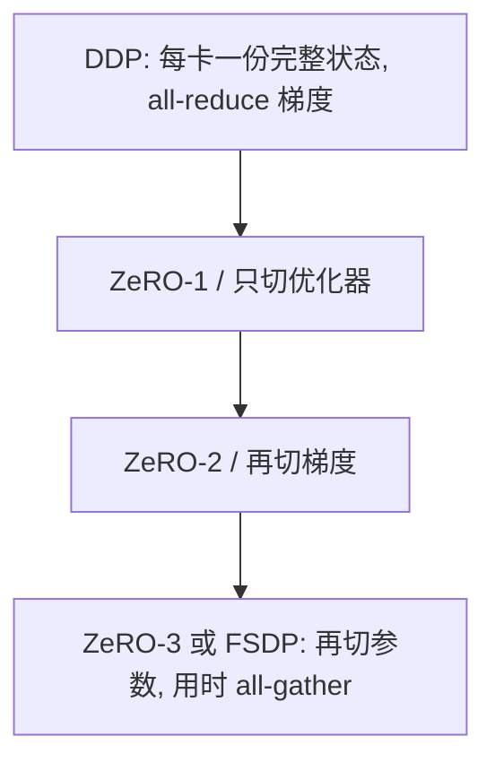

# 10.3 数据并行、分片与剖析

> [🏠 返回主页](../../README.md) · [返回本章](README.md)

## 先修

[10.1](01-memory-precision.md) 的静态账,[10.2](02-batch-checkpoint-packing.md) 的一次只改一个因素。多 GPU 程序不在本仓库的测试里执行。

## 学习目标

- 说出 DDP、FSDP 和 ZeRO 三个阶段各复制或分片了哪些张量
- 列出会破坏正确性的组合,而不是只记速度口号
- 按"时间线 → 内核 → 一次改动"使用剖析器

## 定义

**DDP**(DistributedDataParallel)在每个 rank 上放一份完整模型。反向时对梯度做 all-reduce。PyTorch 文档中的默认归约是平均。每个 rank 的静态内存仍是一份完整的参数、梯度和优化器状态。它适合模型放得下、想用多卡加大吞吐的时候。

**FSDP**(FullyShardedDataParallel)把参数、梯度和优化器状态按参数组切开。前向和反向之前 all-gather 出需要的参数,用完可以丢掉非本 rank 的分片,梯度用 reduce-scatter 分回各 rank。单卡静态内存下降,通信次数上升。

**ZeRO** 是同一方向上的三个阶段(Rajbhandari 等人):

| 阶段 | 分片的状态 |
|---|---|
| ZeRO-1 | 优化器状态 |
| ZeRO-2 | 优化器状态和梯度 |
| ZeRO-3 | 优化器状态、梯度和参数 |

ZeRO-3 与 FSDP 的全分片是同一类设计。阶段越高,单卡状态越小,集合通信越多。论文给出通信量的公式;本章不把那些系数背成与实现无关的常数。你要用的框架版本的通信计数,以该版本的剖析为准。

## 原理:取舍

选择取决于静态账放不放得下,而不是"FSDP 更新所以应该用"。

- 完整的 \(16P\) 放得进每张卡:DDP 的通信是梯度 all-reduce,实现路径最短。先把它跑对。
- 优化器状态放不下、参数放得下:ZeRO-1 或等价配置。
- 参数本身放不下:FSDP 或 ZeRO-3,或者换 LoRA/QLoRA,让 \(P_{\mathrm{train}}\) 变小。分片不能减少冻结基座在前向时必须物化的那一份,除非计算发生时才 all-gather。

正确性约束,来自当前 PyTorch 文档,而不是经验口诀:

- DDP 与 `use_reentrant=True` 的检查点组合有限。不使用的参数、同一层检查点多次,都不在支持范围内。`use_reentrant=False` 是文档的推荐。
- 梯度累积再叠加 DDP 的平均时,每个 rank 的 token 数若不同,全局平均不会自动等于 token 加权。系数要自己对拍,见第 10.2 节。
- FSDP 的混合精度用构造函数里的 `MixedPrecision`,不要假设外面的 `autocast` 会按同样方式保留主权重。
- 分片优化器的状态字典和单卡 Adam 的键不一样。恢复训练要保存分片协议要求的那份状态,而不是只保存 `state_dict()` 里你认识的权重。

本章没有多 GPU 测试。上面任何一条都没有在本仓库里被运行验证。把它们当成阅读文档时的检查表,然后在你的集群上做最小复现:两个 rank、一个线性层、已知梯度。

## 剖析,而不是同时拧所有开关

顺序是:

1. **时间线**。PyTorch Profiler 或 Nsight Systems 回答:时间在数据加载、CPU 算子、GPU 内核还是同步空隙。配方见 PyTorch 的 profiler 教程。
2. **内核**。Nsight Compute 回答某一个内核的占用率、内存吞吐和算术强度,用来对照第 8 章的屋顶线。
3. **一次改动**。只改累积步数、只改检查点、或只改分片策略。配置、数据哈希和种子写进实验日志。
4. **正确性门**。损失是有限的、一个小批次的梯度与单卡参考在容差内、保留集指标没有无故下跌。速度只有在门通过之后才有资格被记录,而且必须附上硬件和软件版本。

Nsight 的计数器名称随版本变化。报告里贴计数器时,写下工具版本和 GPU 名称。不要把教程截图里的百分比抄进自己的实验。

CPU 上也能练习这个纪律:用 `cProfile` 看第 9 章教学脚本的时间在分词、前向还是反向。那是剖析流程的排练,不是 GPU 结论。

## 排障

| 现象 | 读法 |
|---|---|
| 加卡之后单步变慢 | 通信已经盖过计算。看时间线上 all-gather 是否和计算重叠,而不是再加卡 |
| 损失比单卡低一个常数倍 | 梯度被平均了两次,或累积又除了一次 `world_size` |
| 恢复训练后第一步就 NaN | 加载的是权重而不是优化器矩,或混合精度主权重没有恢复 |
| 剖析器本身让步时变长 | 只在短的剖析窗口打开,不要用带剖析的时间当成绩 |
| 两个改动一起上线后"变快了" | 无法归因。拆成两次实验,否则不要写进变更说明 |

## 练习

1. 模型静态状态 40 GiB,每张卡 24 GiB,共 4 张卡。DDP 是否可能放下?FSDP 在"参数可以分片、单卡只需驻留一部分"的前提下,还需要哪一项证据才敢说放得下?
2. 两个 rank 的未屏蔽 token 数是 10 和 30,DDP 对梯度做平均。若你想要的是 token 加权,每个 rank 在 `backward` 之前还应乘什么系数?假设本地损失已经是本地 token 的平均梯度。
3. 假设一次剖析里,时间线的主要空隙是主机到设备的拷贝,内核本身已经接近带宽顶。先改哪个:打包、融合内核,还是把 FSDP 换成 DDP?这里的"主要空隙"是题目给出的读法,不是本仓库的测量。

### 参考解答

1. DDP 要在每张卡放 40 GiB,24 GiB 的卡放不下。FSDP 只说明"有可能按分片放下"。还需要:单卡在前向峰值时 all-gather 出来的参数块、激活、梯度和分配器保留的和不超过 24 GiB。这个峰值要用分配器或剖析器读出来,分片公式给不出激活。
2. 全局 token 数 40。rank0 的平均梯度应乘 \(10/40\),rank1 乘 \(30/40\),然后如果 DDP 再把两个 rank **平均**(除以 2),系数里还要乘 2,否则加权和会被再缩小。即 rank0 乘 \(2\times 10/40=0.5\),rank1 乘 \(2\times 30/40=1.5\)。关键是写明 DDP 已经做了平均。若配置改成求和归约,系数里的 2 就要拿掉。用一个标量梯度对拍。
3. 先减少主机到设备的字节或重叠拷贝,例如缩短填充、固定内存、异步拷贝。融合内核解决的是已经在 GPU 上的算子空隙;带宽顶说明计算侧不是第一缺口。DDP 与 FSDP 的替换改变的是参数通信,和"拷贝输入太慢"不是同一行。一次只做打包或 `pin_memory` 这一类改动。

## 小结

DDP 复制状态,FSDP 和 ZeRO-3 分片状态并用通信换内存。阶段选择由第 10.1 节的字节账决定。正确性约束(检查点、梯度平均、状态字典)先于速度。剖析定位一行瓶颈,实验只改那一行,硬件和版本写进日志。

## 关键术语

all-reduce、all-gather、reduce-scatter、ZeRO 阶段、主权重、剖析窗口

## 延伸阅读

- DDP — https://docs.pytorch.org/docs/stable/generated/torch.nn.parallel.DistributedDataParallel.html
- FSDP — https://docs.pytorch.org/docs/stable/fsdp.html
- 分布式总览 — https://docs.pytorch.org/docs/stable/distributed.html
- ZeRO — https://arxiv.org/abs/1910.02054
- Profiler 配方 — https://pytorch.org/tutorials/recipes/recipes/profiler_recipe.html
- Profiler API — https://docs.pytorch.org/docs/stable/profiler.html
- Nsight Systems — https://docs.nvidia.com/nsight-systems/UserGuide/index.html

---

[🏠 返回主页](../../README.md)
