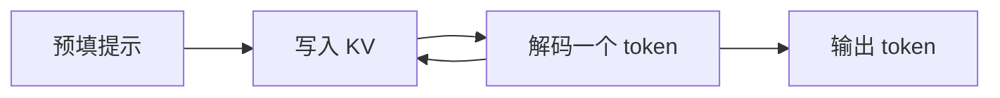

# 11.1 预填、解码与 KV cache

> [🏠 返回主页](../../README.md) · [返回本章](README.md)

## 先修

矩阵乘的 FLOP 数 \(2mnk\),第 8 章的算术强度。Transformer 的自注意力只需要"每个 token 产生一组 K 和 V"这一事实,论文见 Vaswani 等人。

## 学习目标

- 定义预填和解码,并估计解码步的算术强度
- 推导一条序列的 KV 字节,包括分组查询注意力
- 把 TTFT、TPOT 合成端到端延迟,并把它和吞吐分开

## 定义

**预填(prefill)**读入提示,并行计算这些 token 的表示,写出第一份 KV,并产生第一个输出 token。**解码(decode)**每次生成一个新 token(投机解码除外),读取已经存在的 KV,并追加一对新的 K、V。

**TTFT**(time to first token)是从请求到达服务到第一个输出 token 可被读取的时间,包含排队和预填。**TPOT**(time per output token)是其后每个输出 token 的时间。输出 \(N\) 个 token(\(N\ge 1\))的端到端时间定义为

$$
\mathrm{TTFT} + (N-1)\cdot\mathrm{TPOT}
$$

\(N=1\) 时没有解码步。这个定义是约定,写进 SLO 时要和测量脚本使用同一句。单请求延迟的倒数不是系统吞吐。吞吐是单位墙钟时间里所有请求产出的输出 token 数。

**p50** 和 **p95** 用 Hyndman–Fan type 7 线性插值,与 NumPy 默认的 percentile 一致,实现在 [latency.py](py/latency.py)。样本 `[10,20,30,40]` 的 p50 是 25。换一种分位定义,数字会变,所以报告里要写明 type 7。

## 原理:解码为什么常常看带宽

一个解码步的矩阵乘是矩阵乘向量。权重 \(W\) 形状 \((d_{\mathrm{out}}, d_{\mathrm{in}})\),FLOP 数 \(2 d_{\mathrm{out}} d_{\mathrm{in}}\)。若权重不在片上复用,读权重的字节约是 \(d_{\mathrm{out}} d_{\mathrm{in}} b\),向量本身相对很小。算术强度约 \(2/b\) FLOP/byte。fp16 或 bf16 的 \(b=2\),强度约 1 FLOP/byte。

把第 8 章那个假设设备的脊点 50 FLOP/byte 拿来对照,1 远低于 50:在这组假设峰值下,解码的上界是带宽顶。这不是对你的 GPU 的测量。预填把多个 token 堆成矩阵乘矩阵,强度随参与的 token 数上升,长提示才有机会离开带宽顶。所以"预填吃算力、解码吃带宽"是强度公式的结论,成立与否要代入你的 \(\pi\)、\(\beta\) 和真实的访存(权重是否重复读、KV 是否已经在缓存里)。

## 原理:KV 字节

每一层、每个 token、每个 KV 头,保存 K 和 V 两个向量,每个向量长度是 `head_dim`。一条序列、一个 token 的增量是

$$
L \cdot 2 \cdot n_{\mathrm{kv}} \cdot d_{\mathrm{head}} \cdot b
$$

批量 \(B\)、已经缓存的长度 \(S\) 的总量再乘 \(B\cdot S\)。分组查询注意力(GQA)里 \(n_{\mathrm{kv}}\) 可以小于查询头数。多头注意力是 \(n_{\mathrm{kv}}=n_{\mathrm{head}}\) 的特例,多查询注意力是 \(n_{\mathrm{kv}}=1\)。

### 演算

假设结构:\(L=32\),\(n_{\mathrm{kv}}=8\),\(d_{\mathrm{head}}=128\),\(b=2\),\(B=1\),\(S=4096\)。

每 token:

$$
32\cdot 2\cdot 8\cdot 128\cdot 2 = 131072\ \mathrm{字节} = 128\ \mathrm{KiB}
$$

全长:

$$
131072\times 4096 = 536870912\ \mathrm{字节} = 512\ \mathrm{MiB}
$$

若改成多头、\(n_{\mathrm{kv}}=32\),字节是 4 倍,2 GiB。GQA 省的是 KV,不是权重。测试锁定了 131072、536870912 和这 4 倍关系。

分页不改变这条逻辑字节数。它把 KV 切成固定块,块可以不连续,从而少做"按最大长度预留一整段"造成的空洞。最后一块里没用完的槽是另一种浪费:

$$
\frac{\lceil S/B_{\mathrm{block}}\rceil B_{\mathrm{block}} - S}{\lceil S/B_{\mathrm{block}}\rceil B_{\mathrm{block}}}
$$

\(S=4096\)、块大小 16 时浪费比例是 0。\(S=17\)、块大小 16 时用 2 块共 32 个槽,浪费 \(15/32\)。这只计算末块,不含分配器碎片。



## 实例

```bash
python3 -c "
import sys
sys.path[:0]=['02-ai-llm/11-inference/py']
from kv_cache import kv_cache_bytes
from latency import request_latency
print(kv_cache_bytes(32, 8, 128, 4096))
print(request_latency(30, 5, 4))
"
```

第二个打印是 \(30+3\times 5=45\)。30 和 5 是输入,不是测量。

## 排障

| 现象 | 读法 |
|---|---|
| 上下文加长后显存线性上涨 | 先用每 token 字节乘长度,看是不是 KV,而不是权重 |
| 批大小加一倍,权重字节不变、KV 加倍 | 符合公式。权重与 batch 无关,KV 与 batch 成正比 |
| 报出来的 TTFT 比预填内核还长 | 定义里包含了排队。把队列时间和内核时间分开记 |
| 平均延迟达标、p95 不达标 | SLO 若写的是 p95,平均不能代替。样本要够,分位算法要写明 |
| GQA 模型套用了 \(n_{\mathrm{head}}\) 计算 KV | 字节会被放大到 \(n_{\mathrm{head}}/n_{\mathrm{kv}}\) 倍 |

## 练习

1. 上面的假设结构,batch = 4,序列长 1024,bf16。KV 总字节是多少?
2. TTFT = 200 ms,TPOT = 20 ms,生成 50 个 token。端到端是多少毫秒?若把 TTFT 误算成"不含第一个 token",会多算还是少算一个 TPOT?
3. 为什么解码强度公式里可以把激活的字节先忽略?什么时候这个忽略不成立?

### 参考解答

1. 每 token 每序列仍是 131072 字节。总量 \(131072\times 1024\times 4 = 536870912\),和 batch=1、长度 4096 相同,因为 \(B\cdot S\) 相同。报告时仍要写明是 4 条 1024 而不是 1 条 4096,分页和调度并不相同。
2. \(200+49\times 20 = 1180\) 毫秒。若有人用 \(\mathrm{TTFT}+N\cdot\mathrm{TPOT}\),会得到 1200,多算了一个 TPOT。SLO 文本必须引用同一条公式。
3. 权重字节是 \(d_{\mathrm{out}}d_{\mathrm{in}}b\),激活是向量,量级是 \(d\cdot b\)。当 \(d_{\mathrm{in}}\) 为数千时,向量相对权重很小。当批量很大,矩阵乘向量变成矩阵乘矩阵,或者 KV 的读取超过了权重,忽略就不成立。长上下文的解码要同时算权重字节和 KV 字节。

## 小结

预填和解码的差别是矩阵乘矩阵还是矩阵乘向量,强度差一个序列维。KV 字节是 \(2L n_{\mathrm{kv}} d_{\mathrm{head}} b\) 乘 batch 和长度。延迟用 TTFT 和 TPOT 组合成端到端,吞吐另算,尾部分位数要声明算法。

## 关键术语

预填、解码、TTFT、TPOT、GQA、KV cache、末块浪费

## 延伸阅读

- Attention is All You Need — https://arxiv.org/abs/1706.03762
- GQA — https://arxiv.org/abs/2305.13245
- FlashAttention — https://arxiv.org/abs/2205.14135

---

[🏠 返回主页](../../README.md)
