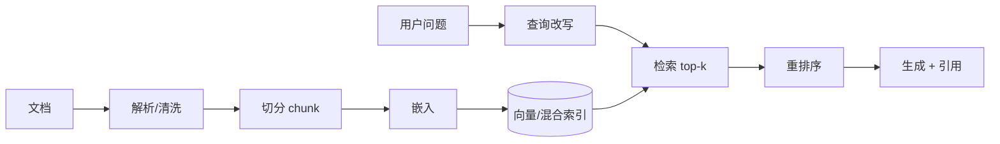

# 第 3 章 LLM 应用系统:RAG、Agent 与评测

> [🏠 返回主页](../README.md)

## 学习目标
- 理解 LLM 应用的系统构成与失效模式
- 能设计与调优 RAG 管线,能构建受控的 Agent 工作流
- 能建立评测体系,用数据而非感觉驱动迭代

## 3.1 核心概念
- **上下文窗口**:模型单次可处理的 token 上限;决定可注入多少检索内容。
- **RAG(检索增强生成)**:先从外部知识库检索相关片段,再让模型基于片段作答,以提升事实性与可溯源性。
- **嵌入(Embedding)**:将文本映射为向量,语义相近者距离相近。
- **工具调用(Tool Use)**:模型输出结构化调用请求,由程序执行后返回结果。
- **Agent**:由模型动态决定步骤与工具调用的系统;**工作流(Workflow)**:步骤由代码预定义。Anthropic 的工程文章建议优先使用最简单可行的方案,仅在必要时引入 Agent。
- **评测(Eval)**:针对任务定义的、可重复执行的质量测量。

## 3.2 RAG 管线

关键设计决策:
| 决策 | 选项 | 取舍 |
|---|---|---|
| 切分 | 固定长度 / 按结构(标题、段落) | 结构化切分通常保留语义更好 |
| 检索 | 向量 / BM25 / 混合 | 混合检索对专有名词、编号更稳健 |
| 重排序 | 交叉编码器 | 提升精度,增加延迟 |
| 元数据过滤 | 按权限、时间、部门 | 企业场景必须做**权限过滤**,防止越权 |

**失效模式诊断**:先判断是"检索没找到"(看召回)还是"找到了但答错"(看生成),分别优化。

## 3.3 Agent 与工作流模式
常见模式:提示链(prompt chaining)、路由(routing)、并行化、编排者-执行者、评估者-优化者。企业落地原则:
1. 工具接口清晰、参数校验严格;2. 有最大步数与成本上限;3. 高风险操作(写库、发邮件、付款)需人工确认;4. 全链路追踪日志。

### 实例:结构化抽取 + 校验
```python
from pydantic import BaseModel, ValidationError
class Invoice(BaseModel):
    vendor: str
    total: float
    currency: str
def extract(text, llm):
    for _ in range(3):
        raw = llm(f"从发票中抽取 JSON(vendor,total,currency):\n{text}")
        try: return Invoice.model_validate_json(raw)
        except ValidationError as e: text += f"\n上次输出不合法:{e}"
    raise ValueError("抽取失败,转人工")
```

## 3.4 评测体系
分三层:
1. **单元级断言**:格式、必含字段、禁止内容(代码可判定)
2. **模型评判(LLM-as-judge)**:需与人工标注对齐并定期校准
3. **人工评审与线上指标**:采纳率、人工修改率、任务完成时间
方法:先做**错误分析**——人工阅读几十到上百条真实轨迹,归类失败原因,再针对高频类别建评测。Hamel Husain 的文章对此有系统论述。

RAG 指标:检索召回率@k、答案忠实度(是否被引用支持)、答案相关性。

## 3.5 生产化关注点
- 延迟与成本:缓存、较小模型路由、流式输出
- 安全:提示注入(尤其是检索内容或工具结果中的间接注入)、数据泄露、输出过滤
- 版本管理:提示词、模型版本、索引版本均需可追溯

## 3.6 与训练、推理专项的边界
本章的工具是检索、权限、引用和评测。文档会更新或必须按用户身份隔离时,继续用 RAG,不要把正文微调进权重。提示稳不住的是格式或工具参数,并且你有干净的输入输出对时,再进入专项[第 9 章](../07-specialization/09-finetuning/README.md)。延迟、KV cache 和批调度在[第 11 章](../07-specialization/11-inference/README.md)。这些章节是选修,不是每个 FDE 项目的下一步。

## 案例
某法务团队的合同问答准确率不佳。错误分析发现主要问题是条款编号查询失败(纯向量检索对"第 7.2 条"不敏感)和跨版本合同混淆。改为混合检索 + 按合同版本元数据过滤后显著改善。**教训**:先看数据,再改架构。

## 练习
1. 为客户内部知识库设计 RAG 方案,说明权限如何贯穿检索。*评分:是否在检索时按用户身份过滤,而非生成后过滤。*
2. 收集 30 条问答,手动做错误分析并归类。
3. 何时选 Agent,何时选固定工作流?各举一例。*参考:步骤可预知(发票处理)→工作流;开放式研究任务→Agent。*

## 小结
LLM 系统 = 数据 + 检索 + 模型 + 工具 + 评测;评测是迭代的方向盘。

## 关键术语
RAG、嵌入、混合检索、重排序、工具调用、Agent/工作流、LLM-as-judge、提示注入

## 延伸阅读
- Anthropic:Building effective agents — https://www.anthropic.com/engineering/building-effective-agents
- Hamel Husain 关于评测的文章 — https://hamel.dev/blog/posts/evals/
- DeepLearning.AI 短课程 — https://www.deeplearning.ai/short-courses/

---

[🏠 返回主页](../README.md)
