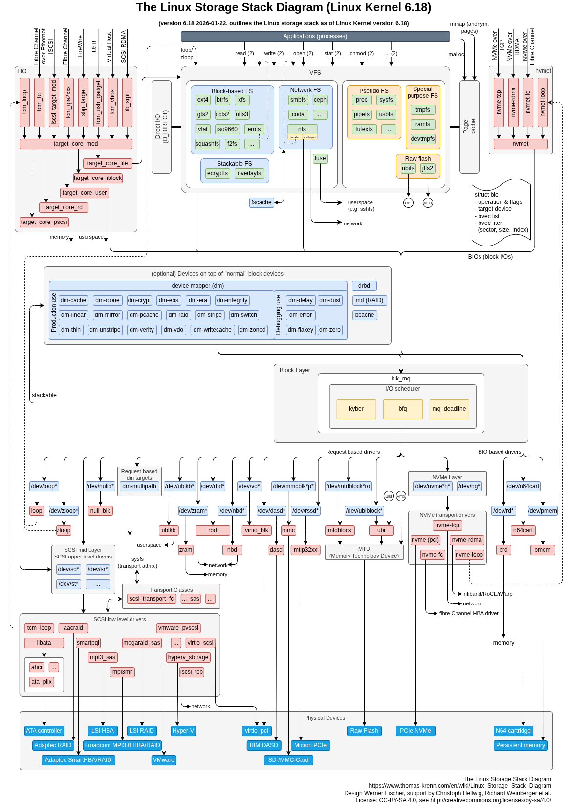

# 3.9 Linux I/O 与存储栈（系统层补充）

> [🏠 返回主页](../../README.md) · [返回本章入口](README.md) · [上一节 3.8](08-cuda-and-gpu-kernels.md)

## 先修
3.6（PyTorch 工程，数据加载）、3.7（训练与推理系统）。

## 为什么 FDE 要懂存储栈
GPU 再快，数据喂不上就是空转。客户现场常见的问题——训练时 DataLoader 卡顿、checkpoint 保存很慢、模型冷启动加载几分钟、容器里读文件特别慢、数据明明写了却在断电后丢失——根因多半在存储栈，而不在模型。本节给出一张“地图”，让你能判断问题落在哪一层。

## 全景图

> 图：*The Linux Storage Stack Diagram*，版本 6.18，设计 Werner Fischer，Christoph Hellwig、Richard Weinberger 等协助，来源 [Thomas-Krenn Wiki](https://www.thomas-krenn.com/en/wiki/Linux_Storage_Stack_Diagram)，许可 CC BY-SA 4.0。

## 一次读写的旅程
自上而下共七层：

| 层 | 代表组件 | 作用 |
|---|---|---|
| 应用 / 系统调用 | `read`、`write`、`open`、`mmap` | 进入内核的入口 |
| VFS | 统一的文件接口 | 屏蔽不同文件系统差异 |
| 文件系统 | ext4、xfs、btrfs、NFS、overlayfs、tmpfs、FUSE | 把“文件”映射成“块” |
| 页缓存 | Page cache | 内存缓存，普通 I/O 都经过它 |
| 块层 | `bio`、blk-mq、I/O 调度器（kyber、bfq、mq-deadline） | 合并、排序、分发 I/O 请求 |
| 设备映射层（可选） | device mapper（LVM、dm-crypt、thin、verity）、md RAID、bcache | 在块设备之上做逻辑卷、加密、RAID、缓存 |
| 驱动与硬件 | SCSI/SATA、NVMe、virtio、pmem | 与真实设备通信 |

左右两侧还有“目标端”：LIO 把本机存储导出为 iSCSI / FC，nvmet 导出为 NVMe over TCP / RDMA。

## 关键机制

### 1. 页缓存与 `fsync`
普通 `write` 只写入页缓存就返回，数据尚在内存中；断电可能丢失。要保证落盘，需要 `fsync` / `fdatasync`，或用 `O_SYNC`。
**对应场景：** 保存 checkpoint 后立即断电，文件可能不完整。工程上应先写临时文件、`fsync`，再原子 `rename`。

### 2. Direct I/O（`O_DIRECT`）
绕过页缓存，直接与块层交互，要求对齐（通常 512B 或 4KB）。数据库和高性能读取常用，可避免大文件把缓存挤满。
**对应场景：** 读超大训练数据集时，页缓存反复被冲刷，收益低，可考虑 Direct I/O 或 GPUDirect Storage。

### 3. `mmap`
把文件映射到进程地址空间，按页缺页加载。
**对应场景：** safetensors、GGUF 等模型格式利用 `mmap` 实现快速加载与多进程共享；冷启动时首次访问仍会产生缺页读盘。

### 4. 块层与 I/O 调度器
- NVMe SSD 并行度高，通常用 `none` 或 `mq-deadline`。
- 机械盘或多租户场景可用 `bfq` 保证公平。
- `blk-mq` 为每个 CPU 建立队列，匹配 NVMe 多队列硬件。

### 5. 设备映射层
- LVM / dm-thin：灵活分卷、精简配置，但可能引入额外延迟。
- dm-crypt：全盘加密，增加 CPU 开销。
- md RAID：软件 RAID，决定可靠性与吞吐。
**对应场景：** 客户机器上叠了多层 dm 时，要逐层排查性能损耗。

### 6. overlayfs 与容器
容器的写时复制层基于 overlayfs；第一次修改下层文件需要整文件复制（copy-up）。
**对应场景：** 在容器可写层里放大模型或频繁写日志会很慢，应把数据放到挂载卷（volume）。

### 7. 网络文件系统
NFS、Ceph、SMB 的延迟和一致性语义与本地盘不同，元数据操作（`stat`、`open`）开销尤其明显。
**对应场景：** 数百万小文件的训练集放在 NFS 上，`ls` 和打开文件的开销会压垮吞吐，应打包成大文件（如 WebDataset、Parquet）。

## 诊断工具与方法
| 目的 | 工具 |
|---|---|
| 设备层吞吐、延迟、利用率 | `iostat -x 1` |
| 按进程看 I/O | `iotop`、`pidstat -d` |
| 块设备拓扑与调度器 | `lsblk`、`cat /sys/block/<dev>/queue/scheduler` |
| 追踪块层请求 | `blktrace`、`biolatency`（bcc / bpftrace） |
| 基准测试 | `fio` |
| 缓存命中情况 | `vmstat`、`free -h`、`/proc/meminfo`（Cached、Dirty） |
| 文件系统层 | `strace -T -e trace=file,read,write` |

**排查顺序建议：**
1. 先确认瓶颈是 CPU、GPU、内存、网络还是磁盘（`top`、`nvidia-smi`、`iostat`）。
2. 若是磁盘，区分顺序读写与随机读写，对比 `fio` 结果与硬件标称值。
3. 看延迟分布（P99），而不仅是平均值。
4. 逐层剥离：绕过文件系统、绕过 dm、直接测裸设备，定位损耗来自哪一层。

## 常见症状与可能原因
| 症状 | 可能原因 |
|---|---|
| 训练前几步很慢，之后变快 | 页缓存冷启动，首轮读盘 |
| GPU 利用率周期性掉到 0 | DataLoader 阻塞在 I/O；`num_workers` 太少或数据在慢盘 |
| checkpoint 保存时训练暂停 | 同步写大文件；可改异步保存或写到本地 NVMe 再上传 |
| 容器内读写比宿主机慢 | overlayfs、挂载方式、卷驱动 |
| 小文件特别多时很慢 | 元数据开销；合并成大文件 |
| 内存里 Dirty 页持续很多 | 写入速度大于落盘速度，触发回写限流 |

## 练习
1. 用 `fio` 分别测同一块盘的顺序读和 4KB 随机读，解释差距。
2. 对比 `dd` 读同一文件第一次与第二次的速度，说明页缓存的作用。
3. 写一个脚本：先写临时文件，`fsync`，再 `rename`，说明为什么比直接覆盖更安全。
4. 自己画一遍：从 `torch.load` 读取模型权重，到数据进入 GPU 显存，经过了哪些层？

## 参考
- [Linux Storage Stack Diagram](https://www.thomas-krenn.com/en/wiki/Linux_Storage_Stack_Diagram)（Thomas-Krenn Wiki，CC BY-SA 4.0）
- 内核文档：`Documentation/block/`、`Documentation/filesystems/`

---

[🏠 返回主页](../../README.md) · [返回本章入口](README.md)
