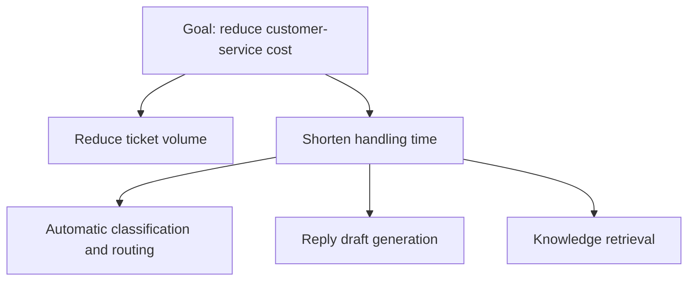

# Chapter 4 Discovery, Scoping, and Stakeholder Management

> 🌐 [中文](README.md)

> [🏠 Back to home](../README.en.md)

## Learning Objectives
- Master structured customer discovery methods
- Be able to break vague goals down into deliverable, verifiable scope
- Be able to identify and manage stakeholders and drive organizational adoption

## 4.1 Core Concepts
- **Discovery**: the process of understanding the customer's real problems and constraints through interviews, observation, and data.
- **Decomposition**: breaking a vague goal into mutually exclusive and collectively exhaustive (MECE) sub-problems.
- **Scoping**: making explicit what will be done, what will not be done, the success criteria, and the timeline.
- **Stakeholders**: people who affect or are affected by the project: sponsors, decision-makers, users, and gatekeepers (IT/security/legal).

## 4.2 Discovery Methods
Interviewing principles: ask about specific past behavior rather than hypothetical intentions ("How did you handle it last week?" beats "Would you use it?"); keep asking "why" until you reach a business metric; **observe the actual workflow** (shadowing).
Interview guide template:
1. What is your role and what are your goals? How are they measured?
2. Walk me through the most recent complete run of the process
3. Which step takes the most time / is most error-prone?
4. What tools do you use now? Where is the data?
5. If this problem were solved, what would change?

## 4.3 From Goals to Scope

Priority matrix: value × feasibility (data availability, integration difficulty, risk). Choose "high value, high feasibility" as the first milestone, and aim to deliver visible results within 2–4 weeks.

**Scope statement** template: background / goals and success metrics / in scope / out of scope / assumptions and dependencies / risks / milestones / acceptance criteria.

## 4.4 Stakeholder Management
Power-interest matrix: high power, high interest → collaborate closely; high power, low interest → keep satisfied; low power, high interest → keep informed; the rest → monitor.
Communication cadence: a written weekly update (done / next week / risks / decisions needed), with demos at key milestones.

## 4.5 Demos and Writing
Demo structure: problem → current pain points (using the customer's own data) → solution demo → outcome metrics → next steps and decisions needed.
For writing, use the Pyramid Principle: lead with the conclusion, then support it with grouped arguments.

## 4.6 Handling Ambiguity and Change
- When things are ambiguous: form hypotheses and validate them quickly with prototypes; list the "unknowns" and eliminate them one by one
- When requirements change: assess the impact on scope/timeline and confirm the trade-offs in writing, rather than silently absorbing them with overtime
- Driving adoption: find front-line "champions", train people, lower switching costs, measure usage

## Case Study
A bank's risk-control team asked to "use AI to detect fraud". After interviews, the FDE found that analysts spent 70% of their time (note: this figure is part of the case setup) manually stitching together data across systems. The first milestone was changed to a "unified investigation view"; after launch it earned the analysts' trust, and model scoring was introduced in the second phase. **Lesson**: the first deliverable should solve something that hurts users every day.

## Exercises
1. Role-play: a partner plays a customer who only says "we want an AI assistant"; you run a 20-minute interview and produce a scope statement.
   *Scoring (1–5 each): are the success metrics quantified, is out-of-scope made explicit, are data sources identified, is the decision-maker identified, is there a 2–4 week milestone.*
2. Draw a stakeholder matrix for a project and create a communication plan.
3. Write a 200-word weekly report that includes one risk requiring a customer decision.

## Summary
The core value of an FDE lies in finding "the right problem" and building trust through small, measurable deliveries.

## Key Terms
Discovery, MECE, scope statement, power-interest matrix, Pyramid Principle, champion

## Further Reading
- Barbara Minto, *The Pyramid Principle*
- Rob Fitzpatrick, *The Mom Test* (customer interview methods)

---

[🏠 Back to home](../README.en.md)
