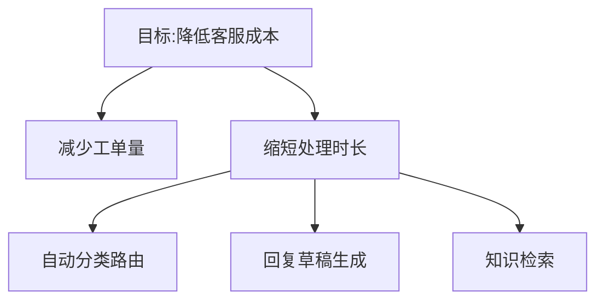

# 第 4 章 发现、界定与干系人管理

## 学习目标
- 掌握结构化的客户发现方法
- 能把模糊目标分解为可交付、可验收的范围
- 能识别并管理干系人,推动组织采纳

## 4.1 核心概念
- **发现(Discovery)**:通过访谈、观察和数据了解客户真实问题与约束的过程。
- **问题分解(Decomposition)**:将模糊目标拆为互斥且穷尽(MECE)的子问题。
- **范围界定(Scoping)**:明确做什么、不做什么、成功标准与时间。
- **干系人**:影响或受项目影响的人:发起人、决策者、使用者、把关者(IT/安全/法务)。

## 4.2 发现方法
访谈原则:问过去的具体行为而非假设性意愿("上周你是怎么处理的?"优于"你会用吗?");追问"为什么"直到触及业务指标;**观察实际工作流程**(shadowing)。
访谈提纲模板:
1. 你的角色与目标?如何衡量?
2. 带我走一遍最近一次完整流程
3. 哪一步最耗时/最容易出错?
4. 现在用什么工具?数据在哪里?
5. 如果这个问题解决了,会发生什么变化?

## 4.3 从目标到范围

优先级矩阵:价值 × 可行性(数据可得、集成难度、风险)。选择"高价值、高可行"作为首个里程碑,争取 2–4 周内交付可见成果。

**范围说明书**模板:背景 / 目标与成功指标 / 范围内 / 范围外 / 假设与依赖 / 风险 / 里程碑 / 验收标准。

## 4.4 干系人管理
权力-利益矩阵:高权力高利益→紧密合作;高权力低利益→保持满意;低权力高利益→保持告知;其余→监控。
沟通节奏:每周书面进展(完成 / 下周 / 风险 / 需要的决策),关键节点演示。

## 4.5 演示与写作
演示结构:问题 → 现状痛点(用客户自己的数据)→ 方案演示 → 结果指标 → 下一步与所需决策。
写作采用金字塔原理:结论先行,再以分组论据支持。

## 4.6 处理模糊与变更
- 模糊时:提出假设并快速用原型验证,把"未知"列成清单逐一消除
- 需求变更:评估对范围/时间的影响,书面确认取舍,而非默默加班吸收
- 推动采纳:找到一线"拥护者"、培训、降低切换成本、度量使用率

## 案例
银行风控团队要求"用 AI 检测欺诈"。FDE 访谈后发现分析师 70% 的时间(注:此为案例设定)花在跨系统手工拼数据上。首个里程碑改为"统一调查视图",上线后获得分析师信任,第二阶段再引入模型打分。**教训**:首个成果要解决用户每天都痛的事。

## 练习
1. 角色扮演:同伴扮演只说"我们要个 AI 助手"的客户,你用 20 分钟访谈,产出范围说明书。
   *评分(每项 1–5):是否量化成功指标、是否明确范围外、是否识别数据来源、是否识别决策者、是否有 2–4 周里程碑。*
2. 为一个项目画干系人矩阵并制定沟通计划。
3. 写一封 200 字周报,包含一项需要客户决策的风险。

## 小结
FDE 的核心价值在于找到"正确的问题",并以可衡量的小步交付建立信任。

## 关键术语
Discovery、MECE、范围说明书、权力-利益矩阵、金字塔原理、拥护者

## 延伸阅读
- 芭芭拉·明托《金字塔原理》
- Rob Fitzpatrick《The Mom Test》(客户访谈方法)
